# Technical design: data types, properties and scope in the gene frame

**Status:** proposed 2026-11-05, for Andrew's agreement before any code. Andrew's design; this document writes it
down. **Revised 2026-11-05:** section 3 is now ONE FIXED schema that every kingdom fills with rows (Andrew: the tables
are fixed, a kingdom is configured only by rows); it removes the five Futhark-only parts of the first version (the
formula operators, the trip count subject, no output subject, the hard-coded substitutions, the adapter sites) and a
sixth (sizes assumed at least 1). Section 8 tests it against eleven kingdoms with their rows, and holds the gaps found,
what stays code, what changes from today's code and the honest limits. Sections 4, 5 and 9 follow it. It starts from the gene frame's data model, changes it, and then applies it to the Futhark kingdom first
(WGSL later). It supersedes the type estimates of `docs/PLAN_futhark_kingdom.md` section 7 where they differ.
**Revised again 2026-11-05 (data on read), agreed in principle with Andrew** after reviewing the "flat enhanced
format" of his data-quality tool (book.dataradar.co.uk, chapter 9: each data item is an object holding its raw value,
never changed, the properties that rules measure from it, and the corrected forms that transformation rules make beside
it; "data quality on read"). What changed and why: a terminal is now an object (its value, its properties, optional
alternative forms); properties are defined once in one catalogue for every kingdom and attached to data types by an
edge table, so a kingdom's properties follow from its view's data types; measure rules fill a terminal's properties
from the training cases, once, offline; every property value records its source (declared or measured) and every
requirement its strength (must or advise), so a measured value can never make a program legal. The schema had not yet
frozen, so these go in now (section 3.7 lists what was taken, what was not, and when). Sections 3, 4, 5, 8 and 9
carry the change.
**Revised 2026-11-05: conversions are configuration** (section 3.8, Andrew): a conversion is an ordinary typed row
with a failure adapter, placed by typed GEP where a function needs it; section 8 gives SQL, Spark and NLP rows.

## 1. Context

**Objective.** A gene's types are the data types of function arguments, and nothing else. Facts about a value that
are not its data type (an array's length, an index's range) travel with the value as **properties**. Which variables
a node can use is **scope**, decided while decoding. Every gene still expresses a legal program.

**The problem.** The gene frame's data model has one entity for types, and arity is a count per type. It has no place
for a property, so the Futhark kingdom folded sizes and scope into the type: histogram 162 types, k-means 14,359 (85 %
of them scope bodies at depth 3), the k-means view with integer assignments 237,325, over the 65,536 type codes, so it
cannot load. The k-means gene is 27.6 million words; its layout takes 34 s, and the start population's e-graph and
fold 149 s and 193 s at 19.5 GB.

## 2. The data model today

`src/geneframe.rs`:

```
Symbol (kingdom, symbol id, symbol_name, alias, semantic_id)
  └── Arity { inputs: Ty → count, outputs: Ty → count }

Ty = S | I | F | B | A | L | T1 | T2 | (NLP labels) | ... | Futhark(u16) | ...
```

- A **kingdom** is a filter over the master symbol table.
- **Arity** is a map from type to count: `add: in {F: 2}, out {F: 1}`. It has no argument order.
- `Ty::Futhark(u16)` is an index into a Futhark view's own type table. That table is where the 14,359 rows live:
  each row is a data type crossed with sizes (`a.n`, `a.k`, `ix.n`) and with a scope (the variables bound around the
  node).
- Karva's head and tail are laid out per type; the GPU draws, varies and selects symbols by type.

## 3. The data model proposed: one fixed schema, filled by rows

Andrew's principle (2026-11-05): "The GeneFrame is an abstracted data model. Once we have the core design and tables,
these are to be FIXED and almost NEVER change. What changes is how we fill the tables with a kingdom." A kingdom is
configured only by rows. This section is that schema; section 8 tests it against eleven kingdoms.

The first version of these tables (`src/geneframe.rs`, `KingdomTables`; decoded by `src/typed_environment.rs`) was built for the Futhark kingdom first, and five things in it are
Futhark's, not the frame's:

1. the formula language (`PropertyExpr`) has only Futhark's operators (sum, min);
2. `Subject::Trips` and the `TripArgument` table exist only for Futhark's work bound;
3. a requirement cannot name the node's own output;
4. `Substitute` hard-codes two substitutions (`subst`, `subst.const`) in code;
5. `AdapterSite` (node, body, root) and the "a heavy adapter at `trips >= depth` substitutes the node" decision come
   from Futhark's rendering.

A sixth turned up while writing the rows: `at_least_one` assumes every size name is at least 1, the Futhark entry
points' contract, written into the comparison.

### 3.1 The decisions

- **One condition language, no "subject".** A requirement is a condition (a Boolean formula). `in1.len = in0.len`,
  `env.trips < depth`, `out.order <= 3`, `in1.value in in0.cols` are all conditions. Leaks 2 and 3 disappear: any
  reference (`in<k>.p`, `out.p`, `env.a`) can appear on either side.
- **Environment attributes are rows.** `trips` is one attribute among many (`uniform` for WGSL barriers, a loop depth
  for Lua or Brainfuck), declared with a root value, and changed per argument by Environment rule rows. The
  `TripArgument` table becomes the row `tab, argument 1: trips := env.trips + 1`.
- **Repairs are ordered lists of adapter calls.** A requirement names `fit.pair; subst.own`: the first adapter whose
  guard holds is used. The heavy-adapter rule of Futhark becomes a guard `env.trips < depth` on the `fit` adapters,
  evaluated in the environment where the adapter runs. Leak 5 disappears.
- **Adapters are rows with an action.** `wrap` (a template around the node, an operand, or the program's result) or
  `replace` (the node renders as one of an ordered list of candidates: an input, the first input of its own data
  type, its data type's constant). `subst`, `subst.const` and TSR's "its first input" are three rows of one table.
  Leak 4 disappears.
- **The formula language is closed and general** (section 3.4): integer arithmetic, `min`, `max`, `if`, tags, flags,
  lists of scalars, and list comprehension. Leak 1 disappears.
- **Size names are rows with a lower bound.** The comparison reads `n >= 1` from the table, not from code. Leak 6
  disappears.

The next six decisions come from the flat enhanced format (status line; section 3.7).

- **A terminal is an object:** its value, its properties, and optional alternative forms of it. The gene reasons about
  a terminal only through these. Its properties come from declarations (the program's signature) and from
  measurements (the training cases). This is the flat enhanced format's data item: the raw value never changes; rules
  record what they measure about it and the corrected forms they make beside it.
- **One property catalogue for every kingdom.** Each property (`len`, `rows`, `cols`, `bound`, `depth`, `order`,
  `trips`, `dtype`, `uniform`, ...) is defined once: its name, kind and meaning, its measure rule, and later its one
  entry in the device's formula bytecode (8.16, limit 8), each written once. An edge table says which properties a data
  type carries; a kingdom's properties follow from its view's data types. This replaces today's per-kingdom
  PropertyType rows (migration in 8.15).
- **Measure rules are property rules at a leaf.** Where a PropertyRule reads a node's children, a measure rule reads a
  terminal's data. Measurement runs once, offline, before evolution, on the training cases only (never the test cases:
  that would leak the test set), and is written into the entry tables as rows. The decoder stays symbolic: nothing is
  measured while decoding or evolving.
- **Every property value records its source:** `declared` (from the signature: holds for every input) or
  `measured on <case set>` (holds only for the cases seen). A measured value may choose a template, feed the cost, or
  seed a choice. It never makes a `must` requirement hold and never removes a legality adapter.
- **Every requirement has a strength:** `must` (enforced: its repair runs, so every gene stays legal) or `advise`
  (a preference: no repair; a failure is reported and may be charged by the cost). Every legality rule is `must`, and
  the tests enforce it (3.3). A search-space limit may be either; section 8 states each kingdom's choice.
- **Alternative forms are extra variables.** A transformation rule on an entry parameter makes a corrected or derived
  form (a standardised date, a sorted copy, a normalised vector) that sits beside the raw value as one more variable
  of the root environment, chosen by `var.T`'s index word like any other. Evolution takes it or leaves it. Arity and
  the alphabet do not change; only the count of variables c grows (3.5). The cost charges an expensive form (a sort).
  **Adapters are corrected forms made on read:** `fit xs` is to `xs` what a standardised date is to the raw date, made
  where a requirement needs it rather than up front.

### 3.2 Diagram

```mermaid
erDiagram
    SYMBOL ||--o{ ARGUMENT : "has ordered"
    SYMBOL ||--o{ SPELLING : "is written as"
    SYMBOL ||--o{ PROPERTY_RULE : "derives"
    SYMBOL ||--o{ REQUIREMENT : "must meet"
    SYMBOL ||--o{ BINDING : "binds"
    SYMBOL ||--o{ ENVIRONMENT_RULE : "changes"
    DATA_TYPE ||--o{ DATA_TYPE_PROPERTY : "carries"
    PROPERTY ||--o{ DATA_TYPE_PROPERTY : "carried by"
    PROPERTY ||--o{ ENTRY_PROPERTY : "valued as"
    DATA_TYPE ||--o{ CONSTANT_PROPERTY : "constant has"
    DATA_TYPE ||--o{ ARGUMENT : "types"
    DATA_TYPE ||--o{ BINDING : "types"
    REQUIREMENT ||--|{ REPAIR : "repaired by, in order"
    ADAPTER ||--o{ REPAIR : "named in"
    ADAPTER ||--o{ ADAPTER_TEMPLATE : "renders by"
    ENVIRONMENT_ATTRIBUTE ||--o{ ENVIRONMENT_RULE : "updated by"
    ENTRY ||--o{ ENTRY_PARAMETER : "takes"
    ENTRY ||--o{ ENTRY_REQUIREMENT : "result must meet"
    ENTRY ||--o{ SIZE_NAME : "names"
    ENTRY ||--o{ ENTRY_ENVIRONMENT : "starts with"
    ENTRY_PARAMETER ||--o{ ENTRY_PROPERTY : "has"
    TRANSFORM ||--o{ ENTRY_PARAMETER : "makes an alternative form"
    DATA_TYPE ||--o{ TRANSFORM : "from, to"

    SYMBOL {
        int id PK
        string name
        string alias
        string semantic_id
        enum role "function, constant, variable"
    }
    SPELLING {
        int symbol FK
        string form "empty for the default"
        string template
    }
    DATA_TYPE {
        int id PK
        string name
        enum kind "scalar, array, tuple, function"
        list members "element, components, parameters and result"
    }
    CONSTANT_PROPERTY {
        int data_type FK
        string property
        formula value
    }
    PROPERTY {
        string name PK
        enum kind "size, bound, range, tag, flag, list"
        enum element "for a list: size, range, tag, flag"
        list values "for a tag: its legal names"
        string meaning
        string measure "its measure rule; empty if never measured"
        int bytecode "later: its one device formula entry"
    }
    DATA_TYPE_PROPERTY {
        int data_type FK
        string property FK
    }
    ARGUMENT {
        int symbol FK
        int position
        enum direction "in, out"
        int data_type FK
        bool head "receives the node's form"
    }
    PROPERTY_RULE {
        int symbol FK
        string property
        formula value
    }
    REQUIREMENT {
        int symbol FK
        int order
        condition holds
        enum strength "must, advise"
    }
    REPAIR {
        int symbol FK
        int requirement_order
        int rank
        string adapter FK
        string site "node, in k, root"
        list parameters "formulas"
    }
    ADAPTER {
        string name PK
        enum action "wrap, replace"
        list by "replace only: in k, in.own, const"
        condition guard "in the site's environment"
        bool heavy "read by the cost only"
        string prelude "text added once to the program"
    }
    ADAPTER_TEMPLATE {
        string adapter FK
        int rank
        condition when
        string template
    }
    BINDING {
        int symbol FK
        int position
        int data_type FK
        formula count "default 1"
        string name_template
        list properties "property = formula, may read each"
    }
    ENVIRONMENT_ATTRIBUTE {
        string name PK
        enum kind "size, range, tag, flag"
        formula root_default
    }
    ENVIRONMENT_RULE {
        int symbol FK
        int position
        string attribute FK
        formula value
    }
    ENTRY {
        string problem PK
        int root_data_type FK
    }
    ENTRY_PARAMETER {
        string name
        int data_type FK
        string form_of "empty for a raw value; else its raw parameter"
        string transform FK "empty for a raw value"
    }
    ENTRY_PROPERTY {
        string parameter FK
        string property FK
        formula value
        string source "declared, or measured on a case set"
    }
    TRANSFORM {
        string name PK
        int from_type FK
        int to_type FK
        string template
        list properties "the form's, from the raw's"
        formula cost
    }
    ENTRY_REQUIREMENT {
        condition holds
        enum strength "must, advise"
        list repair
    }
    SIZE_NAME {
        string name
        int at_least
    }
    ENTRY_ENVIRONMENT {
        string attribute FK
        formula value
    }
```



### 3.3 The tables, one per entity

Columns marked **new** are not in today's code; **(test)** marks those the kingdom test of section 8 added to the
first draft; **(on read)** marks those the flat enhanced format added (3.1, the last six decisions).

**Symbol.** A function or terminal. Its arity is derived from its Argument rows, as today (section 3.5).

| column | meaning |
|---|---|
| id, name, alias, semantic_id | as today |
| role **new** | `function` (every ordinary symbol, terminals included), `constant` (the `?_T` placeholder, a Dc word), `variable` (the `var.T` terminal, a Dv word). Today in `KingdomRelations.constants` and `.variables` |

**Spelling** (test: NLP). How a symbol is written, per form. Replaces `SymbolRow.spelling`.

| column | meaning |
|---|---|
| symbol, form, template | `form` is empty for the default spelling. A node asked for a form it lacks passes the request to its `head` argument, else uses the default |

**DataType.** Unchanged: id, name, kind (scalar, array, tuple, function), members.

**ConstantProperty.** The properties of a data type's constant (`[0f32]`: `len = 1`). Today the `constant` column of
DataType. One row per property; the constant's spelling is a Spelling row of the data type under the form `const`,
and a data type with no such spelling has no constant (Futhark's `size`).

**Property** **new** (on read). The property catalogue: one row per property, shared by every kingdom. Replaces
today's per-kingdom PropertyType rows (8.15).

| column | meaning |
|---|---|
| name | unique across kingdoms: `len`, `rows`, `cols`, `bound`, `depth`, `order`, `trips`, `dtype`, `uniform`, `width`, `space`, `number`, ... Two kingdoms that mean the same thing use the same name; two meanings need two names |
| kind | `size` (a count of elements), `bound` (an index's exclusive upper bound), `range` (an integer on an ordered scale: depth, order, rank, width), `tag` **new** (one name from an unordered set: an address space, a grammatical number, a dtype), `flag` (true or false), `list` **new** (test: SQL) (an ordered list of one element kind) |
| element **new** | for a list, its element kind |
| values **new** | for a tag (or a list of tags), its legal names; the table check reports any other tag literal |
| meaning | one sentence, the definition every kingdom shares |
| measure | the measure rule: a name from the closed list of measures in the offline sniffer (kingdom-free code: `axis_len(k)` for `len`, `rows`, `cols`; `max_plus_one` for `bound`; `is_sorted`; `dtype_of`; ...), applied to any data type that carries the property; empty for a property only declared or derived (`depth`, `order`, `trips`) |
| bytecode | later: the property's one entry in the device's formula bytecode (8.16, limit 8) |

An environment attribute (`trips`, `uniform`) names its catalogue row, so one name means one thing in properties and
in environments.

**DataTypeProperty** **new** (on read). `data_type, property`: the edge table, which properties a data type carries
(`[]f32: len`; `[][]f32: rows, cols`; `i64: bound`; `F: depth, order, fam, arm, ties`). A kingdom's properties are the
properties of its view's data types, so a view generator writes data types and the edges follow; no kingdom declares a
property of its own.

**Measure rules** (on read) are a property rule at a leaf: the catalogue's `measure` reads a terminal's data where a
PropertyRule reads a node's children. The sniffer runs them once, offline, before evolution, over the training cases
only, and writes each result as an EntryProperty row with source `measured on <case set>`. A measured value is the
value that holds over every training case (the largest index plus one, the one length every case shares), else `?`.
Nothing is measured during decoding or evolution.

**Argument.** As today (symbol, position, direction, data type), plus `head` **new** (test: NLP): the argument that
receives a form asked of the node (a verb phrase's verb).

**PropertyRule.** `symbol, property, formula`. The formula may now read the node's other output properties (`out.p`)
(test: TSR), in an order without cycles, which the table check finds, as it does today for bindings
(`decode_order`).

**Requirement.** `symbol, order, condition, strength`. It holds when its condition is decided true (section 3.4.4).
Rows are checked in `order`. `strength` **new** (on read) is `must` or `advise`:

| strength | when it does not hold | used for |
|---|---|---|
| `must` | its repair runs (the first adapter whose guard holds), so the program is legal; a measured value never makes it hold (3.4.4) | every legality rule (map2 lengths, index bounds, a WGSL access mode) and every safety rule (a work bound that protects the device); a search-space limit may also be `must` |
| `advise` | no repair; the decoder reports the failure, and the cost may charge it | a preference: a search-space limit left to selection, the cost side of a work bound, Spark's repartition |

The table check fails a `must` requirement with no repair. The tests enforce the rule that every legality rule is
`must`: the random genes of every kingdom's test must render, compile and run N of N with every `advise` requirement
ignored, so a legality rule written as `advise` fails them.

**Repair** **new**. The ordered adapter calls of one requirement: `rank, adapter, site, parameters`. The site is `node`,
`in<k>` or `root` (an entry requirement); the parameters are formulas the template reads as `{p0}`, `{p1}`. Today a
requirement has one adapter name and the site is a column of the adapter.

**Adapter.** `name, action, by, guard, heavy, prelude`.

| column | meaning |
|---|---|
| action **new** | `wrap`: the site renders through a template; `replace`: the node renders as the first of `by` that exists |
| by **new** | for `replace`, an ordered list of `in<k>`, `in.own` (the first input of the node's output data type), `const` (the output data type's constant). Today's `subst` is `in.own; const`, `subst.const` is `const`, TSR's is `in0` |
| guard **new** | a condition, evaluated in the environment of the site (the node's, or argument k's). An adapter whose guard fails is skipped and the next in the repair is tried. Futhark's `fit` adapters carry `env.trips < depth` |
| heavy | kept only for the static cost; the decoder no longer reads it |
| prelude | text added once to a program that uses the adapter (`def fit ...`, Lua's `getf`) |

**AdapterTemplate** **new**. `adapter, rank, when, template`: the first template whose `when` holds renders. Today
the rendering column of `adapters.tsv` is prose and the renderer is Futhark code.

**Binding.** As today (symbol, position, data type, properties), plus `count` **new** (test: SQL), a formula giving
how many variables the row binds (default 1); the properties may read `each`, the ordinal of the variable among them;
and `name_template` **new**, the variable's spelling (`v{depth}_{each}`, or a column's own name `{=out.name}`).

**EnvironmentAttribute** **new**. `name, kind, root_default`: an attribute every environment has (`trips`, size, 0;
`uniform`, flag, true). Replaces `Subject::Trips`.

**EnvironmentRule** **new**. `symbol, position, attribute, formula`: the environment of argument `position`'s subtree
sets `attribute` to `formula`, read over the node's environment (`env.a`) and its already-decoded siblings
(`in<j>.p`, ordered as bindings are today). Replaces `TripArgument`.

**Entry** (one per problem, written by the view generator as today, now part of the schema): `EntryParameter` (name,
data type: the root environment's variables, including builtins such as WGSL's invocation ids, and the alternative
forms below), `EntryProperty` **new** (on read: parameter, property, value, `source`), `EntryRequirement` (a
condition on `out`, its strength and its repair, site `root`), `SizeName` **new** (a size name and its lower bound;
replaces the hard-coded `at_least_one`), `EntryEnvironment` (a root value overriding an attribute's default).

**Source** **new** (on read), on every EntryProperty row: `declared` (from the program's signature: `points : [n][d]f32`
gives `rows = n`, `cols = d`; it holds for every input) or `measured on <case set>` (a measure rule's result; it holds
only for the cases seen). A value a rule or binding derives carries `measured` if any value it reads does, else
`declared`. A measured value may choose a template, feed the cost, or seed a choice (a start individual's variable); it
never makes a `must` requirement hold and never removes a legality adapter.

**Transform** **new** (on read). A transformation rule: `name, from_type, to_type, template, properties, cost`. An
EntryParameter with `form_of` and `transform` set is an **alternative form**: the raw parameter rendered through the
template once, at the program's head (`let points_sorted = sort points`), with its properties given by the rule from
the raw's (a sorted copy keeps `len` and gains `sorted = true`; a normalised vector keeps `len`). It is one more
variable of `to_type` in the root environment. The raw value stays and never changes; the cost charges `cost` once if a
program uses the form.

### 3.4 The formula language (closed list)

A **formula** gives a value; a **condition** gives true, false or undecided. Every formula has one spelling (normal
form), as today's sums and mins have, so symbolic equality is equality of spellings.

#### 3.4.1 Terms

| term | example | meaning |
|---|---|---|
| integer literal | `3`, `-1` | |
| tag literal | `'read_write'`, `'pl'` | one name of a tag property |
| `true`, `false` | | flag literals |
| `?` | | unknown until run time |
| size name | `n`, `depth` | from SizeName |
| input property | `in1.len` | a property of input 1 |
| output property | `out.arm` | another property of this node (rules and requirements) |
| environment attribute | `env.trips` | the node's environment (or the site's, in a guard) |
| index | `each`, `i` | a binding's ordinal; a comprehension's index |

#### 3.4.2 Operators on values

| operator | meaning | normal form |
|---|---|---|
| `a + b`, `a - b`, `a * b` | integer arithmetic | a polynomial: monomials sorted, literal coefficients added (T1 adds literal folding of sums) |
| `min(a, b, ...)`, `max(a, b, ...)` | least, greatest | flattened, sorted, without repeats, one literal kept |
| `if(c, a, b)` | `a` where `c` holds, `b` where it fails, itself while undecided | decided branches taken |
| `list(a, b, ...)` | a list | |
| `len(L)` | its length | |
| `at(L, i, d)` | element `i` (from 0), or `d` when `i` is out of range | |
| `concat(L, M)` | | flattened |
| `find(L, x)` | position of `x`, `-1` when absent, `?` when undecided | |
| `for(i < n : f)` | the list of `f` for `i = 0 .. n-1` | literal `n` expands |

#### 3.4.3 Conditions

| condition | meaning |
|---|---|
| `a = b`, `a <= b`, `a < b` | the three relations of today, on spellings (lists: element by element) |
| `x in L` | membership |
| `known(a)` | `a` contains no `?` (chooses a template for a run-time length) |
| `c and d`, `c or d`, `not c` | three-valued |
| `all(i < n : c)` | `c` for every `i` |

A flag property is a condition, and a condition may be a flag rule's formula (`uniform := env.uniform and in0.uniform`).

#### 3.4.4 Comparison semantics (fixed, in code)

Three values: **holds**, **fails**, **undecided**. `?` anywhere makes a comparison undecided. `=` holds on identical
spellings and fails on two different literals (tags, flags, integers, fully literal lists); otherwise undecided. `<=`
holds by today's rules (literals; a literal at most a size name's lower bound from SizeName; min and max argument
rules) and fails on two literals. A requirement **holds** only when its condition holds; on fail or undecided a `must`
requirement's repair runs and an `advise` requirement's failure is reported. A comparison that a cleverer prover could
decide costs only a needless adapter, as today.

**Source in comparisons.** In a `must` requirement's condition every value whose source is `measured` reads as `?`,
so a measurement can leave it undecided (its repair runs) but never make it hold. An `advise` requirement, a guard, a
template's `when` and the cost read measured values as they are.

**Kinds that compare** (today's README 5.2, extended): size with size, bound and integer literals; bound only by `<=`;
range with range and integer literals; tag with tag and tag literals by `=`; flag with flag by `=`; a list with a list
of the same element kind by `=`; `x in L` when `x`'s kind is `L`'s element kind.

### 3.5 Gene expression programming: arity stays explicit and fixed

GEP sizes every open reading frame from the symbols' arities, before any gene is expressed. This model keeps that:

1. **Every symbol's arity is fixed by its Argument rows.** The typed arity Karva needs (the count of inputs of each
   data type) is the count of those rows, derived once when the table loads. It is the same many-hot arity as today.
2. **The frames are sized by the same formulas:** each data type's head and tail from the most inputs of that type any
   symbol takes, `t = h·(n_max − 1) + 1` per type. Fewer types give fewer and smaller frames.
3. **Properties, rules, requirements and bindings never change arity.** They are read after Karva has expressed the
   tree.
4. **Adapters are not in the gene.** They are written into the rendered program text and take no cell.
5. **`var.T` is a terminal of arity 0.** Its index word is in a Dc-style array of fixed length beside its data type's
   region, one word a cell, as GEP-RNC keeps its constants.
6. **Alternative forms add variables, not symbols.** A form is one more variable of its data type in the root
   environment; `var.T` reaches it through its index word (w mod c, with c one larger). The alphabet, the arities, the
   frames and the gene's length are unchanged.

The model forbids a symbol whose number of arguments depends on a property: arity must be known before expression.

### 3.6 What derives from what

- **Arity** (the count per data type that Karva's head and tail need) is derived from the Argument rows. The gene
  layout and the GPU's typed variation are unchanged: they read Argument and DataType only.
- **Ty codes** stay data types. `Ty::Futhark(u16)` indexes the DataType table: about 8 rows for k-means.
- **Properties, rules, requirements, repairs, bindings and environment rules** are read only by the decoder, on the host.
- **A kingdom's properties** derive from its view's data types through DataTypeProperty; it declares none itself.
- **Measured values** are rows written offline before a run; neither the decoder nor the device measures anything.
- A kingdom whose data types carry no DataTypeProperty rows works exactly as today.

### 3.7 Data quality on read: what is taken from the flat enhanced format, what is not, and when

The flat enhanced format keeps each data item as an object: the raw value (never changed), shape masks (HU, LU),
and Rules holding measured properties and corrected forms (`std_date`). Consumers take a corrected form or leave it;
the quality work is done on read. Section 3.1's last six decisions are what this design takes from it. Deliberately
not taken:

| not taken | why |
|---|---|
| unicode shape masks (HU, LU) for numeric kingdoms | they describe text; a number's shape is its properties. Kept as a later measure rule for the string kingdoms (regex, NLP, SQL) |
| dotted provenance paths | presentation; the provenance the decoder needs is the `source` column |
| ragged records (an item with any number of rules) | GEP needs fixed arity (3.5); the catalogue and edge table fix which properties a data type carries |
| several competing values of one property | the design's `?` covers it: values that disagree across cases are unknown |
| profiling during evolution | never: measurement is offline, on training cases, before the run |

| when | what |
|---|---|
| **now**, before the schema freezes | the Property catalogue and the DataTypeProperty edge table; the `source` column; the `strength` column |
| **later** | the sniffer measuring the training cases (a profiler of the entry inputs in the style of the flat enhanced format); alternative entry forms, kept only if an A/B run shows they help; shape masks for string kingdoms |
| **never** | a measured value removing a legality adapter |

### 3.8 Conversions are configuration

Andrew Morgan's principle (2026-11-05). Data is transformed as it moves: it is extracted, transformed and loaded.
Symbolic genetic programming usually handles this badly, in one of two ways. Either each function is written to read
many types and convert them inside itself, which gives hundreds of expanded variants and hides the conversions; or
every terminal is enriched with every form it could take, a large overhead that is mostly never used.

This design does neither. **A conversion is an ordinary typed function row** that a kingdom configures in the fixed
schema, with the tables it already has:

| table | rows (examples) |
|---|---|
| Symbol, Argument | `parse_int(String) -> i32`; `std_date(String) -> Date` |
| Spelling | the conversion's template, as for any symbol |
| PropertyRule | what the output's properties are, from the input's: a string of length 10 with a date mask gives a date with a known format |
| Requirement, Repair, Adapter | when the conversion can fail, a `must` requirement with an adapter: a string that does not parse gives the target type's constant |

So every gene stays legal and all behaviour is deterministic. Typed GEP then places a conversion subtree wherever a
function needs the target type and the data arrives as another. The conversion is visible in the program, it is
costed like any other node, and it is present only where evolution uses it. The precomputed alternative forms of the
inputs (3.3, Transform) stay the exception, offered only when a kingdom declares them. No new table is needed.

## 4. The decoder

The gene is unchanged: Karva, the head and tail of each data type, and a Dc-style array of index words beside each
type's region.

**Before any run, once, offline (not a pass):** the view generator writes the entry tables: each parameter's declared
properties from the signature, its alternative forms (Transform rows), and, later, the sniffer's measured properties
from the training cases, each EntryProperty row with its source. Decoding then runs in five passes, each
deterministic in the gene and these rows alone:

1. **Express** (as today): breadth-first, giving the tree of symbols.
2. **Environment, top-down:** the root's environment is the entry point's parameters and their alternative forms, each
   an object: its data type and its EntryProperty rows with their sources (`points : [n][d]f32` → rows = `n`,
   cols = `d`, declared). A child's environment is its
   parent's plus the Binding rows of the argument it fills, with its attributes (`env.trips`, `env.uniform`, ...)
   set by the EnvironmentRule rows of that argument (the root's from EnvironmentAttribute and EntryEnvironment).
3. **Variables:** each variable terminal `var.T` takes the index word w at its cell and becomes the (w mod c)-th
   variable of data type T in its environment (c of them, raw values and alternative forms alike). With none (c = 0)
   it becomes T's constant.
4. **Properties, bottom-up, and requirements:** each node's properties from its children by its PropertyRule rows,
   as symbolic expressions (`n`, `k`, `d`, a literal, or `?` when only known at run time), each carrying its source
   (3.3); each Requirement is a condition evaluated three-valued (section 3.4.4), a `must` one with measured values
   read as `?`. A `must` requirement that does not hold takes the first adapter of its Repair rows whose guard holds
   in the environment of its site; an `advise` requirement that does not hold is recorded on the node for the report
   and the cost, and nothing is repaired. A `replace` adapter (`subst.own`, `subst.const`,
   `subst.in0`) replaces the node, which takes its substitute's properties, and none of the node's other adapters
   render; requirements are checked in their `order`, so a work bound (`env.trips < depth`) is checked first.
5. **Render:** where every requirement holds, the plain spelling (its Spelling row); where one fails, the spelling
   wrapped by its `wrap` adapter's template (AdapterTemplate), one of our own functions that makes the property hold
   at run time, with the adapter's prelude added once; each alternative form the program uses is bound once at its
   head by its Transform template. The template engine is kingdom-free (8.14.2).

This is `Terminal_With_Properties`: a terminal is reached as an object, its value plus its properties and their
sources, raw or an alternative form (pass 2 and 3), and every function carries its properties up (pass 4). The passes
read measured values from rows; they never look at data.

The GPU never runs passes 2 to 5. Every gene is legal whatever its index words and properties, so the device draws,
varies and selects symbols by data type, as now.

## 5. Futhark: the adapters

In the schema of section 3 these are Adapter rows with AdapterTemplate rows: `fit`, `fit.pair`, `fit.state`,
`fit.body`, `fit.inner`, `fit.root` are `wrap` adapters with the guard `env.trips < depth`, read in their site's
environment (an operand that is a loop's or lambda's body is one trip deeper), so a heavy adapter that would run too
deep is skipped and the requirement's next repair, `subst.own` (`replace`, by `in.own; const`), replaces the node;
`clampix` has no guard; `subst.const` is `replace, by const`. The rows are in 8.5.

In the terms of the flat enhanced format, an adapter is a corrected form made on read: `fit l z xs` is to `xs` what a
standardised date is to the raw date, and `clampix m i` to `i`. The raw value is not changed; the form is made where a
`must` requirement needs it. So a measured property can never replace an adapter: k-means' `assign` measured on the
training cases with `bound = k` still renders `clampix k`, because a test case, or a value the program computes, may
fall outside what the training cases showed.

Rendered once in each program's prelude:

```futhark
-- exactly length l: the first l elements of xs, padded with z when xs is shorter
def fit [m] 't (l: i64) (z: t) (xs: [m]t) : [l]t =
  tabulate l (\i -> if i < m then xs[i] else z)

-- an index into an array of length m, from any index: clamped into [0, m)
def clampix (m: i64) (i: i64) : i64 = i64.max 0 (i64.min (m - 1) i)
```

| requirement fails at | rendered as |
|---|---|
| `map2 f xs ys`, lengths differ (both known, `k` and `n`) | `map2 f (fit (i64.min k n) z xs) (fit (i64.min k n) z ys)`, each `fit` only where the length is not already the minimum |
| `map2 f xs ys`, a length known only at run time | `let ad_a = xs let ad_b = ys let ad_l = i64.min (length ad_a) (length ad_b) in map2 f (fit ad_l z ad_a) (fit ad_l z ad_b)` |
| a slot requires length L, gets another | `fit L z x` |
| `xs[i]`, i's bound is not len(xs) | `xs[clampix (length xs) i]` |
| a loop body's result differs from the state | the body wrapped in `fit` to the state's length; a state of a length known only at run time is first bound with its size, `let [ad_m] (ad_s: [ad_m]t) = state`, and the loop declared `[ad_m]` |
| the entry's result | `fit` on each dimension to the signature's sizes |

`z` is the element type's zero. Every array dimension is at least 1, as the entry points' contracts state, so
`clampix` is in range.

**Corrected by the F2 build (2026-11-05), for Futhark's size rules.** The `map2` row first read
`let l = i64.min (length xs) (length ys) in ..` for every pair. With two known lengths that `l` is an existential
size, and Futhark 0.28.1 rejects a `map2` of two such results ("Sizes d12 and d25 do not match"); the minimum written
out (`i64.min k n`) is a size Futhark compares as written. A loop state of unknown length named by
`let m = length s` is a value, not the state's size ("Sizes ad_m and d6 do not match"); the size binding
`let [ad_m] (ad_s: [ad_m]t)` names the size. The master's README section 5.5 holds the texts the renderer writes.

**Sizes are chosen, not computed (lead decision 2026-11-05, from the reviews).** A function that takes a size
(`tabulate`, `replicate`, `hist`'s length, a loop's trip count) takes it from the data type `size`, rendered as
Futhark's `i64`, whose only terminals are the size names in scope (the entry's `n`, `k`, `d`, and the sizes a binder
introduces), chosen by the index word of `var.size` as any variable is chosen (section 4, pass 3), plus the kingdom's
size literals if it has any. No function returns a `size`. So every length and bound stays a size name, a literal or
a symbolic expression of them, the work a program does is known from the case's sizes before it runs, and no adapter
for a computed size is needed. This applies section 3.3 (`tabulate`: out.len = in0, a size) and the model of a size as
a data type whose values are the names in scope; it does not change the model. `size` is one more data type in each
view's count of section 7.

## 6. A worked example: histogram

Entry: `main [n] (k: i32) (is: [n]i32) (vs: [n]i32) : [k]i32`. Data types: `i32`, `[]i32`, `i64`. Today: 162 types.

The reference program `hist (+) 0 k (tabulate n (\i -> is[i] % k)) vs`:

| node | environment's `[]i32` | properties | requirement | rendered |
|---|---|---|---|---|
| `hist.add` | is, vs | len = `k` | indices.len = values.len: `n` = `n` holds | `hist (+) 0 k ...` |
| `tabulate`, size `n` | is, vs | len = `n` | | `tabulate n (\i -> ...)`, binds `i`, bound `n` |
| `var.[]i32`, w = 1 | is, vs | `vs`, len = `n` | | `vs` |
| `get` | is, vs | element | i.bound = is.len: `n` = `n` holds | `is[i]` |

The same text as today. A mutation that changes the `tabulate` size to `k` breaks two requirements, so it renders as
`hist (+) 0 k (fit (i64.min k n) 0 (tabulate k (\i -> is[clampix n i] % k))) (fit (i64.min k n) 0 vs)`. That is
legal, a different program, scored by its fitness.

## 7. Sizes

| problem | data types | today |
|---|---|---:|
| reduce, scan | `i32`, `[]i32`, `i64` | 28 |
| histogram | `i32`, `[]i32`, `i64` | 162 |
| pathfinder | `i32`, `[]i32`, `[][]i32`, `i64` | 184 |
| a7 | `f32`, `[]f32`, `[][]f32`, `i64`, two function types | 11 |
| k-means, f32 | `f32`, `[]f32`, `[][]f32`, `i64`, `(f32, f32)`, `(f32, f32, f32)`, function types: about 8 | 14,359 |
| k-means, i32 + f32 | the above plus `i32`, `[]i32`, mixed tuples: about 14 | 237,325 (cannot load) |

### 7.1 The size of an individual

An individual is one Karva gene, sized by Ferreira's equations for a program of at most N functions: master head
h = 1 + (N − 1)·n_max, master tail t = h·(n_max − 1) + 1. Each data type is a column of that gene: a position holds one
symbol per type, and expression reads the column of the type demanded there. A column's length follows from how many
inputs of its type the symbols take (`kingdom_contract.rs`, `heads_from_program_size` and `bounds`), so it varies by
type; for k-means today the measured average is about 1,920 positions a column (27,563,026 words over 14,359 columns,
`docs/kmeans_seed.md`).

| k-means, N = 192 | type columns | positions a column (average) | symbols | index words (`var.T`) | words | bytes |
|---|---:|---:|---:|---:|---:|---:|
| today | 14,359 | ≈ 1,920 | 27,563,026 | 0 | 27.6 million | 110 MB |
| this design | ≈ 8 | ≈ 1,920 | ≈ 15,400 | ≈ 15,400 | ≈ 31,000 | ≈ 124 KB |

The positions a column stay about the same, because the program size and the arities do not change; the number of
columns falls from the cross-product of data types, sizes and scopes to the data types. Exact figures come from the
first build of the new table.

## 8. Is it good for many kingdoms? The schema tested, kingdom by kingdom

Each kingdom's characteristic rules written as rows in the schema of section 3: symbolic regression, regex, TSR
(Typed Symbolic Regression), WGSL, Futhark, NLP, SQL, Spark (Dagnetic), Lua, Python with numpy, Brainfuck. A rule that
would not fit is a schema gap; each gap was closed by a general addition (8.13) and the kingdom re-checked. **Result:
eleven of eleven are expressible as rows; seven needed an addition on the first pass; none needs kingdom code in the
decoder.** Each kingdom also states the strength of its requirements (`must` or `advise`, 3.3) and, where it has one,
what a measured property or an alternative form would give it.

### 8.0 How the test was run

Notation: `symbol: formula` for a rule, `symbol: condition -> repair` for a requirement (repair adapters separated by
`;`, site in brackets), `binds` for a Binding, `env` for an EnvironmentRule. A property in a `Property, DataTypeProperty` row below
is a catalogue Property with a DataTypeProperty edge (`F.depth`: data type `F` carries the catalogue's `depth`). Every
requirement written with a repair is `must`; an `advise` one is marked and has no repair.

### 8.1 Symbolic regression (transcendental depth, today's `T1`, `T2`)

| table | rows |
|---|---|
| DataType, Property, DataTypeProperty | `F`; `F.depth` range; constant `depth = 0` |
| PropertyRule | `add: depth = max(in0.depth, in1.depth)`; `sin: depth = in0.depth + 1`; `neg: depth = in0.depth` |
| Requirement | `sin: in0.depth <= 1 -> subst.in0` |
| Adapter | `subst.in0: replace, by in0` |

**Expressible: yes.** Needed only leak 4's fix (a replace adapter by `in0`).

**Strength.** The depth limit is not legality (`sin(sin x)` evaluates); it is a search-space limit, `must` today to
keep T1/T2's behaviour, and the same choice as TSR's (8.3). **On read:** measured `min`/`max` of an input on the
training cases may seed alternative forms (`log x` where every training `x > 0`), but the protected log stays
protected: a measured sign is not a declared one.

### 8.2 Regex

No property, rule, requirement or binding rows: the schema degenerates to today's regex kingdom. An optional
characteristic row, a counted repetition: `rep(Pattern, I lo, I hi): in1.value <= in2.value -> swap` with
`swap: wrap, template {0}{{=in2.value},{=in1.value}}`. **Expressible: yes**, no change. **Strength:** the
repetition's order is legality (POSIX rejects `a{5,3}`): `must`. **Later:** shape masks of the training strings as a
measure rule, a string kingdom's first measured property.

### 8.3 TSR (Typed Symbolic Regression: depth and Horton-Strahler stream order, `docs/PLAN_futhark_kingdom.md` 8.1 and 8.2)

Properties on `F`, all `range`: `depth`, `order`, `fam` (0 none, 1 sum, 2 product), `arm`, `ties`. Leaves (entry
parameters and the constant): `depth 0, order 1, fam 0, arm 1, ties 1`. For `add` (family 1; `mul` is the same with 2,
and `sub`, `pdiv` follow their family), write `b_k = if(in<k>.fam = 1, in<k>.arm, in<k>.order)` and
`t_k = if(in<k>.fam = 1, in<k>.ties, 1)` (written out in the rows; shown here abbreviated):

| table | rows |
|---|---|
| PropertyRule, add | `fam = 1`; `arm = max(b_0, b_1)`; `ties = if(b_0 = out.arm, t_0, 0) + if(b_1 = out.arm, t_1, 0)`; `order = if(2 <= out.ties, out.arm + 1, out.arm)`; `depth = max(in0.depth, in1.depth)` |
| PropertyRule, raising unary (sin ...) | `depth = in0.depth + 1`; `order = in0.order`; `fam = 0`; `arm = in0.order`; `ties = 1` |
| Requirement | `add: out.order <= 3 -> subst.in0`; `sin: in0.depth <= 1 -> subst.in0`; windows variant `sin: in0.order <= 2 -> subst.in0` |

Check by hand: `a + b`: `b_0 = b_1 = 1`, `arm 1`, `ties 2`, `order 2`. `(a + b) + c`: the inner sum is family 1 so it
contributes `arm 1, ties 2`; `c` contributes `1, 1`; `ties 3`, `order 2`, which is Strahler order over the flattened
chain `a, b, c`. `(a·b + c·d)·(a·c + b·d)`: two arms of order 3, `order 4`, which fails `<= 3`.

**First pass: gap.** Without `out.arm` and `out.ties` in a rule, `order` must repeat the whole `arm` and `ties`
formulas inside its `if` (expressible, about 20 times longer, which T1's "sums of ifs as counts" does). **Fixed:**
rules may read `out.p` without a cycle. Re-check: expressible, the four lines of plan 8.2 with no Strahler-specific
operator (the plan's `PropertyExpr::Strahler` is not needed).

**Strength: a choice for the TSR A/B.** Neither cap is legality: an order-4 or depth-2 tree evaluates. The order cap
is a choice of search space. As `must` (today's plan 8.1 and 8.2, and the device decode) every expressed individual
stays inside the space, and `subst.in0` is the repair. As `advise` the gene expresses the tree as written,
evolution may pass through order-4 intermediates, the decoder reports the failure and the cost may charge it. The
design holds both; the TSR A/B run decides, with `must` as the default until it has.

### 8.4 WGSL

| table | rows |
|---|---|
| Property, DataTypeProperty | `vecf.width` range; `ptr.space` tag (`function`, `private`, `workgroup`, `storage`, `uniform`); `ptr.access` tag (`read`, `read_write`); `buf.len` size; `u32.bound` bound; `bool.uniform` flag |
| Rule, requirement: vector width | `add@vecf: width = in0.width`; `dot: in1.width = in0.width -> vfit[in1](in0.width)` |
| Adapter `vfit` | wrap; templates: when `{p0} < in1.width`: `({1}).{=at(list('x','xy','xyz','xyzw'), {p0} - 1, '?')}`; when `in1.width < {p0}`: `vec{p0}<f32>({1}{for i < {p0} - in1.width : , 0.0})` |
| Requirement: store | `store(ptr, f32): in0.access = 'read_write' -> drop` with `drop: replace, by const` (the `Stmt` constant is the empty statement) |
| Binding: let | `let@vecf(vecf, Stmt)`: binds at position 1 a `vecf` with `width = in0.width`, name `v{depth}` |
| Invocation ids | EntryParameter `gid_x: u32, bound = threads` (a size name); `get(buf, u32): in1.bound <= in0.len -> clamp[in1]`, template `min({1}, arrayLength(&{0}) - 1u)` |
| Uniform control flow | EnvironmentAttribute `uniform`, flag, root `true`; env rule `if@Stmt, position 1: uniform := env.uniform and in0.uniform`; `barrier: env.uniform -> drop` |
| Work bound | env rule `loop, position 1: trips := env.trips + 1`; `loop: env.trips < depth -> drop` |

**First pass: gap.** The address space and the access mode are not sizes, ranges or flags; spelling them as integer
ranges works but loses the check that `'storage'` is a legal value. **Fixed:** the `tag` kind. Re-check: expressible.

**Strength: all `must`.** Vector width, the store's access mode and the barrier's uniform control flow are legality
(naga rejects the program otherwise); the index clamp and the loop work bound are safety (a runaway kernel starved the
display server on 2026-10-21). **On read:** `buf.len` measured on the training dispatches may choose a template, never
remove the clamp.

### 8.5 Futhark

| table | rows |
|---|---|
| map2 lengths | `map2.add@[]f32: len = min(in0.len, in1.len)`; `map2.add: in1.len = in0.len -> fit.pair[node]; subst.own` |
| `fit.pair` | wrap, guard `env.trips < depth`, heavy; templates: when `known(in0.len) and known(in1.len)`: `{self(0 := {if in0.len = min(in0.len, in1.len) : {0} else fit ({=min(in0.len, in1.len)}) {zero} ({0})}, 1 := ...)}`; otherwise the `let ad_a ... ad_l` text of README 5.5 with `{fresh ad_a}` |
| index | `get: in1.bound <= in0.len -> clampix[in1]`, template `clampix ({=in0.len}) ({1})`, a `?` length by its `let [ad_m]` template |
| tabulate | `tab: len = in0.value`; binds at position 1 an `i64` with `bound = in0.value`; env `tab, position 1: trips := env.trips + 1` |
| work bound | `tab: env.trips < depth -> subst.own` (order 0, so it is checked first); `subst.own: replace, by in.own; const`; `subst.const: replace, by const` (`hist.*`) |
| loop state | `loop: in2.len = in1.len -> fit.state[in2]; subst.own`; `fit.state` guard `env.trips < depth` is read in argument 2's environment, one trip deeper, which is today's "body" site |
| entry | EntryRequirement `out.rows = k -> fit.root[root]`; SizeName `n >= 1`, `k >= 1`, `d >= 1`; EntryEnvironment none |

**First pass: two gaps.** (a) Choosing between the known-length and the run-time-length text needs a condition on
whether a length is known: **fixed** by `known(a)` and template alternatives (`ADAPTER_TEMPLATE.when`). (b) `fit.pair`
rewrites both operands inside the node's own spelling: **fixed** by the template form `{self(k := ...)}` (section
8.14.2). The heavy-adapter decision is now the guard plus the ordered repair, with the same outcome: a heavy adapter
whose site is at `trips >= depth` is skipped and `subst.own` replaces the node. Re-check: expressible.

**Strength.** `must`: the `map2` lengths, the index bound, the loop state and the entry's result (legality: Futhark
rejects the program or reads out of range), and the work bound `env.trips < depth`, which is a safety rule, not a
preference: it protects the GPU from runaway kernels, so no measured value or cost trade may lift it. `advise`: the
work bound's cost side, the work a program does within the bound, which the static cost (`src/futhark_cost.rs`)
charges, with no repair. **On read:** k-means' `assign` measured with `bound = k` on the training cases may choose a
template and feed the cost, never remove `clampix` (section 5); a sorted copy of an input is a candidate alternative
form, charged by the cost as a sort, for the later A/B.

### 8.6 NLP (English)

| table | rows |
|---|---|
| Property, DataTypeProperty | `Np.number` tag (`sg`, `pl`); `Np.person` tag (`1`, `2`, `3`); `Vp.number`, `Vp.person` tags |
| Terminals | `dog: number = 'sg', person = '3'`; `dogs: number = 'pl'`; the lemma `run: number = ?`, with Spelling `run` forms `sg3 -> runs`, `pl -> run`, `sg1 -> run` |
| Rules | `vp(Verb, Np): number = in0.number` (argument 0 is `head`); `and(Np, Np): number = 'pl', person = '3'` |
| Agreement | `clause(Np, Vp): in1.number = in0.number and in1.person = in0.person -> agree[in1]`; `agree`: wrap, template `{1@{=in0.number}{=in0.person}}` (operand 1 in that form; the form passes to the verb by `head`) |
| Determiner | `det_a(Np): in0.number = 'sg' -> agree_sg[in0]`, template `{0@sg3}` |

**First pass: gap.** The check is rows, but the repair needs the verb in another inflection, and a template cannot
conjugate. **Fixed:** the Spelling table with forms, and `head` on Argument so a form asked of a phrase reaches its
head word. Re-check: expressible, provided the lexicon lists each lemma's forms (section 8.16).

**Conversion (3.8).** `num(Tok) -> Num`: Spelling `{0}` read as a number (`"three"` or `"3"` gives 3); rule
`number = 'sg'`; requirement `in0.numeral = true` **must** `-> subst.const` (a token that is not a numeral gives the
type's constant, 0).

**Strength:** agreement is the language's legality (a sentence that does not agree is not grammatical English):
`must`. **Later:** shape masks of the training text as measure rules.

### 8.7 SQL

| table | rows |
|---|---|
| Property, DataTypeProperty | `Rel.cols` list of tag; `Rel.types` list of tag; `Col.name` tag; `Col.dtype` tag; `Col.nullable` flag |
| Entry | parameter `orders: Rel, cols = list('id','cust','total'), types = list('int','int','num')` |
| FROM binds columns | `select(Rel, Bool, Col)`: binds at positions 1 and 2, `count = len(in0.cols)`, a `Col` with `name = at(in0.cols, each, ?)`, `dtype = at(in0.types, each, ?)`, name template `{=out.name}`; rules `cols = list(in2.name)`, `types = list(in2.dtype)` |
| join key types | `join(Rel, Rel, Bool)`: binds at position 2 the columns of in0 and of in1 (two binding rows); `cols = concat(in0.cols, in1.cols)`, `types = concat(in0.types, in1.types)`; `eq(Col, Col): in1.dtype = in0.dtype -> cast[in1]`, template `CAST({1} AS {=in0.dtype})` |
| UNION | `union(Rel, Rel): in1.types = in0.types -> subst.in0` |

**First pass: two gaps.** (a) A schema is a list, not a scalar property: **fixed** by the `list` kind and `len`,
`at`, `concat`. (b) `FROM` binds as many columns as the relation has, and today a binding row binds one variable:
**fixed** by Binding `count` and `each`. Re-check: expressible. A column list in `SELECT` is variadic and arity is
fixed; it is written as a chain `cols(Col, ColList)` with list rules (section 8.16).

**Strength:** the key-type cast and `UNION`'s matching types are legality: `must`. **On read:** `Col.nullable`
measured false on the training rows may feed the cost or choose a template, never drop a null guard: a declared
`NOT NULL` is the only source that removes one. A standardised date column is the flat enhanced format's own example of
an alternative form, and a string column's shape masks a later measure rule.

**Conversion (3.8).** `to_date(Col) -> Col`: Spelling `CAST({0} AS DATE)`; rule `dtype = 'date'`; requirement
`in0.dtype in list('text','date')` **must** `-> null_date[node]`; Requirement on a text input `known(in0.date_mask)`
**must** `-> try_date[node]`, template `TRY_CAST({0} AS DATE)` (an unparseable text gives `NULL`, the type's constant).
`to_int(Col) -> Col`: `CAST({0} AS INTEGER)`, rule `dtype = 'int'`, the same failure adapter with `TRY_CAST({0} AS
INTEGER)`.

### 8.8 Spark (Dagnetic)

| table | rows |
|---|---|
| Property, DataTypeProperty | `Df.cols`, `Df.types`, `Df.part_keys`, `Df.sorted` lists of tag; `Df.parts` size; `Name.value` tag |
| withColumn | `with(Df, Name, Col)`: binds at position 2 the columns of in0 (as SQL); `cols = concat(in0.cols, list(in1.value))`, `types = concat(in0.types, list(in2.dtype))`, `part_keys = in0.part_keys` |
| join keys | `join(Df, Df, Name)`: binds at position 2 a `Name` per column of in0 (`count = len(in0.cols)`, `value = at(in0.cols, each, ?)`); `in2.value in in1.cols -> subst.in0` |
| partitioning | `join: in0.part_keys = list(in2.value)` **advise** (no repair); the same for in1; a symbol `repart(Df, Name)`, template `{0}.repartition("{1}")`, for evolution to use; rule on `join`: `part_keys = list(in2.value)` |
| window needs a sort | `lag(Df, Name, Name): at(in0.sorted, 0, ?) = in2.value -> sort[in0]`, template `{0}.sortWithinPartitions("{=in2.value}")` |

**First pass: gap.** A key in the other side's columns is membership: **fixed** by `in`. Re-check: expressible.

**Strength.** The join key's membership is legality (Spark's analysis rejects the plan): `must`. The partitioning
requirement is a preference: Spark shuffles for the join anyway, so it becomes `advise`, with no `repart` repair; the
cost charges the shuffle and evolution may write `repartition` itself. The window's sort stays `must`: without it
`lag`'s result depends on the row order Spark happens to keep.

**Conversion (3.8).** `cast(Df, Name, Name) -> Df`: Spelling `{0}.withColumn("{=in1.value}", col("{=in1.value}").cast("{=in2.value}"))`;
rule `types = for(i < len(in0.cols) : if(at(in0.cols, i, ?) = in1.value, in2.value, at(in0.types, i, ?)))`;
requirement `in1.value in in0.cols` **must** `-> subst.in0`. Spark's cast gives `null` on a value that does not
parse, so the failure is defined; a non-nullable target adds `-> fill[node]`, template `{0}.na.fill({=const}, ["{=in1.value}"])`.

### 8.9 Lua and LuaJIT

One data type `v` (a dynamic language: the Lua type is a property), and `key`.

| table | rows |
|---|---|
| Property, DataTypeProperty | `v.ltype` tag (`nil`, `boolean`, `number`, `string`, `table`, `function`); `v.fields` list of tag; `v.ftypes` list of tag; `key.value` tag |
| field access | `get(v, key): in0.ltype = 'table' and in1.value in in0.fields -> getf[node]`; `getf`: wrap, template `getf({0}, "{=in1.value}")`, prelude `local function getf(t,k) if type(t)=="table" then return t[k] end end`; rule `ltype = if(in1.value in in0.fields, at(in0.ftypes, find(in0.fields, in1.value), ?), ?)` |
| arithmetic | `add(v, v): in0.ltype = 'number' -> tonum[in0]`, template `(tonumber({0}) or 0)`; the same for in1; rule `ltype = 'number'` |
| local | `local(v, v)`: binds at position 1 a `v` with `ltype = in0.ltype`, `fields = in0.fields`, `ftypes = in0.ftypes` |
| loop | `for(v, v)`: binds at position 1 a `v` with `ltype = 'number'`; env `trips := env.trips + 1`; `for: env.trips < depth -> subst.const` |

A table of unknown shape has `fields = ?`: `in` is undecided, the requirement runs its repair, and the program
reads `nil` by Lua's own rule through `getf`. **First pass: gap.** The field's type is at the field's position:
**fixed** by `find`. Re-check: expressible. **Strength: all `must`:** field access and arithmetic are legality (Lua
raises an error), the loop bound is safety. **On read:** a table's `fields` measured on the training cases may choose
a template, never drop `getf`; this is where measurement helps most (limit 5, 8.16), since declared values are mostly
`?`.

### 8.10 Python with numpy

| table | rows |
|---|---|
| Property, DataTypeProperty | `nd.shape` list of size; `nd.ndim` size; `nd.rank` range (dtype promotion: 0 bool, 1 int64, 2 float64); `nd.dtype` tag |
| broadcasting | `add(nd, nd)`: `ndim = max(len(in0.shape), len(in1.shape))`; writing `a_i = at(in0.shape, i - out.ndim + len(in0.shape), 1)` and `b_i` likewise: requirement `all(i < out.ndim : a_i = b_i or a_i = 1 or b_i = 1) -> bfit[in1]`; rule `shape = if(that condition, for(i < out.ndim : if(a_i = 1, b_i, a_i)), in0.shape)` |
| `bfit` | wrap, template `np.resize({1}, {0}.shape)` |
| dtype | `rank = max(in0.rank, in1.rank)`; `dtype = at(list('bool','int64','float64'), out.rank, ?)` |
| matmul | `at(in0.shape, len(in0.shape) - 1, ?) = at(in1.shape, len(in1.shape) - 2, ?) -> mfit[in1]` |

**First pass: gap.** Broadcasting is an elementwise rule over two shapes aligned from the right: **fixed** by `for`,
`all`, `at` with a default, and `-`. Re-check: expressible; the formula is long but written once per symbol.
**Strength:** broadcasting and `matmul`'s inner sizes are legality (numpy raises): `must`. **On read:** a shape
measured on the training arrays may choose a template; a normalised copy of an input is a candidate alternative form.

### 8.11 Brainfuck

One data type `Prog`; symbols `inc(Prog)`, `dec(Prog)`, `left(Prog)`, `right(Prog)`, `out(Prog)`, `in(Prog)`,
`loop(Prog body, Prog rest)`, `end`. No property, rule, requirement or binding rows. Optional: a work bound on nested
loops, `env loop, position 0: trips := env.trips + 1` and `loop: env.trips < 3 -> subst.in1`. **Expressible: yes**, no
change. **Strength:** the loop bound is safety (a program that never halts): `must`.

### 8.12 Summary

| kingdom | expressible | needed on the first pass | `advise` requirements (all others `must`) |
|---|---|---|---|
| symbolic regression | yes | nothing beyond the five leaks (replace by `in0`) | none today; the depth limit follows TSR's A/B |
| regex | yes | nothing | none |
| TSR | yes | `out.p` in rules | the order and depth caps: a choice for the TSR A/B, `must` until then |
| WGSL | yes | `tag` kind | none |
| Futhark | yes | `known`, template alternatives, `{self(k := ...)}` | the work bound's cost side (the work bound itself is a safety `must`) |
| NLP | yes | Spelling forms, Argument `head` | none |
| SQL | yes | `list` kind, `len`, `at`, `concat`; Binding `count` and `each` | none |
| Spark | yes | `in` | partitioning |
| Lua | yes | `find` | none |
| Python, numpy | yes | `for`, `all`, `at` default, `-` | none |
| Brainfuck | yes | nothing | none |

### 8.13 The gaps, and how the schema closed them

| gap | found by | closed by | general because |
|---|---|---|---|
| a rule cannot read another property of the same node | TSR | `out.p` in a rule, acyclic, checked by the table check | any derived quantity built in steps (Strahler order, numpy's `ndim`, dtype from rank) |
| non-numeric categories | WGSL, NLP, SQL, Lua | `tag` kind, tag literals, `=` only | address spaces, grammatical features, SQL and numpy dtypes, Lua types |
| collection-valued properties | SQL, Spark, Lua, numpy | `list` kind of one element kind; `list`, `len`, `at`, `concat`, `find`, `for`, `in`, `all` | schemas, field sets, partition keys, shapes |
| a variable count of bound variables | SQL, Spark | Binding `count`, `each` | any binder over a collection (columns, struct fields, tuple patterns) |
| a run-time-length choice of text | Futhark | `known(a)` and ordered template alternatives | any adapter that has a cheap static form and a run-time form |
| an adapter rewriting several operands | Futhark | `{self(k := ...)}` in a template | pair repairs (`map2`, binary ops in any language) |
| a repair that changes a word's inflection | NLP | Spelling forms and Argument `head` | morphology, and any language with variant spellings of one symbol |
| the comparison's built-in `n >= 1` | Futhark | SizeName with a lower bound | a kingdom where a size may be 0 (an empty SQL relation) |
| the same property defined again in each kingdom | the flat enhanced format review | the Property catalogue and the DataTypeProperty edge table | `len` or `dtype` means one thing everywhere, and its measure rule and device entry are written once |
| a property known only from the data | the flat enhanced format review | measure rules, run offline on training cases; `source` on every value | Lua's field sets, a SQL column's nullability, an index's observed range |
| a limit that is a preference, not legality | the flat enhanced format review (Spark's repartition, TSR's cap) | Requirement `strength` | any search-space choice or cost preference left to selection |
| a derived input the program may use | the flat enhanced format review | Transform rows; alternative forms as root variables | a sorted copy, a normalised vector, a standardised date |

After the fixes every kingdom was re-checked against the final schema (the rows of 8.1 to 8.11 are written in it); none
needed a further change.

### 8.14 What stays in code, and why

#### 8.14.1 Kingdom-free code (written once)

| code | why it is code |
|---|---|
| the formula evaluator: normal forms, three-valued comparison | it defines what the rows mean; it is the same for every kingdom |
| the decoder's passes: express, environment, variables, properties, requirements, repair choice, replacement | the same five passes for every kingdom (section 4) |
| the table check | reports a malformed row as "our software has a bug" before any run |
| the template engine | the fixed placeholder set below; no kingdom code |

#### 8.14.2 Is adapter rendering data or code?

**Data.** Each adapter's text is a template row, rendered by the one template engine, whose placeholders are a closed
list: `{k}` (operand k's text), `{k@form}` (operand k in a form), `{=formula}` (a formula's value: a size name, a
literal, a tag), `{p0}` (a repair parameter), `{zero}` and `{const}` (the data type's constant spelling),
`{fresh name}` (a name made unique by a counter, today's `ad_a1` suffix rule), `{self(k := template, ...)}` (the node's
own spelling with operands replaced), `{if condition : template else template}`, `{for i < n sep text : template}`.
Name hygiene (fresh names, shadowing) is in the engine, so it is the same for every kingdom.

The justification: today's Futhark renderer encodes each adapter in Rust, so a new kingdom would write renderer code;
the `rendering` column of `adapters.tsv` is already a template in prose. Making it a template keeps a kingdom a set of
rows. The limit: a template cannot do a global analysis of the program (section 8.16).

#### 8.14.3 Kingdom code that is library code, not schema

Each kingdom's evaluator (the Futhark compiler, the WGSL runtime, SR's `Math` evaluator, a SQL engine, a Lua
interpreter) and its fitness schemes are fuller library code by nature; the schema does not replace them. The view
generators (`sniff.py`, `gen_tables.py`) write rows offline and stay code.

### 8.15 What changes from today's code

| today | change | T1 patch already covers |
|---|---|---|
| `PropertyExpr` (Size, Literal, Unknown, Input, Sum, Min) | add Max, If, Difference and Product (one polynomial normal form), tag and flag literals, `out.p`, `env.a`, `each`, the list operators; split off a Condition type with `and`, `or`, `not`, `in`, `known`, `all` | **Max**; **If** with one comparison; literal folding in sums |
| `Relation` (=, <=, <) | add `in`; three-valued result | `<=` against a max |
| `Subject` (Input, Trips) | removed: a requirement is a condition | **`Subject::Output`** (as a third subject) |
| `Subject::Trips`, `TripArgument` | EnvironmentAttribute `trips` and EnvironmentRule rows; master 6's `trip` column becomes `trips := env.trips + 1` | no |
| `Substitute` (OwnInput, Constant) | Adapter `action = replace` with `by` | **substitution allowed on a property requirement** in a kingdom with no heavy adapter (still the enum) |
| `AdapterSite`; the heavy-at-depth decision in `typed_environment.rs` | Repair `site` per call; Adapter `guard`; ordered repairs; the decision becomes "first adapter whose guard holds" | no |
| `Requirement.adapter` (one name) | the Repair table (ordered, with site and parameters) | no |
| `PropertyKind` (size, bound, range, flag) | add `tag`, `list` | no |
| per-kingdom PropertyType rows (`KingdomTables`, one set per view) | the Property catalogue, one for every kingdom, and DataTypeProperty edges; each view's property rows become edges to catalogue names, and two kingdoms' rows of one meaning merge into one catalogue row | no |
| `Requirement` (no strength) | `strength`, `must` for every row migrated, so behaviour is unchanged; a row becomes `advise` only by a decision of section 8 | no |
| EntryParameter properties (declared only, no source) | EntryProperty rows with `source`; measured rows added later by the sniffer | no |
| no alternative forms | Transform rows; EntryParameter `form_of`, `transform` | no |
| `PropertyRule` reads inputs only | may read `out.p`, acyclic | no |
| `Binding` | add `count`, `each`, `name_template` | no |
| `KingdomRelations.constants`, `.variables` | `Symbol.role` | no |
| `SymbolRow.spelling` | Spelling table with forms; Argument `head` | no |
| `DataType.constant` | ConstantProperty rows and a `const` spelling | no |
| `at_least_one` | SizeName lower bounds | no |
| `EntryParameter`, `EntryRequirement` (function arguments of `entry_defects`) | Entry tables in the schema | no |
| master 6 `adapters.tsv` prose rendering; Futhark renderer code | AdapterTemplate rows; the template engine | no |
| table checks tied to the work bound (one per symbol, heavy symbols must have one) | removed; the guards express it | relaxes one of them |

T1 is a correct first step and nothing in it is undone: its Max and If carry over, its `Subject::Output` becomes `out.p`
inside a condition, and its widened substitution becomes `replace` rows.

### 8.16 Honest limits

1. **Symbolic comparison is incomplete.** Equality is equality of normal forms. With products, `min`, `max` and `if`
   together, two equal values can have different spellings; the cost is a needless adapter, as today, never an illegal
   program.
2. **Lists hold scalars only.** A record list (a SQL schema of name and type) is two parallel lists; nested schemas
   (struct columns, numpy structured dtypes, nested Lua tables beyond one level) are not expressible except as `?`.
3. **Arity is fixed.** Variadic forms (a `SELECT` list, a Python call, a Lua table constructor) are written as chains
   of fixed-arity symbols with list rules. The design forbids an arity that depends on a property (section 3.5).
4. **Properties flow up, environments flow down, nothing flows sideways after the fact.** A requirement that needs the
   parent's demand (Python's expected type, NLP agreement imposed on the verb) is repaired at the parent, by an
   adapter on the child's text, not by re-deriving the child. Bidirectional type inference is out of scope.
5. **Dynamic languages repair more.** Lua and Python properties are often `?`, so many requirements are undecided and
   render an adapter. Legal, but it costs run time and moves programs away from idiomatic code; the fitness sees it.
6. **Morphology is tabulated.** NLP agreement needs each lemma's forms as Spelling rows; an open vocabulary needs a
   lexicon generator (offline code writing rows, as `sniff.py` does).
7. **Templates cannot analyse the whole program.** A target-language rule that is global (Futhark's size types,
   WGSL's uniformity beyond what the `uniform` attribute tracks) is respected by the choice of templates and checked by
   the compiler and the tests, not proven by the schema.
8. **The device needs a formula interpreter.** TSR decodes on the GPU (`docs/PLAN_futhark_kingdom.md` 8.3) from rule codes (`max`, `max+1`,
   `copy`, `strahler.*`). Under this schema the device evaluates formulas, so they must be compiled at load into a small
   bytecode a WGSL interpreter runs; a formula outside what the device interpreter supports is "our software has a bug"
   at load. This is the one place where the closed list costs device code, and the catalogue bounds it: each
   property's device entry is written once, for every kingdom.
9. **Rows per data type.** A polymorphic symbol (`let`, `if`) is one row per data type, because arity is by data type.
   The view generator multiplies them; tables grow, the schema does not.
10. **Tag sets are closed per property.** Property `values` lists a tag's legal names, so a misspelt tag is a
    table bug; a kingdom whose names are open (SQL column names, Lua field names) generates them into `values` from
    the problem's entry, offline.
11. **A measured value holds only for the cases seen.** The test cases, and values a program computes, may fall
    outside it. That is why a measured value never makes a `must` requirement hold, and why measurement reads the
    training cases only. A measurement can still mislead a template choice or the cost; the fitness on held-out
    cases sees that.
12. **An alternative form widens the search.** Each form adds a variable, so c grows and a random index word is less
    likely to pick any one input. Forms are added only where an A/B run shows they help (3.7).

## 9. What changes, by repository

- **fuller (symbolic; a crate after the merge of plan 6.2):**
  - `src/geneframe.rs`: the tables of 3.3 and the formula language of 3.4, with Arity derived from Argument (the
    migration list is 8.15). Now, before the schema freezes: the Property catalogue and DataTypeProperty edge tables,
    the `source` column, the `strength` column.
  - Later (3.7): the sniffer (`sniff.py` or a sibling) measuring the training cases into EntryProperty rows; Transform
    rows for alternative forms, after an A/B run; shape masks for string kingdoms.
  - The Futhark master table: `rows.tsv` gains the argument, rule, requirement and binding columns, and loses the
    size and scope columns.
  - The views: data types only.
  - `typed_gep` decoding: passes 2 to 4.
  - The renderer: the adapters and the prelude.
  - The e-graph: one sort per data type; its rules rewrite rendered programs and need no change.
  - The reader that turns a Futhark program into a gene: it emits `var.T` with the index that picks each variable.
- **phylu (evolution):**
  - The typed layout: fewer types, and the index words as a Dc-style array beside each type's region.
  - The point mutation edits an index word as it edits a constant.
  - The start population takes the reference program's gene from the reader.

## 10. Decisions for Andrew

1. The adapters' meaning for Futhark: pad with the element's zero and truncate (`fit`), clamp indices (`clampix`),
   take the shorter length for elementwise pairs. Alternatives: repeat the last element; map to the longer length.
2. Whether `?` properties (run-time lengths, after a filter) are in the first version.
3. Whether SR's transcendental depth moves to a property now, or stays as `T1`/`T2` until the Futhark kingdom is done.
