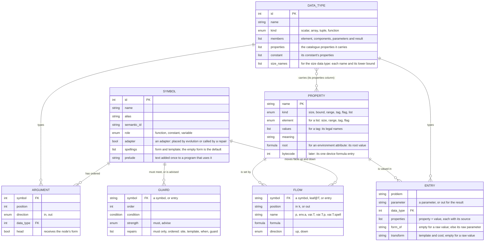

# Technical design: data types, properties and scope in the gene frame

**Status:** 2026-11-05: per-column crossover described; section 5 matches the built fit; section 10 decided. First proposed 2026-11-05. Andrew's design; this document writes it
down. **Revised 2026-11-05:** section 3 is now ONE FIXED schema that every kingdom fills with rows (Andrew: the tables
are fixed, a kingdom is configured only by rows); it removes the five Futhark-only parts of the first version (the
formula operators, the trip count subject, no output subject, the hard-coded substitutions, the adapter sites) and a
sixth (sizes assumed at least 1). Section 8 tests it against eleven kingdoms with their rows, and holds the gaps found,
what stays code, what changes from today's code and the honest limits. Sections 4, 5 and 9 follow it. It starts from the gene frame's data model, changes it, and then applies it to the Futhark kingdom first
(WGSL later). It supersedes the type estimates of `docs/PLAN_futhark_kingdom.md` section 7 where they differ.
**Revised again 2026-11-05 (data on read), agreed in principle with Andrew** after reviewing the "flat enhanced
format" of his data-quality tool (book.dataradar.co.uk, chapter 9: each data item is an object holding its raw value,
never changed, the properties that rules measure from it, and the corrected forms that transformation rules make beside
it; "data quality on read"). What changed and why: a terminal is now an object (its value, its properties, optional
alternative forms); properties are defined once in one catalogue for every kingdom and attached to data types by an
edge table, so a kingdom's properties follow from its view's data types; measure rules fill a terminal's properties
from the training cases, once, offline; every property value records its source (declared or measured) and every
requirement its strength (must or advise), so a measured value can never make a program legal. The schema had not yet
frozen, so these go in now (section 3.7 lists what was taken, what was not, and when). Sections 3, 4, 5, 8 and 9
carry the change.
**Revised 2026-11-05: conversions are configuration** (section 3.8, Andrew): a conversion is an ordinary typed row
with a failure adapter, placed by typed GEP where a function needs it; section 8 gives SQL, Spark and NLP rows.
**Revised 2026-11-05: three model levels and the derived run-time model** (Andrew: the design will work but was
described badly). Section 3 now gives the conceptual model (3.1), the logical model (3.2), the physical configuration
model a kingdom fills (3.3 and 3.4, the tables and diagram of before), and the small run-time model the loader derives
from it once (3.5, a second diagram), with the gene manipulation explained on that model (3.6).
**Revised 2026-11-05: the external review applied** (decisions approved by Andrew Morgan and an advisor). The
physical model is now four kinds of row, `Argument`, `Flow`, `Guard` and `Entry`, over three lists that name things
(Symbol, DataType, Property), with the same expressiveness: section 8's rows are rewritten in that form (3.3). `var.T`
counts its variable from the innermost binder, so a moved subtree keeps the meaning of its own variables (3.5, 3.6,
section 4). Two engines: `must` guards run in the decoder, which repairs; `advise` guards run in the cost, which
charges (3.3.1, section 4). Explicit adapters (`fit`, `clampix`, each kingdom's own) are also ordinary symbols that
evolution can place (3.3.1, section 5). The schema freezes when Futhark and TSR both run end to end on it (section 3).
Declined: a relation's columns as a tuple type (3.4.5).
**Revised 2026-11-05: per-column crossover described; section 5 matches the built fit; section 10 decided.** Section
3.6 now lists the crossovers that work column by column (built and not yet built); section 5 and 8.5 quote the built
adapters (`fit`, `fitrows`, `fitcols`, `clampix`) and their preludes; Andrew's answers to section 10 are recorded
there. Section 7 now gives measured sizes, 8.16 phase 2's known limits, and 8.17 the proof results so far. Master 5
is being deleted: what is kept of it is program text only, with no compatibility path.

## 1. Context

**Objective.** A gene's types are the data types of function arguments, and nothing else. Facts about a value that
are not its data type (an array's length, an index's range) travel with the value as **properties**. Which variables
a node can use is **scope**, decided while decoding. Every gene still expresses a legal program.

**The problem.** The gene frame's data model has one entity for types, and arity is a count per type. It has no place
for a property, so the Futhark kingdom folded sizes and scope into the type: histogram 162 types, k-means 14,359 (85 %
of them scope bodies at depth 3), the k-means view with integer assignments 237,325, over the 65,536 type codes, so it
cannot load. The k-means gene is 27.6 million words; its layout takes 34 s, and the start population's e-graph and
fold 149 s and 193 s at 19.5 GB.

## 2. The data model today

`src/geneframe.rs`:

```
Symbol (kingdom, symbol id, symbol_name, alias, semantic_id)
  └── Arity { inputs: Ty → count, outputs: Ty → count }

Ty = S | I | F | B | A | L | T1 | T2 | (NLP labels) | ... | Futhark(u16) | ...
```

- A **kingdom** is a filter over the master symbol table.
- **Arity** is a map from type to count: `add: in {F: 2}, out {F: 1}`. It has no argument order.
- `Ty::Futhark(u16)` is an index into a Futhark view's own type table. That table is where the 14,359 rows live:
  each row is a data type crossed with sizes (`a.n`, `a.k`, `ix.n`) and with a scope (the variables bound around the
  node).
- Karva's head and tail are laid out per type; the GPU draws, varies and selects symbols by type.

## 3. The data model proposed: three levels, and the model used at run time

Andrew's principle (2026-11-05): "The GeneFrame is an abstracted data model. Once we have the core design and tables,
these are to be FIXED and almost NEVER change. What changes is how we fill the tables with a kingdom." A kingdom is
configured only by rows; section 8 tests the tables against eleven kingdoms.

**"Fixed" is the goal, not yet the status (freeze rule, external review 2026-11-05).** The schema freezes when the
Futhark kingdom and TSR (Typed Symbolic Regression) both run end to end on it, evolution included, and one string
kingdom is added after them. Until then a table may still change, and every change is re-checked against the eleven
kingdoms of section 8.
**Status of the freeze rule (2026-11-05):** the Futhark kingdom is configured on the four kinds of row and its proofs
pass (8.17), but no evolution run has used it yet; TSR is being configured. The schema is not yet frozen.

The model is described at three levels, from the ideas down to the stored tables, and then a fourth model that the
loader derives from the tables. The physical tables must hold every kingdom; on load they are summarised into the
small run-time model, and that is the model that explains how genes are made, varied and expressed.

| level | what it holds | who reads it | section |
|---|---|---|---|
| conceptual | the ideas: kingdom, symbols, terminals as objects, data types, properties, flows, guards, adapters, environment | a reader | 3.1 |
| logical | the entities a kingdom configures and how they relate, without storage detail | a kingdom's author, the view generators | 3.2 |
| physical | three lists that name things (Symbol, DataType, Property) and four kinds of row (Argument, Flow, Guard, Entry): the TSV files a kingdom fills, loaded into `KingdomTables` | the loader and its table check | 3.3, 3.4 |
| run-time (derived) | computed once at load: per data type its alphabet, arities and frame lengths; per symbol its compiled flows and guards | the GPU (type columns, alphabets, arities), the host decoder (`must` guards) and the cost (`advise` guards) | 3.5, 3.6 |

### 3.1 Conceptual model

- A **kingdom** is a language that evolution writes programs in: Futhark, WGSL, SQL, symbolic regression. It is
  configured by rows, never by code.
- A kingdom has **symbols**: **functions**, which take arguments, and **terminals**, which take none. A gene is a
  string of symbols; expressed, it is a tree, and the tree renders as a program.
- Every argument and every result has a **data type** (`f32`, `[]f32`, `[][]f32`, `i64`, a function type). The data
  types are the gene's types, and nothing else is: a node holds only a symbol whose result has the data type its
  parent's argument asks for. They are few (about 8 for k-means).
- A **terminal is an object**: its value, its **properties** (facts about the value that are not its data type: an
  array's length, an index's bound, a tree's depth) and, optionally, **alternative forms** of it (a sorted copy). A
  property is **declared** (from the program's signature, true for every input) or **measured** (on the training cases,
  before the run, true only for the cases seen).
- **Flows** move facts through the tree. Properties flow **up**: each function says how its result's properties follow
  from its arguments' (`map2`: the length is the shorter input's). Environments flow **down**: a function says what
  each argument's subtree sees (a loop's body is one trip deeper; `tabulate` introduces an index variable). A
  measurement is a flow at a leaf, made once, offline.
- **Guards** are conditions on properties. A **must** guard keeps every program legal: where it does not hold, the
  decoder **repairs** the node, writing an **adapter** (one of our own small functions, such as `fit` or `clampix`)
  around it or replacing it, so that the condition holds at run time. An **advise** guard is a preference: the
  decoder never reads it; the **cost** charges a program where it fails, and nothing is repaired. Two engines, two
  jobs: the decoder never reports preferences, and the cost never repairs.
- **Adapters are also symbols.** `fit`, `clampix` and each kingdom's adapters are ordinary functions in the alphabet,
  which evolution can place deliberately; a repair is the fallback where it has not. The cost charges an adapter
  either way, so selection prefers programs that need no rescue.
- The **environment** is what is in scope at a node: the variables (the entry's inputs and those a binder such as
  `tabulate` introduces) and attributes such as the loop depth `trips`. The variable terminal `var.T` picks one
  variable of data type T from its environment by its distance from the innermost binder (3.6).
- **Conversions are ordinary functions** (`parse_int: String -> i32`) with a guard and a repair for the case that
  fails; typed GEP places them where a function needs them (3.8).

```
kingdom
 ├── data types ──carry──> properties (one catalogue shared by every kingdom)
 ├── symbols
 │    ├── functions: arguments and result, each of a data type
 │    │              flows (properties up, environments and variables down),
 │    │              guards: must (repaired by the decoder) | advise (charged by the cost)
 │    ├── adapters: functions like any other, also called by repairs
 │    └── terminals: objects = value + properties (declared | measured) + alternative forms
 └── entry: the program's inputs (the root environment) and the guards on its result
```

### 3.2 Logical model

The entities a kingdom configures, grouped by the idea they record. Columns and their types are in 3.3.

| idea (3.1) | entities | relationships |
|---|---|---|
| symbols | Symbol (with its spellings and prelude) | a symbol is written by one spelling per form (a default, `const`, an inflection) |
| data types and arity | DataType, Argument | a symbol has ordered arguments, in and out, each of one data type; the count of in-arguments per data type is its arity |
| properties | Property, DataType (its `properties` column) | one catalogue for every kingdom; a data type lists the catalogue properties it carries |
| flows | Flow | up: a symbol derives each property of its result from its arguments' (and its other result properties); down: a symbol sets an argument's environment attributes and introduces variables there (a binding); at a leaf: a measure, run offline |
| guards, repairs, adapters | Guard, Symbol (adapter) | a guard (must or advise) belongs to a symbol or to the entry; a `must` guard holds an ordered list of repairs, each a site, a template, a `when` and a guard; a template may call an adapter symbol |
| terminals as objects | Symbol (role `constant` or `variable`), DataType (its `constant` column), Entry | a data type's constant has properties; an entry parameter has properties, each with its source, and may be an alternative form of another |
| environment | Flow (down), Entry, Property (`root` of an attribute), DataType (its size names) | an argument's subtree sees its parent's environment plus what its symbol's down flows add there; the entry gives the root environment and the size names with their lower bounds |
| conversions | Symbol, Argument, Flow, Guard | no entity of their own |

One relationship decides what the gene may hold where: **Argument**. Flow and Guard decide what a legal program needs
and what it costs: the host decoder reads the flows and the `must` guards, the cost the `advise` guards (3.5).

### 3.3 Physical model: the configuration tables

The physical model is what a kingdom fills: the TSV files of its master table and its views (for Futhark,
`kingdoms/futhark/master/` and each problem's `view.tsv`), loaded into `KingdomTables` (`src/geneframe.rs`) and
checked by the table check before any run. Nothing in it is read during evolution as it stands: the loader summarises
it into the run-time model (3.5).

The first version of these tables (`src/geneframe.rs`, `KingdomTables`; decoded by `src/typed_environment.rs`) was built for the Futhark kingdom first, and five things in it are
Futhark's, not the frame's:

1. the formula language (`PropertyExpr`) has only Futhark's operators (sum, min);
2. `Subject::Trips` and the `TripArgument` table exist only for Futhark's work bound;
3. a requirement cannot name the node's own output;
4. `Substitute` hard-codes two substitutions (`subst`, `subst.const`) in code;
5. `AdapterSite` (node, body, root) and the "a heavy adapter at `trips >= depth` substitutes the node" decision come
   from Futhark's rendering.

A sixth turned up while writing the rows: `at_least_one` assumes every size name is at least 1, the Futhark entry
points' contract, written into the comparison.

#### 3.3.1 The decisions

- **Four kinds of row (external review, 2026-11-05).** Three lists name the things a kingdom has: Symbol, DataType
  and Property. Everything said about them is one of four kinds of row:

  | kind of row | columns | what it holds | subsumes (earlier draft) |
  |---|---|---|---|
  | **Argument** | symbol, position, direction, data type, head | what the gene may hold: the only table the GPU's model is built from | Argument |
  | **Flow** | symbol, position (`in<k>` or `out`), name, formula, direction (`up` or `down`) | a fact moved through the tree: a property up, an attribute or a variable down, a measure at a leaf | PropertyRule, EnvironmentRule, Binding (a down flow that introduces a variable), EntryEnvironment, measure rules (a flow at a leaf) |
  | **Guard** | symbol, order, condition, strength, repairs (each: site, template, `when`, guard) | a condition, `must` or `advise`, with its repairs inline | Requirement, Repair, Adapter, AdapterTemplate, EntryRequirement |
  | **Entry** | problem, parameter, data type, properties (each with its source), transform | the program's inputs: the root environment | EntryParameter, EntryProperty, Transform |

  Spelling forms become a column of Symbol; the size names and their lower bounds, the constant's properties and the
  carried properties become columns of DataType; tag values stay a column of Property. The property catalogue and its
  data-type edges therefore stay, as the Property list and DataType's `properties` column: a list that names a thing
  is not one of the four kinds of row, and an edge that belongs to one data type is a column of that data type's row.
  Nothing expressible before is lost; section 8's rows are rewritten in this form.
- **One condition language, no "subject".** A guard is a condition (a Boolean formula). `in1.len = in0.len`,
  `env.trips < depth`, `out.order <= 3`, `in1.value in in0.cols` are all conditions. Leaks 2 and 3 disappear: any
  reference (`in<k>.p`, `out.p`, `env.a`) can appear on either side.
- **Environment attributes are down flows.** `trips` is one attribute among many (`uniform` for WGSL barriers, a loop
  depth for Lua or Brainfuck), a Property with a root value, changed per argument by a down Flow row. The
  `TripArgument` table becomes the row `tab, in1, env.trips := env.trips + 1, down`.
- **Repairs are ordered and inline.** A `must` guard lists its repairs in order; the first whose guard and `when`
  hold is used. The heavy-adapter rule of Futhark becomes a guard `env.trips < depth` on the `fit` repairs, evaluated
  in the environment where the repair runs. Leak 5 disappears.
- **A repair wraps or replaces.** Its template either contains the node's own text (`{self}`, or an operand `{k}` at
  site `in<k>`) and wraps it, or is a substitute (`{in0}`, `{in.own}`: the first input of the node's own data type,
  `{const}`: that data type's constant) and replaces the node. `subst`, `subst.const` and TSR's "its first input" are
  three repair lists of one kind of row. Leak 4 disappears.
- **The formula language is closed and general** (section 3.4): integer arithmetic, `min`, `max`, `if`, tags, flags,
  `known`, and on the host only, lists of scalars with list comprehension. Leak 1 disappears.
- **Size names are rows with a lower bound,** a column of the data type that holds sizes. The comparison reads `n >= 1`
  from the table, not from code. Leak 6 disappears.
- **Two engines (external review).** `must` guards run in the decoder, which repairs. `advise` guards run in the cost,
  which charges a program where one fails and never repairs. The decoder never reports preferences, so an `advise`
  row costs no decoding time.
- **Explicit adapters in the alphabet (external review).** `fit`, `clampix` and each kingdom's adapters are also
  Symbol rows (`adapter = true`) with their own Argument and Flow rows, which evolution can place deliberately like
  any function. The implicit repair stays the fallback, so every gene is still legal. The cost charges an adapter
  whether evolution placed it or a repair wrote it, so selection prefers programs that need no rescue.

The next six decisions come from the flat enhanced format (status line; section 3.7).

- **A terminal is an object:** its value, its properties, and optional alternative forms of it. The gene reasons about
  a terminal only through these. Its properties come from declarations (the program's signature) and from
  measurements (the training cases). This is the flat enhanced format's data item: the raw value never changes; rules
  record what they measure about it and the corrected forms they make beside it.
- **One property catalogue for every kingdom.** Each property (`len`, `rows`, `cols`, `bound`, `depth`, `order`,
  `trips`, `dtype`, `uniform`, ...) is one Property row: its name, kind and meaning, and later its one entry in the
  device's formula bytecode (8.16, limit 8), each written once. DataType's `properties` column says which properties a
  data type carries; a kingdom's properties follow from its view's data types. This replaces today's per-kingdom
  PropertyType rows (migration in 8.15).
- **Measure rules are flows at a leaf.** Where an up flow reads a node's children, a measure reads a terminal's data:
  a Flow row on the leaves of a data type whose formula is a measure from a closed list. Measurement runs once,
  offline, before evolution, on the training cases only (never the test cases: that would leak the test set), and is
  written into Entry rows. The decoder stays symbolic: nothing is measured while decoding or evolving.
- **Every property value records its source:** `declared` (from the signature: holds for every input) or
  `measured on <case set>` (holds only for the cases seen). A measured value may choose a template, feed the cost, or
  seed a choice. It never makes a `must` guard hold and never removes a legality adapter.
- **Every guard has a strength:** `must` (enforced by the decoder: its repair runs, so every gene stays legal) or
  `advise` (a preference charged by the cost). Every legality rule is `must`, and the tests enforce it (3.3.3). A
  search-space limit may be either; section 8 states each kingdom's choice.
- **Alternative forms are extra variables.** A transform on an entry parameter makes a corrected or derived form (a
  standardised date, a sorted copy, a normalised vector) that sits beside the raw value as one more variable of the
  root environment, chosen by `var.T`'s index word like any other. Evolution takes it or leaves it. Arity and the
  alphabet do not change; only the count of variables c grows (3.5). The cost charges an expensive form (a sort).
  **Adapters are corrected forms made on read:** `fit xs` is to `xs` what a standardised date is to the raw date, made
  where a guard needs it (or where evolution placed it) rather than up front.

#### 3.3.2 Diagram: the physical configuration model

Every table a kingdom fills: three lists that name things, and four kinds of row. The run-time model the loader
derives from it is the second diagram, in 3.5.



#### 3.3.3 The rows, one kind at a time

Columns marked **new** are not in today's code; **(test)** marks those the kingdom test of section 8 added to the
first draft; **(on read)** marks those the flat enhanced format added; **(review)** marks those the external review
added (3.3.1).

**Symbol** (a list that names things). A function or terminal. Its arity is derived from its Argument rows, as today
(section 3.5).

| column | meaning |
|---|---|
| id, name, alias, semantic_id | as today |
| role **new** | `function` (every ordinary symbol, terminals included), `constant` (the `?_T` placeholder, a Dc word), `variable` (the `var.T` terminal, a Dv word). Today in `KingdomRelations.constants` and `.variables` |
| adapter **new** (review) | true for `fit`, `clampix`, `getf`, ...: an ordinary function in the alphabet, which a repair's template may also call. The cost charges it either way |
| spellings (test: NLP) | one template per form; the empty form is the default, and the constant's spelling is the `const` form of `?_T`. A node asked for a form it lacks passes the request to its `head` argument, else uses the default. Replaces `SymbolRow.spelling` |
| prelude | text added once to a program that uses the symbol (`def fit ...`, Lua's `getf`), whether evolution placed it or a repair called it |

**DataType** (a list that names things). As today (id, name, kind, members), plus three columns:

| column | meaning |
|---|---|
| properties **new** (on read) | the catalogue properties the data type carries (`[]f32: len`; `[][]f32: rows, cols`; `i64: bound`; `F: depth, order, fam, arm, ties`). A kingdom's properties are those of its view's data types, so a view generator writes data types and their properties follow; no kingdom declares a property of its own. Replaces the DataTypeProperty edge table of the earlier draft |
| constant | the properties of the data type's constant (`[0f32]`: `len = 1`). A data type with no `?_T` symbol has no constant (Futhark's `size`) |
| size_names **new** | for the data type that holds sizes: the size names of the problem, each with its lower bound (`n >= 1`); replaces the hard-coded `at_least_one`. A kingdom where a size may be 0 (an empty SQL relation) writes `>= 0` |

**Property** **new** (on read; a list that names things). The property catalogue: one row per property, shared by
every kingdom. Replaces today's per-kingdom PropertyType rows (8.15).

| column | meaning |
|---|---|
| name | unique across kingdoms: `len`, `rows`, `cols`, `bound`, `depth`, `order`, `trips`, `dtype`, `uniform`, `width`, `space`, `number`, ... Two kingdoms that mean the same thing use the same name; two meanings need two names |
| kind | `size` (a count of elements), `bound` (an index's exclusive upper bound), `range` (an integer on an ordered scale: depth, order, rank, width), `tag` **new** (one name from an unordered set: an address space, a grammatical number, a dtype), `flag` (true or false), `list` **new** (test: SQL; host only, 3.4.5) (an ordered list of one element kind) |
| element **new** | for a list, its element kind |
| values **new** | for a tag (or a list of tags), its legal names; the table check reports any other tag literal |
| meaning | one sentence, the definition every kingdom shares |
| root **new** | for an environment attribute (`trips`: 0; `uniform`: true), its value at the root; an entry's down flow may override it |
| bytecode | later: the property's one entry in the device's formula bytecode (8.16, limit 8) |

An environment attribute (`trips`, `uniform`) is a catalogue row, so one name means one thing in properties and in
environments.

**Argument.** As today (symbol, position, direction, data type), plus `head` **new** (test: NLP): the argument that
receives a form asked of the node (a verb phrase's verb). The only kind of row the GPU's model is built from (3.5).

**Flow** **new** (review). `symbol, position, name, formula, direction`. One row moves one fact:

| direction | symbol, position | name | meaning | earlier draft |
|---|---|---|---|---|
| up | a symbol, `out` | `p` | the result's property `p` := formula, over `in<k>.p`, the node's other results `out.q` (test: TSR), `env.a` | PropertyRule |
| up | `leaf@T`, `out` | `p` | a measure from the closed list in the offline sniffer (kingdom-free code: `axis_len(k)` for `len`, `rows`, `cols`; `max_plus_one` for `bound`; `is_sorted`; `dtype_of`; ...), applied to every terminal of T, offline, on the training cases | measure rule |
| down | a symbol, `in<k>` | `env.a` | attribute `a` in argument k's subtree := formula over the node's environment and its already-decoded siblings (`in<j>.p`) | EnvironmentRule, TripArgument |
| down | a symbol, `in<k>` | `var.T` (or `var.T/g` for a second group on one argument) | introduces formula-many variables of T into argument k's environment (default 1; test: SQL): a binding | Binding, its `count` |
| down | a symbol, `in<k>` | `var.T.p` | property `p` of each variable that row introduces; may read `each`, the variable's ordinal among them | Binding properties |
| down | a symbol, `in<k>` | `var.T.spell` | the variables' spelling, a template (`v{depth}_{each}`, or a column's own name `{=out.name}`) | Binding `name_template` |
| down | `entry`, `out` | `env.a` | a root value overriding the catalogue's `root` | EntryEnvironment |

The flows of one symbol are decoded in an order without cycles, which the table check finds, as it does today for
bindings (`decode_order`). A measure flow's result is written as an Entry property with source
`measured on <case set>`: the value that holds over every training case (the largest index plus one, the one length
every case shares), else `?`. Nothing is measured during decoding or evolution. A view generator writes a data type's
measure flows from its `properties` column, so each measure is still written once per property.

**Guard** **new** (review). `symbol, order, condition, strength, repairs`. It holds when its condition is decided true
(section 3.4.4). Rows are checked in `order`. The symbol `entry` holds the guards on the program's result (`out`).
`strength` **new** (on read) is `must` or `advise`, and picks the engine:

| strength | engine | when it does not hold | used for |
|---|---|---|---|
| `must` | the decoder | its first repair whose guard and `when` hold runs, so the program is legal; a measured value never makes it hold (3.4.4) | every legality rule (map2 lengths, index bounds, a WGSL access mode) and every safety rule (a work bound that protects the device); a search-space limit may also be `must` |
| `advise` | the cost | the cost charges the program; nothing is repaired, and the decoder never reads the row | a preference: a search-space limit left to selection, the cost side of a work bound, Spark's repartition |

Each **repair** is `site, template, when, guard`, inline in the Guard row:

| field | meaning |
|---|---|
| site | `node`, `in<k>` (operand k), or `root` (an entry guard) |
| template | the text that renders, by the one template engine (8.14.2). At site `in<k>` it rewrites operand k (`{k}` is its text). At site `node` a template with `{self}` or `{self(k := ...)}` wraps the node; a template that is one substitute (`{in<k>}`, `{in.own}`, `{const}`) replaces it, and the node takes the substitute's properties; any other template renders in place of the node's spelling. A template may call an adapter symbol by name, whose prelude is then added once. A repair whose template names a substitute the node lacks (no input of its own data type, no constant) is skipped |
| when | a condition choosing this text (`known(in0.len)` for a static length, else the run-time text) |
| guard | a condition, evaluated in the environment of the site (the node's, or argument k's). Futhark's `fit` repairs carry `env.trips < depth` |

The first repair whose guard and `when` hold is used. A kingdom repeats a repair list across many symbols (`fit.pair`
on every `map2`): the view generator writes it once and copies it into each row, and this document names such a list
(`fit.pair`, `subst.own`) as shorthand. The table check fails a `must` guard with no repair, and an `advise` guard with
one. The tests enforce the rule that every legality rule is `must`: the random genes of every kingdom's test must
render, compile and run N of N, and the decoder never reads an `advise` row, so a legality rule written as `advise`
fails them.

**Entry** (one per problem, written by the view generator as today, now part of the schema). One row per parameter:
`problem, parameter, data type, properties, form_of, transform`. The parameters are the root environment's variables,
including builtins such as WGSL's invocation ids and the alternative forms below; the row `out` gives the result's data
type, and the entry's guards on it are Guard rows of symbol `entry`, site `root`.

**Source** **new** (on read), on every Entry property: `declared` (from the program's signature: `points : [n][d]f32`
gives `rows = n`, `cols = d`; it holds for every input) or `measured on <case set>` (a measure flow's result; it holds
only for the cases seen). A value a flow derives carries `measured` if any value it reads does, else `declared`. A
measured value may choose a template, feed the cost, or seed a choice (a start individual's variable); it never makes
a `must` guard hold and never removes a legality adapter.

**Transform** **new** (on read), on an Entry row with `form_of` set: an **alternative form**, the raw parameter
rendered through the transform's template once, at the program's head (`let points_sorted = sort points`), with its
properties given from the raw's (a sorted copy keeps `len` and gains `sorted = true`; a normalised vector keeps `len`).
It is one more variable of its data type in the root environment. The raw value stays and never changes; the cost
charges the transform's cost once if a program uses the form.

### 3.4 The formula language (closed list)

The language of the Flow formulas and the Guard conditions. The loader parses and normalises every formula once
(3.5); nothing is parsed during a run.

A **formula** gives a value; a **condition** gives true, false or undecided. Every formula has one spelling (normal
form), as today's sums and mins have, so symbolic equality is equality of spellings.

The host decoder evaluates the whole language. The **device's** subset is small and stays small: polynomials, `min`,
`max`, `if`, tags, flags and `known`. Lists and their operators are host only (3.4.5).

#### 3.4.1 Terms

| term | example | meaning |
|---|---|---|
| integer literal | `3`, `-1` | |
| tag literal | `'read_write'`, `'pl'` | one name of a tag property |
| `true`, `false` | | flag literals |
| `?` | | unknown until run time |
| size name | `n`, `depth` | from DataType's `size_names` |
| input property | `in1.len` | a property of input 1 |
| output property | `out.arm` | another property of this node (flows and guards) |
| environment attribute | `env.trips` | the node's environment (or the site's, in a repair's guard) |
| index | `each`, `i` | a down flow's ordinal; a comprehension's index |

#### 3.4.2 Operators on values

| operator | meaning | normal form | device |
|---|---|---|---|
| `a + b`, `a - b`, `a * b` | integer arithmetic | a polynomial: monomials sorted, literal coefficients added (T1 adds literal folding of sums) | yes |
| `min(a, b, ...)`, `max(a, b, ...)` | least, greatest | flattened, sorted, without repeats, one literal kept | yes |
| `if(c, a, b)` | `a` where `c` holds, `b` where it fails, itself while undecided | decided branches taken | yes |
| `list(a, b, ...)` | a list | | host only |
| `len(L)` | its length | | host only |
| `at(L, i, d)` | element `i` (from 0), or `d` when `i` is out of range | | host only |
| `concat(L, M)` | | flattened | host only |
| `find(L, x)` | position of `x`, `-1` when absent, `?` when undecided | | host only |
| `for(i < n : f)` | the list of `f` for `i = 0 .. n-1` | literal `n` expands | host only |

#### 3.4.3 Conditions

| condition | meaning | device |
|---|---|---|
| `a = b`, `a <= b`, `a < b` | the three relations of today, on spellings (lists: element by element) | yes (scalars) |
| `x in L` | membership | host only |
| `known(a)` | `a` contains no `?` (chooses a template for a run-time length) | yes |
| `c and d`, `c or d`, `not c` | three-valued | yes |
| `all(i < n : c)` | `c` for every `i` | host only |

A flag property is a condition, and a condition may be a flag flow's formula (`uniform := env.uniform and in0.uniform`).

#### 3.4.4 Comparison semantics (fixed, in code)

Three values: **holds**, **fails**, **undecided**. `?` anywhere makes a comparison undecided. `=` holds on identical
spellings and fails on two different literals (tags, flags, integers, fully literal lists); otherwise undecided. `<=`
holds by today's rules (literals; a literal at most a size name's lower bound from DataType's `size_names`; min and max
argument rules) and fails on two literals. A guard **holds** only when its condition holds; on fail or undecided a
`must` guard's repair runs in the decoder and an `advise` guard is charged by the cost. A comparison that a cleverer
prover could decide costs only a needless adapter, as today.

**Source in comparisons.** In a `must` guard's condition every value whose source is `measured` reads as `?`, so a
measurement can leave it undecided (its repair runs) but never make it hold. An `advise` guard, a repair's guard, a
repair's `when` and the cost read measured values as they are.

**Kinds that compare** (today's README 5.2, extended): size with size, bound and integer literals; bound only by `<=`;
range with range and integer literals; tag with tag and tag literals by `=`; flag with flag by `=`; a list with a list
of the same element kind by `=`; `x in L` when `x`'s kind is `L`'s element kind.

#### 3.4.5 Lists stay properties, never types (declined, external review 2026-11-05)

The review proposed turning a list-valued property into a type: a relation's columns as a tuple type, with the number
of columns as the arity. **Declined:** it couples a table's schema to the data type and the arity again, which is the
move that gave the Futhark kingdom 14,359 types (section 1). List-valued properties stay as they are, used only by the
kingdoms decoded on the host (SQL and Spark, Lua, numpy, the string kingdoms), and kept off the GPU: the device's
formula language stays the small one of 3.4.

### 3.5 The derived run-time model

The loader computes this model once, when the kingdom loads, from the rows of 3.3. It is small: a few numbers and
lists per data type, and a compiled bundle of flows and guards per symbol. Nothing in it changes during a run, and it
is the only thing the gene manipulation of 3.6 reads.

```mermaid
erDiagram
    GENE_LAYOUT ||--|{ TYPE_COLUMN : "has one per data type"
    TYPE_COLUMN ||--|{ ALPHABET_ENTRY : "draws from"
    RUN_SYMBOL ||--|| ALPHABET_ENTRY : "is listed in its result's column"
    RUN_SYMBOL ||--o{ TYPED_ARITY : "takes, per data type"
    TYPE_COLUMN ||--o{ TYPED_ARITY : "is counted in"
    TYPE_COLUMN ||--|| FRAME_ENTRY : "is placed on the device by"
    TYPE_COLUMN ||--o| CONSTANT_POOL : "holds constants from"
    RUN_SYMBOL ||--|| COMPILED_RULES : "is decoded on the host with"
    RUN_SYMBOL ||--o| COST_RULES : "is charged by the cost with"
    ROOT_ENVIRONMENT ||--|{ TYPE_COLUMN : "offers variables of"

    GENE_LAYOUT {
        int root_type "the entry's result data type"
        int N "program size: at most N functions"
        int n_max "the most arguments any symbol takes"
        int h "master head, 1 + (N - 1) n_max"
        int t "master tail, h (n_max - 1) + 1"
        int width "words a gene: every head, then every tail, every Dc, every Dv"
    }
    TYPE_COLUMN {
        int dense_type PK "the data type; Ty code"
        int h_T "head length"
        int t_T "tail length"
        int Dc_T "constant words; 0 without a constant"
        int Dv_T "index words, h_T + t_T; 0 without var.T"
    }
    ALPHABET_ENTRY {
        int data_type FK
        int symbol FK
        enum place "function, adapters included: head only; terminal: head and tail"
    }
    RUN_SYMBOL {
        int id PK
        int out_type FK "the column it lives in"
        list signature "data type of each argument, in order"
        enum reads "nothing, a Dc word (?_T), a Dv word (var.T)"
    }
    TYPED_ARITY {
        int symbol FK
        int data_type FK
        int count "its arguments of that data type"
    }
    FRAME_ENTRY {
        list words "12 a type a gene: ty_code, head_off, head_len, tail_off, tail_len, dc_off, dc_len, pool_id, const_len, flags, dv_off, dv_len"
    }
    CONSTANT_POOL {
        int data_type FK
        list values "C_T, the constants a Dc word picks from"
    }
    ROOT_ENVIRONMENT {
        list variables "per data type, outermost: the entry's parameters and alternative forms, with properties and sources"
        list attributes "trips, uniform, ...: root values"
        list size_names "with their lower bounds"
    }
    COMPILED_RULES {
        int symbol FK
        list up_flows "normal-form formulas, in decode order"
        list down_flows "attributes set and variables introduced, per argument"
        list must_guards "condition, ordered repairs with site, when and guard"
        list templates "spellings and repair templates, parsed"
        bytes bytecode "later: for TSR decoding on the device"
    }
    COST_RULES {
        int symbol FK
        list advise_guards "conditions the cost charges where they fail"
        bool adapter "charged as a rescue, placed or repaired"
    }
```



**How each part is computed from the rows.**

| run-time part | from | how |
|---|---|---|
| type columns | DataType, Argument | one column per data type a gene rooted at the entry's result can reach. For k-means about 8 columns, where today there are 14,359 |
| alphabet of T | Symbol, Argument (direction out) | the functions whose result is T, adapter symbols included; T's constant `?_T` if T has one; `var.T` if T can be a variable. Functions go in the head only, terminals in head and tail |
| typed arity | Argument (direction in) | for each symbol, the count of its arguments of each data type: `a_{T,U}` is the most arguments of type T one symbol producing U takes, `a_T` the largest `a_{T,U}`, `n_U` the most arguments of any symbol producing U |
| lengths | typed arity, program size N | `h_T = [T = root] + (N − 1)·a_T`. The tail is the exact bound: with `P_T = [T = root] + Σ_U h_U·a_{T,U}` (the slots of type T the heads can open) and `L = 1 + Σ_U h_U·(n_U − 1)` (the most leaves a tree can have), `t_T = min(P_T, L + h_T) − h_T`, `Dc_T = min(P_T, L)`, `Dv_T = h_T + t_T`. With one data type these are Ferreira's `h = 1 + (N − 1)·n_max` and `t = h·(n_max − 1) + 1`; each data type is a column of that master gene (`kingdom_contract.rs`, `heads_from_program_size` and `bounds`) |
| frame table | the lengths | for the GPU, 12 words per data type per gene (phylu `typed_layout.rs`, `FRAME_WORDS`): its Ty code, the offset and length of its head, tail, Dc and Dv, its constant pool and flags (has a constant, has a frame, has `var.T`); and per gene its root, offset, width and first frame |
| walk tables | Argument | for the GPU, per symbol: its result's column, its argument columns in order, its arity, and which word it reads (none, Dc, Dv) |
| constant pool | Symbol `?_T` (its `const` spelling), the kingdom's constants | `C_T`, the values a Dc word indexes |
| root environment | Entry, Property (`root`), Flow of `entry`, DataType (`size_names`) | the variables of each data type with their properties and sources, outermost in the scope; the attributes' root values; the size names with their lower bounds |
| compiled rules | Flow, Guard (`must`), Symbol (spellings, prelude) | every formula parsed into its normal form (3.4), ordered without cycles, every template parsed; the table check runs here, and a malformed row is "our software has a bug" before any run |
| cost rules | Guard (`advise`), Symbol (`adapter`) | the `advise` conditions, parsed; which symbols the cost charges as a rescue |

**Who reads what.** The GPU sees only the type columns, their alphabets, the arities, the frame table and the walk
tables. It draws, varies and selects symbols by data type; it never resolves a variable and never evaluates a property.
A Dv word is to it an opaque number below `DV_WORDS` (65,536). The host decoder reads the compiled rules and the root
environment (section 4); the cost reads the cost rules on the decoded tree. Properties, flows and guards live only on
the host.

**What the run-time model guarantees.**

1. **Arity is fixed by the Argument rows,** derived once at load: the same many-hot arity as today. Properties, flows
   and guards never change it; they are read after Karva has expressed the tree. The model forbids a symbol whose
   number of arguments depends on a property.
2. **Fewer data types give fewer and smaller columns.** The positions a column stay about the same (7.1); the number of
   columns falls to the number of data types.
3. **Repairs are not in the gene.** A repair is written into the rendered program and takes no cell. An adapter that
   evolution placed is an ordinary symbol and takes one cell, like any function.
4. **`var.T` is a terminal of arity 0.** Its index word is in the Dv lane beside its data type's column, one word a
   head or tail cell, as GEP-RNC keeps its constants in Dc. The word names a variable by its distance from the
   innermost binder (3.6).
5. **Alternative forms add variables, not symbols.** A form is one more root variable, outermost with the raw
   parameters; `var.T` reaches it through its index word (w mod c, with c one larger). The alphabets, arities, lengths
   and frame table do not change.
6. **A kingdom's properties** come from its data types' `properties` column; **measured values** are rows written
   offline before a run, so neither the decoder nor the device measures anything. A kingdom whose data types carry no
   properties works exactly as today.
7. **`advise` guards cost no decoding time:** they are compiled into the cost rules and the decoder never reads them.

### 3.6 Gene manipulation on the run-time model

Every operator works on the run-time model alone: a type column, its alphabet, its lengths. That is why every child is
legal without any check: a column fixes the data type of what it holds, the GEP head rule and the lengths `h_T`, `t_T`
make every tree close, and the `must` guards are met after expression by repairs, so no operator needs to know a
property.

**How `var.T` names a variable (binder-relative, external review 2026-11-05).** A variable is named by its distance
from the innermost binder, not by its place in a list counted from the outside (this is de Bruijn indexing, after the
logician who proposed it: a variable is named by how many binders lie between its use and its definition). The
variables of type T in scope form a stack: the root parameters and their alternative forms at the bottom (outermost),
in the entry's order, then each binder's variables as the tree descends, the innermost on top. The index word w
names the (w mod c)-th variable counted from the top, 0 being the innermost, where c is the count of variables of T in
scope; with c = 0, `var.T` becomes T's constant. The effect on variation:

- **A subtree's own variables keep their meaning when it moves.** A reference to a binder inside the subtree counts
  only binders that move with it, so its distance, and the variable it names, are the same wherever the subtree lands.
- **Outer references may drift.** A reference to a variable outside the subtree counts past the subtree's root into
  the scope where it lands, and names whatever sits at that distance there.
- **The outermost are the most stable.** The root parameters are in every scope and fixed in count; a reference to one
  moves only by the number of binders of T the landing site adds or removes, and is unchanged at the same binder
  depth.
- **The fallback** (w mod c, else T's constant) remains; it matters only where c differs between the scope a word was
  written for and the scope it is read in.

| step | what it does | where |
|---|---|---|
| **initialisation** | in each type column, each head cell is drawn from the column's whole alphabet (adapter symbols included) and each tail cell from its terminals only (the GEP head rule, per column); each Dc word from `C_T`; each Dv word uniformly below 65,536 | GPU |
| **point mutation** | a head cell is redrawn from its column's alphabet, a tail cell from its terminals; a Dc word from `C_T`; an index word redrawn, which may name another variable in scope | GPU |
| **transposition, inversion, one-point, two-point and gene recombination** | cells are moved or exchanged within one type column (two parents at the same gene, column and positions); every head or tail cell carries its Dv word with it, and no operator moves a Dv word alone. Lengths and alphabets are kept | GPU |
| **marriage** (typed subtree crossover) | on the two parents' expressed and resolved trees, two subtrees of the same data type are swapped and each tree is written back into its gene column by column. References to the subtree's own binders need no change; only outer references are re-encoded, each to the new distance of the variable it named where that variable is in scope at the landing site, else left to the fallback | host |
| **expression** | Karva, breadth-first: a slot of type T reads T's head, then T's tail, taking as many children of each data type as the symbol's signature asks | GPU and host |
| **decoding** | on the host, with the compiled rules: the environment top-down (down flows), the variables (distance from the innermost, `w mod c`), the properties bottom-up (up flows), the `must` guards and their repairs, the rendered program (section 4) | host |
| **cost** | on the host, on the decoded tree: the `advise` guards and every adapter, placed or repaired, charged; nothing repaired | host |

**Crossover column by column.** A gene of several data types is a table: each data type is a column (`head_T`, then
`tail_T`, then `Dc_T`), and a row is the same position in every column. Andrew named three crossovers that use this
shape. What the code has today, and what is only designed:

| operator | what moves between the two parents | status |
|---|---|---|
| **row crossover** (`cross-rows`, and `cross-rows-coding` aimed at a row that holds an expressed cell) | GEP's one-point (rows `c..`) or two-point (rows `[c1, c2)`) recombination at the same row in every column; a column runs head, then tail, then Dc, so one cut spans head and tail together, and with one data type it is the classic operator. Each head or tail cell takes its Dv word with it | built: fuller `src/typed_gep.rs:492` (`crossover_rows`), phylu `src/futhark_eval/operators.rs:144` and `:328` |
| **relative row crossover** (`cross-rel`) | the same, but each column is cut at the same fraction of its own length, so short columns take part too | built: fuller `src/typed_gep.rs:570` (`crossover_rel`), phylu `src/futhark_eval/operators.rs:232` |
| **span crossover** (`crossover`) | a range inside one domain (head, tail or Dc) of one data type, around an expressed cell of the first parent, with its Dv words; when the drawn cell is a tail cell this exchanges tail cells only, but it is not a tail-only operator | built: fuller `src/typed_gep.rs:346` (`swap_range`), phylu `src/futhark_eval/operators.rs:26` |
| **interleaved head/tail swap** | per data type, the head of one parent with the tail of the other (each column's head and tail exchanged as two separate pieces, column by column, alternating) | **not yet built** (designed only) |
| **column exchange** | one whole data type's column (head, tail, Dc and Dv words) exchanged between the parents | **not yet built** (designed only); the nearest built operator exchanges a whole gene (fuller `src/typed_gep.rs:666`, phylu `src/evolve/typed_vary.rs:1015`) |
| **tail-only swap** | the tails of one or more data types exchanged, heads kept | **not yet built** (designed only) |

All of them keep legality the same way: a cell moves only to the same column, domain and position in the other
parent, so it stays in its data type's alphabet, the head rule and the lengths `h_T`, `t_T` hold, and a cell's Dv word
always moves with it. The not-yet-built ones keep this by the same construction: a column holds only its data type,
so exchanging a whole column, a whole tail, or a head and a tail of the same column between homologous parents
changes no arity and needs no check.

Selection reads only the fitness. So the dynamics of evolution (what is drawn, moved and kept) happen entirely on the
run-time model's columns; the properties decide only how an expressed tree renders as a legal program and what it
costs.

### 3.7 Data quality on read: what is taken from the flat enhanced format, what is not, and when

The flat enhanced format keeps each data item as an object: the raw value (never changed), shape masks (HU, LU),
and Rules holding measured properties and corrected forms (`std_date`). Consumers take a corrected form or leave it;
the quality work is done on read. Section 3.3.1's last six decisions are what this design takes from it. Deliberately
not taken:

| not taken | why |
|---|---|
| unicode shape masks (HU, LU) for numeric kingdoms | they describe text; a number's shape is its properties. Kept as a later measure flow for the string kingdoms (regex, NLP, SQL) |
| dotted provenance paths | presentation; the provenance the decoder needs is the `source` column |
| ragged records (an item with any number of rules) | GEP needs fixed arity (3.5); the catalogue and DataType's `properties` column fix which properties a data type carries |
| several competing values of one property | the design's `?` covers it: values that disagree across cases are unknown |
| profiling during evolution | never: measurement is offline, on training cases, before the run |

| when | what |
|---|---|
| **now**, before the schema freezes | the Property catalogue and DataType's `properties` column; the `source` column; the `strength` column |
| **later** | the sniffer measuring the training cases (a profiler of the entry inputs in the style of the flat enhanced format); alternative entry forms, kept only if an A/B run shows they help; shape masks for string kingdoms |
| **never** | a measured value removing a legality adapter |

### 3.8 Conversions are configuration

Andrew Morgan's principle (2026-11-05). Data is transformed as it moves: it is extracted, transformed and loaded.
Symbolic genetic programming usually handles this badly, in one of two ways. Either each function is written to read
many types and convert them inside itself, which gives hundreds of expanded variants and hides the conversions; or
every terminal is enriched with every form it could take, a large overhead that is mostly never used.

This design does neither. **A conversion is an ordinary typed function** that a kingdom configures in the schema, with
the rows it already has:

| rows | examples |
|---|---|
| Symbol, Argument | `parse_int(String) -> i32`; `std_date(String) -> Date` |
| Symbol `spellings` | the conversion's template, as for any symbol |
| Flow (up) | what the output's properties are, from the input's: a string of length 10 with a date mask gives a date with a known format |
| Guard | when the conversion can fail, a `must` guard with a repair: a string that does not parse gives the target type's constant |

So every gene stays legal and all behaviour is deterministic. Typed GEP then places a conversion subtree wherever a
function needs the target type and the data arrives as another. The conversion is visible in the program, it is
costed like any other node, and it is present only where evolution uses it. The precomputed alternative forms of the
inputs (3.3.3, Transform) stay the exception, offered only when a kingdom declares them. No new kind of row is needed.

## 4. The decoder

The gene is unchanged: Karva, the head and tail of each data type, and a Dv lane of index words beside each
type's column. The decoder works on the run-time model of 3.5: pass 1 reads the type columns and the arities, passes 2
to 5 the root environment and the compiled rules, that is the Flow rows and the `must` Guard rows.

**Before any run, once, offline (not a pass):** the view generator writes the Entry rows: each parameter's declared
properties from the signature, its alternative forms (`form_of`, `transform`), and, later, the sniffer's measured
properties from the training cases (the measure flows), each property with its source. Decoding then runs in five
passes, each deterministic in the gene and these rows alone:

1. **Express** (as today): breadth-first, giving the tree of symbols.
2. **Environment, top-down (down flows):** the root's environment is the entry's parameters and their alternative
   forms, each an object: its data type and its properties with their sources (`points : [n][d]f32` → rows = `n`,
   cols = `d`, declared), with the attributes at the catalogue's `root` values, overridden by the down flows of
   `entry`. A child's environment is its parent's plus the down flows of the argument it fills: a `var.T` flow pushes
   its variables (with their `var.T.p` properties and `var.T.spell` spellings) on top of T's stack, and an `env.a`
   flow sets an attribute (`env.trips`, `env.uniform`, ...).
3. **Variables:** each variable terminal `var.T` takes the index word w at its cell and becomes the (w mod c)-th
   variable of data type T counted from the innermost (0 = the innermost binder's variable; the root parameters and
   alternative forms are outermost), c being the count of variables of T in its environment. With none (c = 0) it
   becomes T's constant.
4. **Properties, bottom-up (up flows), and `must` guards:** each node's properties from its children by its up flows,
   as symbolic expressions (`n`, `k`, `d`, a literal, or `?` when only known at run time), each carrying its source
   (3.3.3); each `must` guard is a condition evaluated three-valued (section 3.4.4), with measured values read as `?`.
   A `must` guard that does not hold takes its first repair whose guard holds in the environment of its site and whose
   `when` holds. A substitute repair (`{in.own}`, `{const}`, `{in0}`) replaces the node, which takes its substitute's
   properties, and none of the node's other repairs render; guards are checked in their `order`, so a work bound
   (`env.trips < depth`) is checked first. `advise` guards are not read: they cost no decoding time.
5. **Render:** where every `must` guard holds, the plain spelling; where one fails, its repair's template, which calls
   one of our own adapter functions that makes the property hold at run time, with the adapter's prelude added once
   (as for an adapter evolution placed itself); each alternative form the program uses is bound once at its head by
   its transform's template. The template engine is kingdom-free (8.14.2).

This is `Terminal_With_Properties`: a terminal is reached as an object, its value plus its properties and their
sources, raw or an alternative form (passes 2 and 3), and every function carries its properties up (pass 4). The passes
read measured values from rows; they never look at data.

**The second engine: the cost.** After decoding, the cost reads the decoded tree with its properties. It charges each
`advise` guard that does not hold, and every adapter in the rendered program, whether evolution placed it or a repair
wrote it, so selection prefers programs that need no rescue. It never repairs, and the decoder never reports a
preference: each engine does one job.

The GPU never runs passes 2 to 5. Every gene is legal whatever its index words and properties, so the device draws,
varies and selects symbols by data type, as now (3.5, 3.6).

## 5. Futhark: the adapters

In the schema of section 3 the adapters appear twice. As **repairs**, inline in Guard rows: `fit`, `fit.pair`,
`fit.state`, `fit.body`, `fit.inner`, `fit.root` are wrapping repairs with the guard `env.trips < depth`, read in their
site's environment (an operand that is a loop's or lambda's body is one trip deeper), so a heavy adapter that would run
too deep is skipped and the next repair, `subst.own` (`{in.own}`, then `{const}`), replaces the node; `clampix` has no
guard; `subst.const` is `{const}`. As **symbols** (external review): `fit` and `clampix` are also functions of the
alphabet, with their Argument and up Flow rows, which evolution can place deliberately. As built (phase 2, fuller
e87b9ee0, `kingdoms/futhark/master/6/rows.tsv` M0090 to M0093): `fit@a.E(size, []E) -> []E`, `out.len := in0.value`;
`fitrows@m.E(size, [][]E) -> [][]E`, `out.rows := in0.value`; `fitcols@m.E(size, [][]E) -> [][]E`,
`out.cols := in0.value`; `clampix@i64(size, i64) -> i64`, `out.bound := in0.value`. **The symbol takes no pad
argument:** its template writes the element type's zero itself (`fit {0} 0{E} ({1})`), because a view such as a7's
has no element leaf to supply one. Rendered programs are unchanged. The cost charges a placed and a repaired adapter
alike. The rows are in 8.5.

In the terms of the flat enhanced format, an adapter is a corrected form made on read: `fit l xs` is to `xs` what a
standardised date is to the raw date, and `clampix m i` to `i`. The raw value is not changed; the form is made where a
`must` guard needs it. So a measured property can never replace an adapter: k-means' `assign` measured on the
training cases with `bound = k` still renders `clampix k`, because a test case, or a value the program computes, may
fall outside what the training cases showed.

Rendered once in each program that uses it (the preludes in `kingdoms/futhark/master/6/preludes/`, quoted exactly;
the Futhark function keeps a `z` parameter, which the symbol's template always fills with `0{E}`, the element's zero;
`fitcols` renders as `map (fit l 0{E})` and uses `fit`'s prelude):

```futhark
def fit [m] 't (l: i64) (z: t) (xs: [m]t) : [l]t =
  tabulate l (\i -> if i < m then xs[i] else z)

def fitrows [m][c] 't (l: i64) (z: t) (xs: [m][c]t) : [l][c]t =
  tabulate l (\i -> if i < m then xs[i] else replicate c z)

def clampix (m: i64) (i: i64) : i64 = i64.max 0 (i64.min (m - 1) i)
```

| guard fails at | rendered as |
|---|---|
| `map2 f xs ys`, lengths differ (both known, `k` and `n`) | `map2 f (fit (i64.min k n) 0{E} xs) (fit (i64.min k n) 0{E} ys)`, each `fit` only where the length is not already the minimum (repair `fit.pair`) |
| `map2 f xs ys`, a length known only at run time | `let ad_a = xs let ad_b = ys let ad_l = i64.min (length ad_a) (length ad_b) in map2 f (fit ad_l 0{E} ad_a) (fit ad_l 0{E} ad_b)` (not in the first version: section 10, item 2) |
| a slot requires length L, gets another | `fit L 0{E} x` (repair `fit`); a matrix's rows `fitrows L 0{E} x`, its columns `map (fit L 0{E}) x` |
| `xs[i]`, i's bound is not len(xs) | `xs[clampix (length xs) i]` |
| a loop body's result differs from the state | the body wrapped in `fit` to the state's length; a state of a length known only at run time is first bound with its size, `let [ad_m] (ad_s: [ad_m]t) = state`, and the loop declared `[ad_m]` |
| the entry's result | `fit` on each dimension to the signature's sizes (repair `fit.root`) |

`0{E}` is the element type's zero (`0f32`, `0i32`). Every array dimension is at least 1, as the entry points' contracts state (the size
names' lower bounds), so `clampix` is in range.

**Corrected by the F2 build (2026-11-05), for Futhark's size rules.** The `map2` row first read
`let l = i64.min (length xs) (length ys) in ..` for every pair. With two known lengths that `l` is an existential
size, and Futhark 0.28.1 rejects a `map2` of two such results ("Sizes d12 and d25 do not match"); the minimum written
out (`i64.min k n`) is a size Futhark compares as written. A loop state of unknown length named by
`let m = length s` is a value, not the state's size ("Sizes ad_m and d6 do not match"); the size binding
`let [ad_m] (ad_s: [ad_m]t)` names the size. The master's README section 5.5 holds the texts the renderer writes.

**Sizes are chosen, not computed (lead decision 2026-11-05, from the reviews).** A function that takes a size
(`tabulate`, `replicate`, `hist`'s length, a loop's trip count, `fit`'s length) takes it from the data type `size`,
rendered as Futhark's `i64`, whose only terminals are the size names in scope (the entry's `n`, `k`, `d`, and the sizes
a binder introduces), chosen by the index word of `var.size` as any variable is chosen (section 4, pass 3), plus the
kingdom's size literals if it has any. No function returns a `size`. So every length and bound stays a size name, a
literal or a symbolic expression of them, the work a program does is known from the case's sizes before it runs, and
no adapter for a computed size is needed. This applies section 3.3.3 (`tabulate`: out.len := in0.value, a size) and
the model of a size as a data type whose values are the names in scope; it does not change the model. `size` is one
more data type in each view's count of section 7.

## 6. A worked example: histogram

Entry: `main [n] (k: i32) (is: [n]i32) (vs: [n]i32) : [k]i32`. Data types: `i32`, `[]i32`, `i64`. Today: 162 types.

The reference program `hist (+) 0 k (tabulate n (\i -> is[i] % k)) vs`:

| node | environment's `[]i32`, innermost first | properties | `must` guard | rendered |
|---|---|---|---|---|
| `hist.add` | vs, is | len = `k` | indices.len = values.len: `n` = `n` holds | `hist (+) 0 k ...` |
| `tabulate`, size `n` | vs, is | len = `n` | | `tabulate n (\i -> ...)`, binds `i`, bound `n` |
| `var.[]i32`, w = 0 | vs, is | `vs`, len = `n` | | `vs` |
| `get` | vs, is | element | i.bound = is.len: `n` = `n` holds | `is[i]` |

The same text as today. A mutation that changes the `tabulate` size to `k` breaks two guards, so it renders as
`hist (+) 0 k (fit (i64.min k n) 0 (tabulate k (\i -> is[clampix n i] % k))) (fit (i64.min k n) 0 vs)`. That is
legal, a different program, scored by its fitness, and the cost charges its three adapters.

## 7. Sizes

Measured on the built views of master 6 (fuller 0f2d4d44, c2b736ac, e87b9ee0); "master 5" is the type count of the
table being deleted, kept for comparison only.

| problem | data types | symbols | master 5 types |
|---|---:|---:|---:|
| reduce | 4 | 41 | 28 |
| scan | 4 | 41 | 28 |
| histogram | 4 | 41 | 162 |
| pathfinder | 5 | 43 | 184 |
| a7 | 5 | 13 | 11 |
| k-means, f32 | 9 | 83 | 14,359 |
| k-means, i32 + f32 | 22 | 227 | 237,325 (could not load) |

### 7.1 The size of an individual

An individual is one Karva gene, sized by Ferreira's equations for a program of at most N functions: master head
h = 1 + (N − 1)·n_max, master tail t = h·(n_max − 1) + 1. Each data type is a column of that gene: a position holds one
symbol per type, and expression reads the column of the type demanded there. A column's length follows from how many
inputs of its type the symbols take (`kingdom_contract.rs`, `heads_from_program_size` and `bounds`), so it varies by
type.

| k-means, N = 192 | head | tail | Dc | Dv (index words) | words |
|---|---:|---:|---:|---:|---:|
| master 5 (14,359 columns) | | | | 0 | 27,563,026 |
| master 6, f32 (9 data types) | 3,057 | 12,995 | 4,202 | 12,230 | 32,484 |
| master 6, i32 + f32 (22 data types) | | | | | 122,447 |

The i32 + f32 figure is after the fix for data types that no variable can be of (c2b736ac: such a type takes its
constant, not a variable row). **The e-graph** on the k-means reference finds the same 31 variants in 0.13 s, against
244 s before (208e23e7, one sort per data type).

## 8. Is it good for many kingdoms? The schema tested, kingdom by kingdom

Each kingdom's characteristic rules written as rows in the schema of section 3: symbolic regression, regex, TSR
(Typed Symbolic Regression), WGSL, Futhark, NLP, SQL, Spark (Dagnetic), Lua, Python with numpy, Brainfuck. A rule that
would not fit is a schema gap; each gap was closed by a general addition (8.13) and the kingdom re-checked. **Result:
eleven of eleven are expressible as rows; seven needed an addition on the first pass; none needs kingdom code in the
decoder.** After the external review collapsed the physical model to four kinds of row (3.3.1), every kingdom's rows
were rewritten as Flow, Guard and Entry rows (below) and none was lost: the expressiveness is unchanged. Each kingdom
also states the strength of its guards (`must` or `advise`, 3.3.3) and, where it has one, what a measured property or
an alternative form would give it.

### 8.0 How the test was run

Notation, one line a row:

- `T carries p (kind)`: DataType T's `properties` column names the catalogue Property `p`.
- `up s: p := formula`: an up Flow row of symbol `s` (position `out`).
- `down s in<k>: env.a := formula`: a down Flow row setting an attribute in argument k's subtree.
- `down s in<k>: var.T := count; var.T.p := formula; var.T.spell := template`: down Flow rows that introduce variables
  (a binding); count 1 is not written.
- `guard s: condition must -> r1; r2`: a Guard row with its repairs in order, each `[site] template`, with its `when`
  and its guard where it has them; `guard s: condition advise` has no repair.
- Shorthand repair lists: `subst.in0` = `[node] {in0}`; `subst.own` = `[node] {in.own}; [node] {const}`;
  `subst.const` = `[node] {const}`.
- Every adapter a repair calls (`fit`, `clampix`, `vfit`, `getf`, `tonum`, ...) is also a Symbol row with
  `adapter = true`, its Argument rows and its up Flow rows, which evolution may place itself; the tables below do not
  repeat those rows except for Futhark.

### 8.1 Symbolic regression (transcendental depth, today's `T1`, `T2`)

| rows | |
|---|---|
| DataType, Property | `F carries depth (range)`; constant: `depth = 0` |
| Flow | `up add: depth := max(in0.depth, in1.depth)`; `up sin: depth := in0.depth + 1`; `up neg: depth := in0.depth` |
| Guard | `guard sin: in0.depth <= 1 must -> subst.in0` |

**Expressible: yes.** Needed only leak 4's fix (a substitute repair `{in0}`).

**Strength.** The depth limit is not legality (`sin(sin x)` evaluates); it is a search-space limit, `must` today to
keep T1/T2's behaviour, and the same choice as TSR's (8.3). **Deferred (Andrew, 2026-11-05, section 10 item 3):**
SR keeps `T1`/`T2` until the Futhark kingdom is done; these rows are the design for the later move. **On read:** measured `min`/`max` of an input on the
training cases may seed alternative forms (`log x` where every training `x > 0`), but the protected log stays
protected: a measured sign is not a declared one.

### 8.2 Regex

No property, flow or guard rows: the schema degenerates to today's regex kingdom. An optional characteristic row, a
counted repetition: `guard rep(Pattern, I lo, I hi): in1.value <= in2.value must -> [node] {0}{{=in2.value},{=in1.value}}`
(the bounds written swapped). **Expressible: yes**, no change. **Strength:** the repetition's order is legality (POSIX
rejects `a{5,3}`): `must`. **Later:** shape masks of the training strings as a measure flow, a string kingdom's first
measured property.

### 8.3 TSR (Typed Symbolic Regression: depth and Horton-Strahler stream order, `docs/PLAN_futhark_kingdom.md` 8.1 and 8.2)

Properties on `F`, all `range`: `depth`, `order`, `fam` (0 none, 1 sum, 2 product), `arm`, `ties`. Leaves (entry
parameters and the constant): `depth 0, order 1, fam 0, arm 1, ties 1`. For `add` (family 1; `mul` is the same with 2,
and `sub`, `pdiv` follow their family), write `b_k = if(in<k>.fam = 1, in<k>.arm, in<k>.order)` and
`t_k = if(in<k>.fam = 1, in<k>.ties, 1)` (written out in the rows; shown here abbreviated):

| rows | |
|---|---|
| Flow, add | `up add: fam := 1`; `arm := max(b_0, b_1)`; `ties := if(b_0 = out.arm, t_0, 0) + if(b_1 = out.arm, t_1, 0)`; `order := if(2 <= out.ties, out.arm + 1, out.arm)`; `depth := max(in0.depth, in1.depth)` |
| Flow, raising unary (sin ...) | `up sin: depth := in0.depth + 1`; `order := in0.order`; `fam := 0`; `arm := in0.order`; `ties := 1` |
| Guard | `guard add: out.order <= 3 must -> subst.in0`; `guard sin: in0.depth <= 1 must -> subst.in0`; windows variant `guard sin: in0.order <= 2 must -> subst.in0` |

Check by hand: `a + b`: `b_0 = b_1 = 1`, `arm 1`, `ties 2`, `order 2`. `(a + b) + c`: the inner sum is family 1 so it
contributes `arm 1, ties 2`; `c` contributes `1, 1`; `ties 3`, `order 2`, which is Strahler order over the flattened
chain `a, b, c`. `(a·b + c·d)·(a·c + b·d)`: two arms of order 3, `order 4`, which fails `<= 3`.

**First pass: gap.** Without `out.arm` and `out.ties` in a flow, `order` must repeat the whole `arm` and `ties`
formulas inside its `if` (expressible, about 20 times longer, which T1's "sums of ifs as counts" does). **Fixed:**
up flows may read `out.p` without a cycle. Re-check: expressible, the four lines of plan 8.2 with no Strahler-specific
operator (the plan's `PropertyExpr::Strahler` is not needed). Every formula is in the device's subset (3.4: `max`,
`+`, `if`, `=`), so TSR can decode on the GPU.

**Strength: a choice for the TSR A/B.** Neither cap is legality: an order-4 or depth-2 tree evaluates. The order cap
is a choice of search space. As `must` (today's plan 8.1 and 8.2, and the device decode) every expressed individual
stays inside the space, and `subst.in0` is the repair. As `advise` the gene expresses the tree as written, evolution
may pass through order-4 intermediates, and the cost charges the failure; the decoder does not see it. The design
holds both; the TSR A/B run decides, with `must` as the default until it has.

### 8.4 WGSL

| rows | |
|---|---|
| DataType, Property | `vecf carries width (range)`; `ptr carries space (tag: function, private, workgroup, storage, uniform), access (tag: read, read_write)`; `buf carries len (size)`; `u32 carries bound (bound)`; `bool carries uniform (flag)` |
| vector width | `up add@vecf: width := in0.width`; `guard dot: in1.width = in0.width must -> [in1] when in0.width < in1.width: ({1}).{=at(list('x','xy','xyz','xyzw'), in0.width - 1, '?')}; [in1] when in1.width < in0.width: vec{=in0.width}<f32>({1}{for i < in0.width - in1.width : , 0.0})` (the list `vfit`) |
| store | `guard store(ptr, f32): in0.access = 'read_write' must -> drop`, with `drop` = `[node] {const}` (the `Stmt` constant is the empty statement) |
| let | `down let@vecf in1: var.vecf := 1; var.vecf.width := in0.width; var.vecf.spell := v{depth}` |
| invocation ids | Entry `gid_x: u32, bound = threads, declared` (`threads` a size name); `guard get(buf, u32): in1.bound <= in0.len must -> [in1] min({1}, arrayLength(&{0}) - 1u)` |
| uniform control flow | Property `uniform` (flag, root `true`); `down if@Stmt in1: env.uniform := env.uniform and in0.uniform`; `guard barrier: env.uniform must -> drop` |
| work bound | `down loop in1: env.trips := env.trips + 1`; `guard loop: env.trips < depth must -> drop` |

**First pass: gap.** The address space and the access mode are not sizes, ranges or flags; spelling them as integer
ranges works but loses the check that `'storage'` is a legal value. **Fixed:** the `tag` kind. Re-check: expressible.

**Strength: all `must`.** Vector width, the store's access mode and the barrier's uniform control flow are legality
(naga rejects the program otherwise); the index clamp and the loop work bound are safety (a runaway kernel starved the
display server on 2026-10-21). **On read:** `buf.len` measured on the training dispatches may choose a template, never
remove the clamp.

### 8.5 Futhark

| rows | |
|---|---|
| map2 lengths | `up map2.add@[]f32: len := min(in0.len, in1.len)`; `guard map2.add: in1.len = in0.len must -> fit.pair; subst.own` |
| `fit.pair` (repair list) | `[node] when known(in0.len) and known(in1.len), guard env.trips < depth: {self(0 := {if in0.len = min(in0.len, in1.len) : {0} else fit ({=min(in0.len, in1.len)}) {zero} ({0})}, 1 := ...)}`; `[node] guard env.trips < depth`: the `let ad_a ... ad_l` text of README 5.5 with `{fresh ad_a}` |
| index | `guard get: in1.bound <= in0.len must -> [in1] clampix ({=in0.len}) ({1})`, a `?` length by its `let [ad_m]` template |
| tabulate | `up tab: len := in0.value`; `down tab in1: var.i64 := 1; var.i64.bound := in0.value; env.trips := env.trips + 1` |
| work bound | `guard tab (order 0): env.trips < depth must -> subst.own` (checked first); `hist.*` repair by `subst.const` |
| loop state | `guard loop: in2.len = in1.len must -> fit.state; subst.own`, `fit.state` = `[in2] guard env.trips < depth: fit ...`, its guard read in argument 2's environment, one trip deeper, which is today's "body" site |
| explicit adapters (built, e87b9ee0) | Symbol `fit@a.E`, `adapter`, prelude `fit.fut`; Argument `(size, []E) -> []E` (no pad argument; the template writes `0{E}`); `up: len := in0.value`. Symbol `fitrows@m.E`, prelude `fitrows.fut`; Argument `(size, [][]E) -> [][]E`; `up: rows := in0.value`. Symbol `fitcols@m.E`, prelude `fit.fut`; Argument `(size, [][]E) -> [][]E`; `up: cols := in0.value`. Symbol `clampix@i64`, prelude `clampix.fut`; Argument `(size, i64) -> i64`; `up: bound := in0.value`. Repairs call them through `{call S(..)}` (`master/6/repairs.tsv`) |
| entry | `guard entry: out.rows = k must -> [root] fit.root`; DataType `size`: size names `n >= 1`, `k >= 1`, `d >= 1`; no down flows of `entry` |

**First pass: two gaps.** (a) Choosing between the known-length and the run-time-length text needs a condition on
whether a length is known: **fixed** by `known(a)` and the repair's `when`. (b) `fit.pair` rewrites both operands
inside the node's own spelling: **fixed** by the template form `{self(k := ...)}` (section 8.14.2). The heavy-adapter
decision is now the repair's guard plus the ordered repairs, with the same outcome: a heavy adapter whose site is at
`trips >= depth` is skipped and `subst.own` replaces the node. Re-check: expressible.

**Strength.** `must`: the `map2` lengths, the index bound, the loop state and the entry's result (legality: Futhark
rejects the program or reads out of range), and the work bound `env.trips < depth`, which is a safety rule, not a
preference: it protects the GPU from runaway kernels, so no measured value or cost trade may lift it. `advise`: the
work bound's cost side, the work a program does within the bound, which the static cost (`src/futhark_cost.rs`)
charges. The cost also charges each `fit` and `clampix`, placed or repaired. **On read:** k-means' `assign` measured
with `bound = k` on the training cases may choose a template and feed the cost, never remove `clampix` (section 5); a
sorted copy of an input is a candidate alternative form, charged by the cost as a sort, for the later A/B.

### 8.6 NLP (English)

| rows | |
|---|---|
| DataType, Property | `Np carries number (tag: sg, pl), person (tag: 1, 2, 3)`; `Vp` the same |
| terminals | `up dog: number := 'sg'; person := '3'`; `up dogs: number := 'pl'`; the lemma `run`: `up run: number := ?`, with Symbol `spellings` `sg3 -> runs`, `pl -> run`, `sg1 -> run` |
| flows | `up vp(Verb, Np): number := in0.number` (argument 0 is `head`); `up and(Np, Np): number := 'pl'; person := '3'` |
| agreement | `guard clause(Np, Vp): in1.number = in0.number and in1.person = in0.person must -> [in1] {1@{=in0.number}{=in0.person}}` (operand 1 in that form; the form passes to the verb by `head`) |
| determiner | `guard det_a(Np): in0.number = 'sg' must -> [in0] {0@sg3}` |

**First pass: gap.** The check is rows, but the repair needs the verb in another inflection, and a template cannot
conjugate. **Fixed:** spellings by form (Symbol's `spellings` column), and `head` on Argument so a form asked of a
phrase reaches its head word. Re-check: expressible, provided the lexicon lists each lemma's forms (section 8.16).

**Conversion (3.8).** `num(Tok) -> Num`: spelling `{0}` read as a number (`"three"` or `"3"` gives 3);
`up num: number := 'sg'`; `guard num: in0.numeral = true must -> subst.const` (a token that is not a numeral gives the
type's constant, 0).

**Strength:** agreement is the language's legality (a sentence that does not agree is not grammatical English):
`must`. **Later:** shape masks of the training text as measure flows.

### 8.7 SQL

| rows | |
|---|---|
| DataType, Property | `Rel carries cols (list of tag), types (list of tag)`; `Col carries name (tag), dtype (tag), nullable (flag)` |
| Entry | `orders: Rel, cols = list('id','cust','total'), types = list('int','int','num'), declared` |
| FROM binds columns | `select(Rel, Bool, Col)`: `down select in1` and `in2: var.Col := len(in0.cols); var.Col.name := at(in0.cols, each, ?); var.Col.dtype := at(in0.types, each, ?); var.Col.spell := {=out.name}`; `up select: cols := list(in2.name); types := list(in2.dtype)` |
| join key types | `join(Rel, Rel, Bool)`: `down join in2: var.Col` from in0, and `var.Col/2` from in1 (two groups of the same rows); `up join: cols := concat(in0.cols, in1.cols); types := concat(in0.types, in1.types)`; `guard eq(Col, Col): in1.dtype = in0.dtype must -> [in1] CAST({1} AS {=in0.dtype})` |
| UNION | `guard union(Rel, Rel): in1.types = in0.types must -> subst.in0` |

**First pass: two gaps.** (a) A schema is a list, not a scalar property: **fixed** by the `list` kind and `len`,
`at`, `concat` (host only, 3.4.5). (b) `FROM` binds as many columns as the relation has, and a binding first bound one
variable: **fixed** by the count formula of a `var.T` down flow and `each`. Re-check: expressible. A column list in
`SELECT` is variadic and arity is fixed; it is written as a chain `cols(Col, ColList)` with list flows (section 8.16).

**Strength:** the key-type cast and `UNION`'s matching types are legality: `must`. **On read:** `Col.nullable`
measured false on the training rows may feed the cost or choose a template, never drop a null guard: a declared
`NOT NULL` is the only source that removes one. A standardised date column is the flat enhanced format's own example of
an alternative form, and a string column's shape masks a later measure flow.

**Conversion (3.8).** `to_date(Col) -> Col`: spelling `CAST({0} AS DATE)`; `up to_date: dtype := 'date'`;
`guard to_date: in0.dtype in list('text','date') must -> [node] CAST(NULL AS DATE)`; on a text input
`guard to_date: known(in0.date_mask) must -> [node] TRY_CAST({0} AS DATE)` (an unparseable text gives `NULL`, the
type's constant). `to_int(Col) -> Col`: `CAST({0} AS INTEGER)`, `up to_int: dtype := 'int'`, the same failure repair
with `TRY_CAST({0} AS INTEGER)`.

### 8.8 Spark (Dagnetic)

| rows | |
|---|---|
| DataType, Property | `Df carries cols, types, part_keys, sorted (lists of tag), parts (size)`; `Name carries value (tag)` |
| withColumn | `with(Df, Name, Col)`: `down with in2: var.Col` from in0 (as SQL); `up with: cols := concat(in0.cols, list(in1.value)); types := concat(in0.types, list(in2.dtype)); part_keys := in0.part_keys` |
| join keys | `join(Df, Df, Name)`: `down join in2: var.Name := len(in0.cols); var.Name.value := at(in0.cols, each, ?)`; `guard join: in2.value in in1.cols must -> subst.in0` |
| partitioning | `guard join: in0.part_keys = list(in2.value) advise`; the same for in1; a symbol `repart(Df, Name)`, spelling `{0}.repartition("{1}")`, for evolution to use; `up join: part_keys := list(in2.value)` |
| window needs a sort | `guard lag(Df, Name, Name): at(in0.sorted, 0, ?) = in2.value must -> [in0] {0}.sortWithinPartitions("{=in2.value}")` |

**First pass: gap.** A key in the other side's columns is membership: **fixed** by `in`. Re-check: expressible.

**Strength.** The join key's membership is legality (Spark's analysis rejects the plan): `must`. The partitioning
guard is a preference: Spark shuffles for the join anyway, so it is `advise`, read only by the cost, which charges the
shuffle; evolution may write `repartition` itself. The window's sort stays `must`: without it `lag`'s result depends
on the row order Spark happens to keep.

**Conversion (3.8).** `cast(Df, Name, Name) -> Df`: spelling `{0}.withColumn("{=in1.value}", col("{=in1.value}").cast("{=in2.value}"))`;
`up cast: types := for(i < len(in0.cols) : if(at(in0.cols, i, ?) = in1.value, in2.value, at(in0.types, i, ?)))`;
`guard cast: in1.value in in0.cols must -> subst.in0`. Spark's cast gives `null` on a value that does not parse, so the
failure is defined; a non-nullable target adds a guard with the repair `[node] {0}.na.fill({const}, ["{=in1.value}"])`.

### 8.9 Lua and LuaJIT

One data type `v` (a dynamic language: the Lua type is a property), and `key`.

| rows | |
|---|---|
| DataType, Property | `v carries ltype (tag: nil, boolean, number, string, table, function), fields (list of tag), ftypes (list of tag)`; `key carries value (tag)` |
| field access | `guard get(v, key): in0.ltype = 'table' and in1.value in in0.fields must -> [node] getf({0}, "{=in1.value}")`, with Symbol `getf` (`adapter`, prelude `local function getf(t,k) if type(t)=="table" then return t[k] end end`); `up get: ltype := if(in1.value in in0.fields, at(in0.ftypes, find(in0.fields, in1.value), ?), ?)` |
| arithmetic | `guard add(v, v): in0.ltype = 'number' must -> [in0] (tonumber({0}) or 0)`; the same for in1; `up add: ltype := 'number'` |
| local | `down local in1: var.v := 1; var.v.ltype := in0.ltype; var.v.fields := in0.fields; var.v.ftypes := in0.ftypes` |
| loop | `down for in1: var.v := 1; var.v.ltype := 'number'; env.trips := env.trips + 1`; `guard for: env.trips < depth must -> subst.const` |

A table of unknown shape has `fields = ?`: `in` is undecided, the guard runs its repair, and the program reads `nil` by
Lua's own rule through `getf`. **First pass: gap.** The field's type is at the field's position: **fixed** by `find`.
Re-check: expressible. **Strength: all `must`:** field access and arithmetic are legality (Lua raises an error), the
loop bound is safety. **On read:** a table's `fields` measured on the training cases may choose a template, never drop
`getf`; this is where measurement helps most (limit 5, 8.16), since declared values are mostly `?`.

### 8.10 Python with numpy

| rows | |
|---|---|
| DataType, Property | `nd carries shape (list of size), ndim (size), rank (range: dtype promotion, 0 bool, 1 int64, 2 float64), dtype (tag)` |
| broadcasting | `up add(nd, nd): ndim := max(len(in0.shape), len(in1.shape))`; writing `a_i = at(in0.shape, i - out.ndim + len(in0.shape), 1)` and `b_i` likewise: `guard add: all(i < out.ndim : a_i = b_i or a_i = 1 or b_i = 1) must -> [in1] np.resize({1}, {0}.shape)` (`bfit`); `up add: shape := if(that condition, for(i < out.ndim : if(a_i = 1, b_i, a_i)), in0.shape)` |
| dtype | `up add: rank := max(in0.rank, in1.rank); dtype := at(list('bool','int64','float64'), out.rank, ?)` |
| matmul | `guard matmul: at(in0.shape, len(in0.shape) - 1, ?) = at(in1.shape, len(in1.shape) - 2, ?) must -> [in1] mfit` |

**First pass: gap.** Broadcasting is an elementwise rule over two shapes aligned from the right: **fixed** by `for`,
`all`, `at` with a default, and `-`. Re-check: expressible; the formula is long but written once per symbol.
**Strength:** broadcasting and `matmul`'s inner sizes are legality (numpy raises): `must`. **On read:** a shape
measured on the training arrays may choose a template; a normalised copy of an input is a candidate alternative form.

### 8.11 Brainfuck

One data type `Prog`; symbols `inc(Prog)`, `dec(Prog)`, `left(Prog)`, `right(Prog)`, `out(Prog)`, `in(Prog)`,
`loop(Prog body, Prog rest)`, `end`. No property, flow or guard rows. Optional: a work bound on nested loops,
`down loop in0: env.trips := env.trips + 1` and `guard loop: env.trips < 3 must -> [node] {in1}`. **Expressible:
yes**, no change. **Strength:** the loop bound is safety (a program that never halts): `must`.

### 8.12 Summary

| kingdom | expressible | needed on the first pass | `advise` guards (all others `must`) |
|---|---|---|---|
| symbolic regression | yes | nothing beyond the five leaks (a substitute repair `{in0}`) | none today; the depth limit follows TSR's A/B |
| regex | yes | nothing | none |
| TSR | yes | `out.p` in up flows | the order and depth caps: a choice for the TSR A/B, `must` until then |
| WGSL | yes | `tag` kind | none |
| Futhark | yes | `known`, the repair's `when`, `{self(k := ...)}` | the work bound's cost side (the work bound itself is a safety `must`) |
| NLP | yes | spellings by form, Argument `head` | none |
| SQL | yes | `list` kind, `len`, `at`, `concat`; a `var.T` flow's count and `each` | none |
| Spark | yes | `in` | partitioning |
| Lua | yes | `find` | none |
| Python, numpy | yes | `for`, `all`, `at` default, `-` | none |
| Brainfuck | yes | nothing | none |

### 8.13 The gaps, and how the schema closed them

| gap | found by | closed by | general because |
|---|---|---|---|
| a rule cannot read another property of the same node | TSR | `out.p` in an up flow, acyclic, checked by the table check | any derived quantity built in steps (Strahler order, numpy's `ndim`, dtype from rank) |
| non-numeric categories | WGSL, NLP, SQL, Lua | `tag` kind, tag literals, `=` only | address spaces, grammatical features, SQL and numpy dtypes, Lua types |
| collection-valued properties | SQL, Spark, Lua, numpy | `list` kind of one element kind; `list`, `len`, `at`, `concat`, `find`, `for`, `in`, `all`, on the host only (3.4.5) | schemas, field sets, partition keys, shapes |
| a variable count of bound variables | SQL, Spark | the count formula of a `var.T` down flow, and `each` | any binder over a collection (columns, struct fields, tuple patterns) |
| a run-time-length choice of text | Futhark | `known(a)` and the repair's `when` | any adapter that has a cheap static form and a run-time form |
| an adapter rewriting several operands | Futhark | `{self(k := ...)}` in a template | pair repairs (`map2`, binary ops in any language) |
| a repair that changes a word's inflection | NLP | spellings by form, Argument `head` | morphology, and any language with variant spellings of one symbol |
| the comparison's built-in `n >= 1` | Futhark | size names with a lower bound (DataType `size_names`) | a kingdom where a size may be 0 (an empty SQL relation) |
| the same property defined again in each kingdom | the flat enhanced format review | the Property catalogue and DataType's `properties` column | `len` or `dtype` means one thing everywhere, and its device entry is written once |
| a property known only from the data | the flat enhanced format review | measure flows at a leaf, run offline on training cases; `source` on every value | Lua's field sets, a SQL column's nullability, an index's observed range |
| a limit that is a preference, not legality | the flat enhanced format review (Spark's repartition, TSR's cap) | Guard `strength` | any search-space choice or cost preference left to selection |
| a derived input the program may use | the flat enhanced format review | Entry `form_of` and `transform`; alternative forms as root variables | a sorted copy, a normalised vector, a standardised date |
| eleven tables for four ideas | the external review | four kinds of row: Argument, Flow, Guard, Entry | one row shape per idea: what the gene holds, what flows, what must or should hold, what goes in |
| a decoder that carries preferences | the external review | two engines: `must` in the decoder, `advise` in the cost | decoding stays as fast as its legality rules; preferences cost no decoding time |
| a rescue evolution cannot choose or avoid | the external review | adapters as symbols in the alphabet; the cost charges placed and repaired adapters alike | selection learns to need no rescue in every kingdom |
| a moved subtree loses its own variables | the external review | `var.T` counted from the innermost binder | any kingdom with binders (Futhark's lambdas, SQL's `FROM`, Lua's `local`) |

After the fixes every kingdom was re-checked against the final schema (the rows of 8.1 to 8.11 are written in it); none
needed a further change.

### 8.14 What stays in code, and why

#### 8.14.1 Kingdom-free code (written once)

| code | why it is code |
|---|---|
| the formula evaluator: normal forms, three-valued comparison | it defines what the rows mean; it is the same for every kingdom |
| the decoder's passes: express, environment (down flows), variables, properties (up flows), `must` guards, repair choice, replacement | the same five passes for every kingdom (section 4) |
| the cost's reading of `advise` guards and adapters | the same for every kingdom; each kingdom's own cost model (`src/futhark_cost.rs`) adds its measures |
| the table check | reports a malformed row as "our software has a bug" before any run |
| the template engine | the fixed placeholder set below; no kingdom code |

#### 8.14.2 Is adapter rendering data or code?

**Data.** Each repair's text is a template, inline in its Guard row, rendered by the one template engine, whose
placeholders are a closed list: `{k}` (operand k's text), `{k@form}` (operand k in a form), `{=formula}` (a formula's
value: a size name, a literal, a tag), `{self}` (the node's own text), `{in<k>}`, `{in.own}` and `{const}` (the
substitutes), `{zero}` (the data type's constant spelling), `{fresh name}` (a name made unique by a counter, today's
`ad_a1` suffix rule), `{self(k := template, ...)}` (the node's own spelling with operands replaced),
`{if condition : template else template}`, `{for i < n sep text : template}`. Name hygiene (fresh names, shadowing) is
in the engine, so it is the same for every kingdom.

The justification: today's Futhark renderer encodes each adapter in Rust, so a new kingdom would write renderer code;
the `rendering` column of `adapters.tsv` is already a template in prose. Making it a template keeps a kingdom a set of
rows. The limit: a template cannot do a global analysis of the program (section 8.16).

#### 8.14.3 Kingdom code that is library code, not schema

Each kingdom's evaluator (the Futhark compiler, the WGSL runtime, SR's `Math` evaluator, a SQL engine, a Lua
interpreter) and its fitness schemes are fuller library code by nature; the schema does not replace them. The view
generators (`sniff.py`, `gen_tables.py`) write rows offline and stay code.

### 8.15 What changes from today's code

| today | change | T1 patch already covers |
|---|---|---|
| `PropertyExpr` (Size, Literal, Unknown, Input, Sum, Min) | add Max, If, Difference and Product (one polynomial normal form), tag and flag literals, `out.p`, `env.a`, `each`, the list operators (host only); split off a Condition type with `and`, `or`, `not`, `in`, `known`, `all` | **Max**; **If** with one comparison; literal folding in sums |
| `Relation` (=, <=, <) | add `in`; three-valued result | `<=` against a max |
| `Subject` (Input, Trips) | removed: a guard is a condition | **`Subject::Output`** (as a third subject) |
| `Subject::Trips`, `TripArgument` | Property `trips` with its root value, and down Flow rows; master 6's `trip` column becomes `env.trips := env.trips + 1` | no |
| `Substitute` (OwnInput, Constant) | substitute repairs `{in.own}`, `{const}`, `{in<k>}` | **substitution allowed on a property requirement** in a kingdom with no heavy adapter (still the enum) |
| `AdapterSite`; the heavy-at-depth decision in `typed_environment.rs` | each repair's `site` and `guard`; ordered repairs; the decision becomes "first repair whose guard holds" | no |
| `Requirement` and `Requirement.adapter` (one name) | Guard rows with their repairs inline, ordered, each with site, template, `when` and guard | no |
| `PropertyKind` (size, bound, range, flag) | add `tag`, `list` (host only) | no |
| per-kingdom PropertyType rows (`KingdomTables`, one set per view) | the Property catalogue, one for every kingdom, and DataType's `properties` column; each view's property rows become catalogue names on its data types, and two kingdoms' rows of one meaning merge into one catalogue row | no |
| `Requirement` (no strength) | Guard `strength`, `must` for every row migrated, so behaviour is unchanged; a row becomes `advise` only by a decision of section 8, and is then read only by the cost | no |
| EntryParameter properties (declared only, no source) | Entry rows whose properties carry a `source`; measured values added later by the sniffer | no |
| no alternative forms | Entry `form_of` and `transform` | no |
| `PropertyRule` reads inputs only | up Flow rows, which may read `out.p`, acyclic | no |
| `Binding` | down Flow rows `var.T` (with a count), `var.T.p` (may read `each`), `var.T.spell` | no |
| `var.T`'s index word picks the (w mod c)-th variable counted from the outermost | counted from the innermost (3.6); the reader writes binder-relative words, and marriage re-encodes only outer references | no |
| adapters only in the renderer | adapter Symbol rows (`adapter`, `prelude`) in the alphabet, also called by repairs; the cost charges both | no |
| `KingdomRelations.constants`, `.variables` | `Symbol.role` | no |
| `SymbolRow.spelling` | Symbol `spellings` by form; Argument `head` | no |
| `DataType.constant` | DataType `constant` (its properties) and the `const` spelling of `?_T` | no |
| `at_least_one` | DataType `size_names` with lower bounds | no |
| `EntryParameter`, `EntryRequirement` (function arguments of `entry_defects`) | Entry rows, and Guard rows of `entry` | no |
| master 6 `adapters.tsv` prose rendering; Futhark renderer code | repair templates; adapter preludes on Symbol; the template engine | no |
| table checks tied to the work bound (one per symbol, heavy symbols must have one) | removed; the repairs' guards express it | relaxes one of them |

T1 is a correct first step and nothing in it is undone: its Max and If carry over, its `Subject::Output` becomes `out.p`
inside a condition, and its widened substitution becomes substitute repairs.

### 8.16 Honest limits

1. **Symbolic comparison is incomplete.** Equality is equality of normal forms. With products, `min`, `max` and `if`
   together, two equal values can have different spellings; the cost is a needless adapter, as today, never an illegal
   program.
2. **Lists hold scalars only, and stay on the host.** A record list (a SQL schema of name and type) is two parallel
   lists; nested schemas (struct columns, numpy structured dtypes, nested Lua tables beyond one level) are not
   expressible except as `?`. Lists never become types (3.4.5).
3. **Arity is fixed.** Variadic forms (a `SELECT` list, a Python call, a Lua table constructor) are written as chains
   of fixed-arity symbols with list flows. The design forbids an arity that depends on a property (section 3.5).
4. **Properties flow up, environments flow down, nothing flows sideways after the fact.** A guard that needs the
   parent's demand (Python's expected type, NLP agreement imposed on the verb) is repaired at the parent, by a repair on
   the child's text, not by re-deriving the child. Bidirectional type inference is out of scope.
5. **Dynamic languages repair more.** Lua and Python properties are often `?`, so many guards are undecided and
   render an adapter. Legal, but it costs run time and moves programs away from idiomatic code; the cost and the
   fitness see it.
6. **Morphology is tabulated.** NLP agreement needs each lemma's forms as spellings; an open vocabulary needs a
   lexicon generator (offline code writing rows, as `sniff.py` does).
7. **Templates cannot analyse the whole program.** A target-language rule that is global (Futhark's size types,
   WGSL's uniformity beyond what the `uniform` attribute tracks) is respected by the choice of templates and checked by
   the compiler and the tests, not proven by the schema.
8. **The device needs a formula interpreter.** TSR decodes on the GPU (`docs/PLAN_futhark_kingdom.md` 8.3) from rule
   codes (`max`, `max+1`, `copy`, `strahler.*`). Under this schema the device evaluates formulas, so they must be
   compiled at load into a small bytecode a WGSL interpreter runs. Its language is the device subset of 3.4
   (polynomials, `min`, `max`, `if`, tags, flags, `known`), never lists; a formula outside it in a kingdom that decodes
   on the device is "our software has a bug" at load. This is the one place where the closed list costs device code,
   and the catalogue bounds it: each property's device entry is written once, for every kingdom.
9. **Rows per data type.** A polymorphic symbol (`let`, `if`, `fit`) is one row per data type, because arity is by
   data type. The view generator multiplies them; tables grow, the schema does not. Repair lists repeated across
   symbols are copied the same way.
10. **Tag sets are closed per property.** Property `values` lists a tag's legal names, so a misspelt tag is a
    table bug; a kingdom whose names are open (SQL column names, Lua field names) generates them into `values` from
    the problem's entry, offline.
11. **A measured value holds only for the cases seen.** The test cases, and values a program computes, may fall
    outside it. That is why a measured value never makes a `must` guard hold, and why measurement reads the training
    cases only. A measurement can still mislead a template choice or the cost; the fitness on held-out cases sees
    that.
12. **An alternative form widens the search.** Each form adds a variable, so c grows and a random index word is less
    likely to pick any one input. Forms are added only where an A/B run shows they help (3.7).
13. **Outer references drift.** Counting from the innermost keeps a moved subtree's own variables, but a reference to
    a variable outside it names whatever sits at the same distance where it lands. Marriage re-encodes those; the GPU
    operators that move cells (transposition, recombination) do not, so after them an outer reference may name another
    variable of the same data type. The child is still legal, and its fitness judges it.
14. **Phase 2's known limits (e87b9ee0).** Shared-definition (ADF) rendering was dropped for the new tables and is
    not yet rebuilt. Of 200 random genes per view, 13 that mix a placed adapter with repairs do not read back into the
    same gene; they are counted, and none is read wrongly.

### 8.17 Proof results so far (2026-11-05)

| check | result |
|---|---|
| random genes per view pass `futhark check` | 1,000 of 1,000 |
| compiled runs per view against the interpreter | 100 of 100, bit for bit |
| reference programs rendered | 15, byte for byte |
| the reader on the pool programs | 842 of 842 |
| interpreter against Futhark's C backend | 1,499 of 1,500; the one difference is Futhark folding `0/x` (`docs/issues/2026-11-05_futhark_zero_division_fold.md`) |
| random genes with no adapter, per view | reduce 99.9 %, scan 99.9 %, histogram 16.6 %, pathfinder 31.6 %, a7 3.3 %, k-means 7.8 % |

The last row is the search risk to watch: in most views a random gene needs adapters, so the search may drift toward
adapter-heavy programs. The guard is the cost, which charges every adapter, placed or repaired.

## 9. What changes, by repository

- **fuller (symbolic; a crate after the merge of plan 6.2):**
  - `src/geneframe.rs`: the Symbol, DataType and Property lists and the four kinds of row of 3.3.3 (Argument, Flow,
    Guard, Entry), the formula language of 3.4, with Arity derived from Argument (the migration list is 8.15), and the
    loader that derives the run-time model of 3.5. Now, before the schema freezes: the Property catalogue and
    DataType's `properties` column, the `source` column, the `strength` column.
  - Later (3.7): the sniffer (`sniff.py` or a sibling) measuring the training cases into Entry properties; alternative
    forms, after an A/B run; shape masks for string kingdoms.
  - The Futhark master table: `rows.tsv` gains the argument, flow and guard columns, and loses the size and scope
    columns; `fit` and `clampix` become adapter symbols of the master.
  - The views: data types only.
  - `typed_gep` decoding: passes 2 to 4, reading the down flows, the up flows and the `must` guards.
  - The cost (`src/futhark_cost.rs`): reads the `advise` guards and charges every adapter, placed or repaired.
  - The renderer: the repairs, the adapters and the prelude.
  - The e-graph: one sort per data type; its rules rewrite rendered programs and need no change.
  - The reader that turns a Futhark program into a gene: it emits `var.T` with the binder-relative index that picks
    each variable (0 = the innermost).
  - **Built 2026-11-05 (phase 2):** the Futhark views are four-row tables (`tables.tsv`); adapters are symbols, repairs are
    templates calling them, formula spellings are rows; renderer, interpreter, cost and reader read only those rows.
    `fit` pads with the element's zero and takes no pad argument (`fit(size, []E)`), so a view whose element has no
    leaf (A7) can still place and call it; section 5 now describes this.
- **phylu (evolution):**
  - The typed layout: fewer types, and the index words as a Dc-style array beside each type's region.
  - The point mutation edits an index word as it edits a constant.
  - Marriage re-encodes only the outer references of a moved subtree.
  - The start population takes the reference program's gene from the reader.

## 10. Decisions for Andrew

1. The adapters' meaning for Futhark: pad with the element's zero and truncate (`fit`), clamp indices (`clampix`),
   take the shorter length for elementwise pairs. Alternatives: repeat the last element; map to the longer length.
   **Decided 2026-11-05 (Andrew): YES**, as built.
2. Whether `?` properties (run-time lengths, after a filter) are in the first version.
   **Decided 2026-11-05 (Andrew): NO.** The first version has only lengths known from the entry's sizes; the `?`
   rows of section 5 and 8.5 (the `let ad_l` and `let [ad_m]` forms) are kept as design for a later version.
3. Whether SR's transcendental depth moves to a property now, or stays as `T1`/`T2` until the Futhark kingdom is done.
   **Decided 2026-11-05 (Andrew): DEFERRED.** SR keeps `T1`/`T2` for now (8.1).
