# Design check: one fixed gene frame schema, filled by rows for every kingdom

**Status:** proposed 2026-11-05, design only, no code. For Andrew's agreement before any build.

## 1. Context

**Objective.** Andrew's principle (2026-11-05): "The GeneFrame is an abstracted data model. Once we have the core
design and tables, these are to be FIXED and almost NEVER change. What changes is how we fill the tables with a
kingdom." A kingdom is configured only by rows.

**The problem.** Today's tables (`src/geneframe.rs`, `KingdomTables`; decoded by `src/typed_environment.rs`; design in
`docs/DESIGN_futhark_types_and_properties.md`) were built for the Futhark kingdom first, and five things in them are
Futhark's, not the frame's:

1. the formula language (`PropertyExpr`) has only Futhark's operators (sum, min);
2. `Subject::Trips` and the `TripArgument` table exist only for Futhark's work bound;
3. a requirement cannot name the node's own output;
4. `Substitute` hard-codes two substitutions (`subst`, `subst.const`) in code;
5. `AdapterSite` (node, body, root) and the "a heavy adapter at `trips >= depth` substitutes the node" decision come
   from Futhark's rendering.

A sixth turned up while writing the rows: `at_least_one` assumes every size name is at least 1, the Futhark entry
points' contract, written into the comparison.

**Approach.** Propose one schema with a closed formula language, then test it by writing each kingdom's
characteristic rules as rows (section 5): symbolic regression, regex, TSR (Typed Symbolic Regression), WGSL, Futhark,
NLP, SQL, Spark (Dagnetic), Lua, Python with numpy, Brainfuck. Every rule that would not fit is a schema gap; each gap
was closed by a general addition and the kingdom re-checked.

**Result.** Eleven of eleven kingdoms are expressible as rows in the final schema. Seven needed a schema addition
on the first pass (section 6); none needs kingdom code in the decoder. What stays code is the kingdom-free decoder,
the formula evaluator, the template engine, and each kingdom's evaluator (compiler, interpreter, fitness), which is
library code by nature.

**What is unique.** The work bound, the address space, subject-verb agreement, a SQL schema and numpy broadcasting are
all the same five things: a property, a rule, a requirement, a repair, and an environment attribute.

## 2. The decisions in one paragraph each

- **One condition language, no "subject".** A requirement is a condition (a Boolean formula). `in1.len = in0.len`,
  `env.trips < depth`, `out.order <= 3`, `in1.value in in0.cols` are all conditions. Leaks 2 and 3 disappear: any
  reference (`in<k>.p`, `out.p`, `env.a`) can appear on either side.
- **Environment attributes are rows.** `trips` is one attribute among many (`uniform` for WGSL barriers, a loop depth
  for Lua or Brainfuck), declared with a root value, and changed per argument by Environment rule rows. The
  `TripArgument` table becomes the row `tab, argument 1: trips := env.trips + 1`.
- **Repairs are ordered lists of adapter calls.** A requirement names `fit.pair; subst.own`: the first adapter whose
  guard holds is used. The heavy-adapter rule of Futhark becomes a guard `env.trips < depth` on the `fit` adapters,
  evaluated in the environment where the adapter runs. Leak 5 disappears.
- **Adapters are rows with an action.** `wrap` (a template around the node, an operand, or the program's result) or
  `replace` (the node renders as one of an ordered list of candidates: an input, the first input of its own data
  type, its data type's constant). `subst`, `subst.const` and TSR's "its first input" are three rows of one table.
  Leak 4 disappears.
- **The formula language is closed and general** (section 4): integer arithmetic, `min`, `max`, `if`, tags, flags,
  lists of scalars, and list comprehension. Leak 1 disappears.
- **Size names are rows with a lower bound.** The comparison reads `n >= 1` from the table, not from code. Leak 6
  disappears.

## 3. The schema

### 3.1 Diagram

```mermaid
erDiagram
    SYMBOL ||--o{ ARGUMENT : "has ordered"
    SYMBOL ||--o{ SPELLING : "is written as"
    SYMBOL ||--o{ PROPERTY_RULE : "derives"
    SYMBOL ||--o{ REQUIREMENT : "must meet"
    SYMBOL ||--o{ BINDING : "binds"
    SYMBOL ||--o{ ENVIRONMENT_RULE : "changes"
    DATA_TYPE ||--o{ PROPERTY_TYPE : "carries"
    DATA_TYPE ||--o{ CONSTANT_PROPERTY : "constant has"
    DATA_TYPE ||--o{ ARGUMENT : "types"
    DATA_TYPE ||--o{ BINDING : "types"
    REQUIREMENT ||--|{ REPAIR : "repaired by, in order"
    ADAPTER ||--o{ REPAIR : "named in"
    ADAPTER ||--o{ ADAPTER_TEMPLATE : "renders by"
    ENVIRONMENT_ATTRIBUTE ||--o{ ENVIRONMENT_RULE : "updated by"
    ENTRY ||--o{ ENTRY_PARAMETER : "takes"
    ENTRY ||--o{ ENTRY_REQUIREMENT : "result must meet"
    ENTRY ||--o{ SIZE_NAME : "names"
    ENTRY ||--o{ ENTRY_ENVIRONMENT : "starts with"

    SYMBOL {
        int id PK
        string name
        string alias
        string semantic_id
        enum role "function, constant, variable"
    }
    SPELLING {
        int symbol FK
        string form "empty for the default"
        string template
    }
    DATA_TYPE {
        int id PK
        string name
        enum kind "scalar, array, tuple, function"
        list members "element, components, parameters and result"
    }
    CONSTANT_PROPERTY {
        int data_type FK
        string property
        formula value
    }
    PROPERTY_TYPE {
        int data_type FK
        string name
        enum kind "size, bound, range, tag, flag, list"
        enum element "for a list: size, range, tag, flag"
        list values "for a tag: its legal names"
    }
    ARGUMENT {
        int symbol FK
        int position
        enum direction "in, out"
        int data_type FK
        bool head "receives the node's form"
    }
    PROPERTY_RULE {
        int symbol FK
        string property
        formula value
    }
    REQUIREMENT {
        int symbol FK
        int order
        condition holds
    }
    REPAIR {
        int symbol FK
        int requirement_order
        int rank
        string adapter FK
        string site "node, in k, root"
        list parameters "formulas"
    }
    ADAPTER {
        string name PK
        enum action "wrap, replace"
        list by "replace only: in k, in.own, const"
        condition guard "in the site's environment"
        bool heavy "read by the cost only"
        string prelude "text added once to the program"
    }
    ADAPTER_TEMPLATE {
        string adapter FK
        int rank
        condition when
        string template
    }
    BINDING {
        int symbol FK
        int position
        int data_type FK
        formula count "default 1"
        string name_template
        list properties "property = formula, may read each"
    }
    ENVIRONMENT_ATTRIBUTE {
        string name PK
        enum kind "size, range, tag, flag"
        formula root_default
    }
    ENVIRONMENT_RULE {
        int symbol FK
        int position
        string attribute FK
        formula value
    }
    ENTRY {
        string problem PK
        int root_data_type FK
    }
    ENTRY_PARAMETER {
        string name
        int data_type FK
        list properties
    }
    ENTRY_REQUIREMENT {
        condition holds
        list repair
    }
    SIZE_NAME {
        string name
        int at_least
    }
    ENTRY_ENVIRONMENT {
        string attribute FK
        formula value
    }
```

### 3.2 The tables

Columns marked **new** are not in today's code; **(test)** marks those the kingdom test of section 5 added to the
first draft.

**Symbol.** A function or terminal. Its arity is derived from its Argument rows, as today (design 3.2).

| column | meaning |
|---|---|
| id, name, alias, semantic_id | as today |
| role **new** | `function` (every ordinary symbol, terminals included), `constant` (the `?_T` placeholder, a Dc word), `variable` (the `var.T` terminal, a Dv word). Today in `KingdomRelations.constants` and `.variables` |

**Spelling** (test: NLP). How a symbol is written, per form. Replaces `SymbolRow.spelling`.

| column | meaning |
|---|---|
| symbol, form, template | `form` is empty for the default spelling. A node asked for a form it lacks passes the request to its `head` argument, else uses the default |

**DataType.** Unchanged: id, name, kind (scalar, array, tuple, function), members.

**ConstantProperty.** The properties of a data type's constant (`[0f32]`: `len = 1`). Today the `constant` column of
DataType. One row per property; the constant's spelling is a Spelling row of the data type under the form `const`,
and a data type with no such spelling has no constant (Futhark's `size`).

**PropertyType.** A property the values of a data type carry.

| column | meaning |
|---|---|
| data_type, name | as today |
| kind | `size` (a count of elements), `bound` (an index's exclusive upper bound), `range` (an integer on an ordered scale: depth, order, rank, width), `tag` **new** (one name from an unordered set: an address space, a grammatical number, a dtype), `flag` (true or false), `list` **new** (test: SQL) (an ordered list of one element kind) |
| element **new** | for a list, its element kind |
| values **new** | for a tag (or a list of tags), its legal names; the table check reports any other tag literal |

**Argument.** As today (symbol, position, direction, data type), plus `head` **new** (test: NLP): the argument that
receives a form asked of the node (a verb phrase's verb).

**PropertyRule.** `symbol, property, formula`. The formula may now read the node's other output properties (`out.p`)
(test: TSR), in an order without cycles, which the table check finds, as it does today for bindings
(`decode_order`).

**Requirement.** `symbol, order, condition`. It holds when its condition is decided true (section 4.4). Rows are
checked in `order`.

**Repair** **new**. The ordered adapter calls of one requirement: `rank, adapter, site, parameters`. The site is `node`,
`in<k>` or `root` (an entry requirement); the parameters are formulas the template reads as `{p0}`, `{p1}`. Today a
requirement has one adapter name and the site is a column of the adapter.

**Adapter.** `name, action, by, guard, heavy, prelude`.

| column | meaning |
|---|---|
| action **new** | `wrap`: the site renders through a template; `replace`: the node renders as the first of `by` that exists |
| by **new** | for `replace`, an ordered list of `in<k>`, `in.own` (the first input of the node's output data type), `const` (the output data type's constant). Today's `subst` is `in.own; const`, `subst.const` is `const`, TSR's is `in0` |
| guard **new** | a condition, evaluated in the environment of the site (the node's, or argument k's). An adapter whose guard fails is skipped and the next in the repair is tried. Futhark's `fit` adapters carry `env.trips < depth` |
| heavy | kept only for the static cost; the decoder no longer reads it |
| prelude | text added once to a program that uses the adapter (`def fit ...`, Lua's `getf`) |

**AdapterTemplate** **new**. `adapter, rank, when, template`: the first template whose `when` holds renders. Today
the rendering column of `adapters.tsv` is prose and the renderer is Futhark code.

**Binding.** As today (symbol, position, data type, properties), plus `count` **new** (test: SQL), a formula giving
how many variables the row binds (default 1); the properties may read `each`, the ordinal of the variable among them;
and `name_template` **new**, the variable's spelling (`v{depth}_{each}`, or a column's own name `{=out.name}`).

**EnvironmentAttribute** **new**. `name, kind, root_default`: an attribute every environment has (`trips`, size, 0;
`uniform`, flag, true). Replaces `Subject::Trips`.

**EnvironmentRule** **new**. `symbol, position, attribute, formula`: the environment of argument `position`'s subtree
sets `attribute` to `formula`, read over the node's environment (`env.a`) and its already-decoded siblings
(`in<j>.p`, ordered as bindings are today). Replaces `TripArgument`.

**Entry** (one per problem, written by the view generator as today, now part of the schema): `EntryParameter` (name,
data type, properties: the root environment's variables, including builtins such as WGSL's invocation ids),
`EntryRequirement` (a condition on `out` and its repair, site `root`), `SizeName` **new** (a size name and its lower
bound; replaces the hard-coded `at_least_one`), `EntryEnvironment` (a root value overriding an attribute's default).

## 4. The formula language (closed list)

A **formula** gives a value; a **condition** gives true, false or undecided. Every formula has one spelling (normal
form), as today's sums and mins have, so symbolic equality is equality of spellings.

### 4.1 Terms

| term | example | meaning |
|---|---|---|
| integer literal | `3`, `-1` | |
| tag literal | `'read_write'`, `'pl'` | one name of a tag property |
| `true`, `false` | | flag literals |
| `?` | | unknown until run time |
| size name | `n`, `depth` | from SizeName |
| input property | `in1.len` | a property of input 1 |
| output property | `out.arm` | another property of this node (rules and requirements) |
| environment attribute | `env.trips` | the node's environment (or the site's, in a guard) |
| index | `each`, `i` | a binding's ordinal; a comprehension's index |

### 4.2 Operators on values

| operator | meaning | normal form |
|---|---|---|
| `a + b`, `a - b`, `a * b` | integer arithmetic | a polynomial: monomials sorted, literal coefficients added (T1 adds literal folding of sums) |
| `min(a, b, ...)`, `max(a, b, ...)` | least, greatest | flattened, sorted, without repeats, one literal kept |
| `if(c, a, b)` | `a` where `c` holds, `b` where it fails, itself while undecided | decided branches taken |
| `list(a, b, ...)` | a list | |
| `len(L)` | its length | |
| `at(L, i, d)` | element `i` (from 0), or `d` when `i` is out of range | |
| `concat(L, M)` | | flattened |
| `find(L, x)` | position of `x`, `-1` when absent, `?` when undecided | |
| `for(i < n : f)` | the list of `f` for `i = 0 .. n-1` | literal `n` expands |

### 4.3 Conditions

| condition | meaning |
|---|---|
| `a = b`, `a <= b`, `a < b` | the three relations of today, on spellings (lists: element by element) |
| `x in L` | membership |
| `known(a)` | `a` contains no `?` (chooses a template for a run-time length) |
| `c and d`, `c or d`, `not c` | three-valued |
| `all(i < n : c)` | `c` for every `i` |

A flag property is a condition, and a condition may be a flag rule's formula (`uniform := env.uniform and in0.uniform`).

### 4.4 Comparison semantics (fixed, in code)

Three values: **holds**, **fails**, **undecided**. `?` anywhere makes a comparison undecided. `=` holds on identical
spellings and fails on two different literals (tags, flags, integers, fully literal lists); otherwise undecided. `<=`
holds by today's rules (literals; a literal at most a size name's lower bound from SizeName; min and max argument
rules) and fails on two literals. A requirement **holds** only when its condition holds; on fail or undecided its
repair runs. A comparison that a cleverer prover could decide costs only a needless adapter, as today.

**Kinds that compare** (today's README 5.2, extended): size with size, bound and integer literals; bound only by `<=`;
range with range and integer literals; tag with tag and tag literals by `=`; flag with flag by `=`; a list with a list
of the same element kind by `=`; `x in L` when `x`'s kind is `L`'s element kind.

## 5. The test, kingdom by kingdom

Notation: `symbol: formula` for a rule, `symbol: condition -> repair` for a requirement (repair adapters separated by
`;`, site in brackets), `binds` for a Binding, `env` for an EnvironmentRule.

### 5.1 Symbolic regression (transcendental depth, today's `T1`, `T2`)

| table | rows |
|---|---|
| DataType, PropertyType | `F`; `F.depth` range; constant `depth = 0` |
| PropertyRule | `add: depth = max(in0.depth, in1.depth)`; `sin: depth = in0.depth + 1`; `neg: depth = in0.depth` |
| Requirement | `sin: in0.depth <= 1 -> subst.in0` |
| Adapter | `subst.in0: replace, by in0` |

**Expressible: yes.** Needed only leak 4's fix (a replace adapter by `in0`).

### 5.2 Regex

No property, rule, requirement or binding rows: the schema degenerates to today's regex kingdom. An optional
characteristic row, a counted repetition: `rep(Pattern, I lo, I hi): in1.value <= in2.value -> swap` with
`swap: wrap, template {0}{{=in2.value},{=in1.value}}`. **Expressible: yes**, no change.

### 5.3 TSR (Typed Symbolic Regression: depth and Horton-Strahler stream order, plan 8.1 and 8.2)

Properties on `F`, all `range`: `depth`, `order`, `fam` (0 none, 1 sum, 2 product), `arm`, `ties`. Leaves (entry
parameters and the constant): `depth 0, order 1, fam 0, arm 1, ties 1`. For `add` (family 1; `mul` is the same with 2,
and `sub`, `pdiv` follow their family), write `b_k = if(in<k>.fam = 1, in<k>.arm, in<k>.order)` and
`t_k = if(in<k>.fam = 1, in<k>.ties, 1)` (written out in the rows; shown here abbreviated):

| table | rows |
|---|---|
| PropertyRule, add | `fam = 1`; `arm = max(b_0, b_1)`; `ties = if(b_0 = out.arm, t_0, 0) + if(b_1 = out.arm, t_1, 0)`; `order = if(2 <= out.ties, out.arm + 1, out.arm)`; `depth = max(in0.depth, in1.depth)` |
| PropertyRule, raising unary (sin ...) | `depth = in0.depth + 1`; `order = in0.order`; `fam = 0`; `arm = in0.order`; `ties = 1` |
| Requirement | `add: out.order <= 3 -> subst.in0`; `sin: in0.depth <= 1 -> subst.in0`; windows variant `sin: in0.order <= 2 -> subst.in0` |

Check by hand: `a + b`: `b_0 = b_1 = 1`, `arm 1`, `ties 2`, `order 2`. `(a + b) + c`: the inner sum is family 1 so it
contributes `arm 1, ties 2`; `c` contributes `1, 1`; `ties 3`, `order 2`, which is Strahler order over the flattened
chain `a, b, c`. `(a·b + c·d)·(a·c + b·d)`: two arms of order 3, `order 4`, which fails `<= 3`.

**First pass: gap.** Without `out.arm` and `out.ties` in a rule, `order` must repeat the whole `arm` and `ties`
formulas inside its `if` (expressible, about 20 times longer, which T1's "sums of ifs as counts" does). **Fixed:**
rules may read `out.p` without a cycle. Re-check: expressible, the four lines of plan 8.2 with no Strahler-specific
operator (the plan's `PropertyExpr::Strahler` is not needed).

### 5.4 WGSL

| table | rows |
|---|---|
| PropertyType | `vecf.width` range; `ptr.space` tag (`function`, `private`, `workgroup`, `storage`, `uniform`); `ptr.access` tag (`read`, `read_write`); `buf.len` size; `u32.bound` bound; `bool.uniform` flag |
| Rule, requirement: vector width | `add@vecf: width = in0.width`; `dot: in1.width = in0.width -> vfit[in1](in0.width)` |
| Adapter `vfit` | wrap; templates: when `{p0} < in1.width`: `({1}).{=at(list('x','xy','xyz','xyzw'), {p0} - 1, '?')}`; when `in1.width < {p0}`: `vec{p0}<f32>({1}{for i < {p0} - in1.width : , 0.0})` |
| Requirement: store | `store(ptr, f32): in0.access = 'read_write' -> drop` with `drop: replace, by const` (the `Stmt` constant is the empty statement) |
| Binding: let | `let@vecf(vecf, Stmt)`: binds at position 1 a `vecf` with `width = in0.width`, name `v{depth}` |
| Invocation ids | EntryParameter `gid_x: u32, bound = threads` (a size name); `get(buf, u32): in1.bound <= in0.len -> clamp[in1]`, template `min({1}, arrayLength(&{0}) - 1u)` |
| Uniform control flow | EnvironmentAttribute `uniform`, flag, root `true`; env rule `if@Stmt, position 1: uniform := env.uniform and in0.uniform`; `barrier: env.uniform -> drop` |
| Work bound | env rule `loop, position 1: trips := env.trips + 1`; `loop: env.trips < depth -> drop` |

**First pass: gap.** The address space and the access mode are not sizes, ranges or flags; spelling them as integer
ranges works but loses the check that `'storage'` is a legal value. **Fixed:** the `tag` kind. Re-check: expressible.

### 5.5 Futhark

| table | rows |
|---|---|
| map2 lengths | `map2.add@[]f32: len = min(in0.len, in1.len)`; `map2.add: in1.len = in0.len -> fit.pair[node]; subst.own` |
| `fit.pair` | wrap, guard `env.trips < depth`, heavy; templates: when `known(in0.len) and known(in1.len)`: `{self(0 := {if in0.len = min(in0.len, in1.len) : {0} else fit ({=min(in0.len, in1.len)}) {zero} ({0})}, 1 := ...)}`; otherwise the `let ad_a ... ad_l` text of README 5.5 with `{fresh ad_a}` |
| index | `get: in1.bound <= in0.len -> clampix[in1]`, template `clampix ({=in0.len}) ({1})`, a `?` length by its `let [ad_m]` template |
| tabulate | `tab: len = in0.value`; binds at position 1 an `i64` with `bound = in0.value`; env `tab, position 1: trips := env.trips + 1` |
| work bound | `tab: env.trips < depth -> subst.own` (order 0, so it is checked first); `subst.own: replace, by in.own; const`; `subst.const: replace, by const` (`hist.*`) |
| loop state | `loop: in2.len = in1.len -> fit.state[in2]; subst.own`; `fit.state` guard `env.trips < depth` is read in argument 2's environment, one trip deeper, which is today's "body" site |
| entry | EntryRequirement `out.rows = k -> fit.root[root]`; SizeName `n >= 1`, `k >= 1`, `d >= 1`; EntryEnvironment none |

**First pass: two gaps.** (a) Choosing between the known-length and the run-time-length text needs a condition on
whether a length is known: **fixed** by `known(a)` and template alternatives (`ADAPTER_TEMPLATE.when`). (b) `fit.pair`
rewrites both operands inside the node's own spelling: **fixed** by the template form `{self(k := ...)}` (section
7.2). The heavy-adapter decision is now the guard plus the ordered repair, with the same outcome: a heavy adapter
whose site is at `trips >= depth` is skipped and `subst.own` replaces the node. Re-check: expressible.

### 5.6 NLP (English)

| table | rows |
|---|---|
| PropertyType | `Np.number` tag (`sg`, `pl`); `Np.person` tag (`1`, `2`, `3`); `Vp.number`, `Vp.person` tags |
| Terminals | `dog: number = 'sg', person = '3'`; `dogs: number = 'pl'`; the lemma `run: number = ?`, with Spelling `run` forms `sg3 -> runs`, `pl -> run`, `sg1 -> run` |
| Rules | `vp(Verb, Np): number = in0.number` (argument 0 is `head`); `and(Np, Np): number = 'pl', person = '3'` |
| Agreement | `clause(Np, Vp): in1.number = in0.number and in1.person = in0.person -> agree[in1]`; `agree`: wrap, template `{1@{=in0.number}{=in0.person}}` (operand 1 in that form; the form passes to the verb by `head`) |
| Determiner | `det_a(Np): in0.number = 'sg' -> agree_sg[in0]`, template `{0@sg3}` |

**First pass: gap.** The check is rows, but the repair needs the verb in another inflection, and a template cannot
conjugate. **Fixed:** the Spelling table with forms, and `head` on Argument so a form asked of a phrase reaches its
head word. Re-check: expressible, provided the lexicon lists each lemma's forms (section 8).

### 5.7 SQL

| table | rows |
|---|---|
| PropertyType | `Rel.cols` list of tag; `Rel.types` list of tag; `Col.name` tag; `Col.dtype` tag; `Col.nullable` flag |
| Entry | parameter `orders: Rel, cols = list('id','cust','total'), types = list('int','int','num')` |
| FROM binds columns | `select(Rel, Bool, Col)`: binds at positions 1 and 2, `count = len(in0.cols)`, a `Col` with `name = at(in0.cols, each, ?)`, `dtype = at(in0.types, each, ?)`, name template `{=out.name}`; rules `cols = list(in2.name)`, `types = list(in2.dtype)` |
| join key types | `join(Rel, Rel, Bool)`: binds at position 2 the columns of in0 and of in1 (two binding rows); `cols = concat(in0.cols, in1.cols)`, `types = concat(in0.types, in1.types)`; `eq(Col, Col): in1.dtype = in0.dtype -> cast[in1]`, template `CAST({1} AS {=in0.dtype})` |
| UNION | `union(Rel, Rel): in1.types = in0.types -> subst.in0` |

**First pass: two gaps.** (a) A schema is a list, not a scalar property: **fixed** by the `list` kind and `len`,
`at`, `concat`. (b) `FROM` binds as many columns as the relation has, and today a binding row binds one variable:
**fixed** by Binding `count` and `each`. Re-check: expressible. A column list in `SELECT` is variadic and arity is
fixed; it is written as a chain `cols(Col, ColList)` with list rules (section 8).

### 5.8 Spark (Dagnetic)

| table | rows |
|---|---|
| PropertyType | `Df.cols`, `Df.types`, `Df.part_keys`, `Df.sorted` lists of tag; `Df.parts` size; `Name.value` tag |
| withColumn | `with(Df, Name, Col)`: binds at position 2 the columns of in0 (as SQL); `cols = concat(in0.cols, list(in1.value))`, `types = concat(in0.types, list(in2.dtype))`, `part_keys = in0.part_keys` |
| join keys | `join(Df, Df, Name)`: binds at position 2 a `Name` per column of in0 (`count = len(in0.cols)`, `value = at(in0.cols, each, ?)`); `in2.value in in1.cols -> subst.in0` |
| partitioning | `join: in0.part_keys = list(in2.value) -> repart[in0](in2.value)`; the same for in1; `repart`: wrap, heavy, template `{0}.repartition("{p0}")`; rule `part_keys = list(in2.value)` |
| window needs a sort | `lag(Df, Name, Name): at(in0.sorted, 0, ?) = in2.value -> sort[in0]`, template `{0}.sortWithinPartitions("{=in2.value}")` |

**First pass: gap.** A key in the other side's columns is membership: **fixed** by `in`. Re-check: expressible.

### 5.9 Lua and LuaJIT

One data type `v` (a dynamic language: the Lua type is a property), and `key`.

| table | rows |
|---|---|
| PropertyType | `v.ltype` tag (`nil`, `boolean`, `number`, `string`, `table`, `function`); `v.fields` list of tag; `v.ftypes` list of tag; `key.value` tag |
| field access | `get(v, key): in0.ltype = 'table' and in1.value in in0.fields -> getf[node]`; `getf`: wrap, template `getf({0}, "{=in1.value}")`, prelude `local function getf(t,k) if type(t)=="table" then return t[k] end end`; rule `ltype = if(in1.value in in0.fields, at(in0.ftypes, find(in0.fields, in1.value), ?), ?)` |
| arithmetic | `add(v, v): in0.ltype = 'number' -> tonum[in0]`, template `(tonumber({0}) or 0)`; the same for in1; rule `ltype = 'number'` |
| local | `local(v, v)`: binds at position 1 a `v` with `ltype = in0.ltype`, `fields = in0.fields`, `ftypes = in0.ftypes` |
| loop | `for(v, v)`: binds at position 1 a `v` with `ltype = 'number'`; env `trips := env.trips + 1`; `for: env.trips < depth -> subst.const` |

A table of unknown shape has `fields = ?`: `in` is undecided, the requirement runs its repair, and the program
reads `nil` by Lua's own rule through `getf`. **First pass: gap.** The field's type is at the field's position:
**fixed** by `find`. Re-check: expressible.

### 5.10 Python with numpy

| table | rows |
|---|---|
| PropertyType | `nd.shape` list of size; `nd.ndim` size; `nd.rank` range (dtype promotion: 0 bool, 1 int64, 2 float64); `nd.dtype` tag |
| broadcasting | `add(nd, nd)`: `ndim = max(len(in0.shape), len(in1.shape))`; writing `a_i = at(in0.shape, i - out.ndim + len(in0.shape), 1)` and `b_i` likewise: requirement `all(i < out.ndim : a_i = b_i or a_i = 1 or b_i = 1) -> bfit[in1]`; rule `shape = if(that condition, for(i < out.ndim : if(a_i = 1, b_i, a_i)), in0.shape)` |
| `bfit` | wrap, template `np.resize({1}, {0}.shape)` |
| dtype | `rank = max(in0.rank, in1.rank)`; `dtype = at(list('bool','int64','float64'), out.rank, ?)` |
| matmul | `at(in0.shape, len(in0.shape) - 1, ?) = at(in1.shape, len(in1.shape) - 2, ?) -> mfit[in1]` |

**First pass: gap.** Broadcasting is an elementwise rule over two shapes aligned from the right: **fixed** by `for`,
`all`, `at` with a default, and `-`. Re-check: expressible; the formula is long but written once per symbol.

### 5.11 Brainfuck

One data type `Prog`; symbols `inc(Prog)`, `dec(Prog)`, `left(Prog)`, `right(Prog)`, `out(Prog)`, `in(Prog)`,
`loop(Prog body, Prog rest)`, `end`. No property, rule, requirement or binding rows. Optional: a work bound on nested
loops, `env loop, position 0: trips := env.trips + 1` and `loop: env.trips < 3 -> subst.in1`. **Expressible: yes**, no
change.

### 5.12 Summary

| kingdom | expressible | needed on the first pass |
|---|---|---|
| symbolic regression | yes | nothing beyond the five leaks (replace by `in0`) |
| regex | yes | nothing |
| TSR | yes | `out.p` in rules |
| WGSL | yes | `tag` kind |
| Futhark | yes | `known`, template alternatives, `{self(k := ...)}` |
| NLP | yes | Spelling forms, Argument `head` |
| SQL | yes | `list` kind, `len`, `at`, `concat`; Binding `count` and `each` |
| Spark | yes | `in` |
| Lua | yes | `find` |
| Python, numpy | yes | `for`, `all`, `at` default, `-` |
| Brainfuck | yes | nothing |

## 6. The gaps, and how the schema closed them

| gap | found by | closed by | general because |
|---|---|---|---|
| a rule cannot read another property of the same node | TSR | `out.p` in a rule, acyclic, checked by the table check | any derived quantity built in steps (Strahler order, numpy's `ndim`, dtype from rank) |
| non-numeric categories | WGSL, NLP, SQL, Lua | `tag` kind, tag literals, `=` only | address spaces, grammatical features, SQL and numpy dtypes, Lua types |
| collection-valued properties | SQL, Spark, Lua, numpy | `list` kind of one element kind; `list`, `len`, `at`, `concat`, `find`, `for`, `in`, `all` | schemas, field sets, partition keys, shapes |
| a variable count of bound variables | SQL, Spark | Binding `count`, `each` | any binder over a collection (columns, struct fields, tuple patterns) |
| a run-time-length choice of text | Futhark | `known(a)` and ordered template alternatives | any adapter that has a cheap static form and a run-time form |
| an adapter rewriting several operands | Futhark | `{self(k := ...)}` in a template | pair repairs (`map2`, binary ops in any language) |
| a repair that changes a word's inflection | NLP | Spelling forms and Argument `head` | morphology, and any language with variant spellings of one symbol |
| the comparison's built-in `n >= 1` | Futhark | SizeName with a lower bound | a kingdom where a size may be 0 (an empty SQL relation) |

After the fixes every kingdom was re-checked against the final schema (section 5 rows are written in it); none
needed a further change.

## 7. What stays in code, and why

### 7.1 Kingdom-free code (written once)

| code | why it is code |
|---|---|
| the formula evaluator: normal forms, three-valued comparison | it defines what the rows mean; it is the same for every kingdom |
| the decoder's passes: express, environment, variables, properties, requirements, repair choice, replacement | the same five passes for every kingdom (design section 4) |
| the table check | reports a malformed row as "our software has a bug" before any run |
| the template engine | the fixed placeholder set below; no kingdom code |

### 7.2 Is adapter rendering data or code?

**Data.** Each adapter's text is a template row, rendered by the one template engine, whose placeholders are a closed
list: `{k}` (operand k's text), `{k@form}` (operand k in a form), `{=formula}` (a formula's value: a size name, a
literal, a tag), `{p0}` (a repair parameter), `{zero}` and `{const}` (the data type's constant spelling),
`{fresh name}` (a name made unique by a counter, today's `ad_a1` suffix rule), `{self(k := template, ...)}` (the node's
own spelling with operands replaced), `{if condition : template else template}`, `{for i < n sep text : template}`.
Name hygiene (fresh names, shadowing) is in the engine, so it is the same for every kingdom.

The justification: today's Futhark renderer encodes each adapter in Rust, so a new kingdom would write renderer code;
the `rendering` column of `adapters.tsv` is already a template in prose. Making it a template keeps a kingdom a set of
rows. The limit: a template cannot do a global analysis of the program (section 8).

### 7.3 Kingdom code that is library code, not schema

Each kingdom's evaluator (the Futhark compiler, the WGSL runtime, SR's `Math` evaluator, a SQL engine, a Lua
interpreter) and its fitness schemes are fuller library code by nature; the schema does not replace them. The view
generators (`sniff.py`, `gen_tables.py`) write rows offline and stay code.

## 8. Migration from today's code

| today | change | T1 patch already covers |
|---|---|---|
| `PropertyExpr` (Size, Literal, Unknown, Input, Sum, Min) | add Max, If, Difference and Product (one polynomial normal form), tag and flag literals, `out.p`, `env.a`, `each`, the list operators; split off a Condition type with `and`, `or`, `not`, `in`, `known`, `all` | **Max**; **If** with one comparison; literal folding in sums |
| `Relation` (=, <=, <) | add `in`; three-valued result | `<=` against a max |
| `Subject` (Input, Trips) | removed: a requirement is a condition | **`Subject::Output`** (as a third subject) |
| `Subject::Trips`, `TripArgument` | EnvironmentAttribute `trips` and EnvironmentRule rows; master 6's `trip` column becomes `trips := env.trips + 1` | no |
| `Substitute` (OwnInput, Constant) | Adapter `action = replace` with `by` | **substitution allowed on a property requirement** in a kingdom with no heavy adapter (still the enum) |
| `AdapterSite`; the heavy-at-depth decision in `typed_environment.rs` | Repair `site` per call; Adapter `guard`; ordered repairs; the decision becomes "first adapter whose guard holds" | no |
| `Requirement.adapter` (one name) | the Repair table (ordered, with site and parameters) | no |
| `PropertyKind` (size, bound, range, flag) | add `tag`, `list` | no |
| `PropertyRule` reads inputs only | may read `out.p`, acyclic | no |
| `Binding` | add `count`, `each`, `name_template` | no |
| `KingdomRelations.constants`, `.variables` | `Symbol.role` | no |
| `SymbolRow.spelling` | Spelling table with forms; Argument `head` | no |
| `DataType.constant` | ConstantProperty rows and a `const` spelling | no |
| `at_least_one` | SizeName lower bounds | no |
| `EntryParameter`, `EntryRequirement` (function arguments of `entry_defects`) | Entry tables in the schema | no |
| master 6 `adapters.tsv` prose rendering; Futhark renderer code | AdapterTemplate rows; the template engine | no |
| table checks tied to the work bound (one per symbol, heavy symbols must have one) | removed; the guards express it | relaxes one of them |

T1 is a correct first step and nothing in it is undone: its Max and If carry over, its `Subject::Output` becomes `out.p`
inside a condition, and its widened substitution becomes `replace` rows.

## 9. Honest limits

1. **Symbolic comparison is incomplete.** Equality is equality of normal forms. With products, `min`, `max` and `if`
   together, two equal values can have different spellings; the cost is a needless adapter, as today, never an illegal
   program.
2. **Lists hold scalars only.** A record list (a SQL schema of name and type) is two parallel lists; nested schemas
   (struct columns, numpy structured dtypes, nested Lua tables beyond one level) are not expressible except as `?`.
3. **Arity is fixed.** Variadic forms (a `SELECT` list, a Python call, a Lua table constructor) are written as chains
   of fixed-arity symbols with list rules. The design forbids an arity that depends on a property (design 3.2).
4. **Properties flow up, environments flow down, nothing flows sideways after the fact.** A requirement that needs the
   parent's demand (Python's expected type, NLP agreement imposed on the verb) is repaired at the parent, by an
   adapter on the child's text, not by re-deriving the child. Bidirectional type inference is out of scope.
5. **Dynamic languages repair more.** Lua and Python properties are often `?`, so many requirements are undecided and
   render an adapter. Legal, but it costs run time and moves programs away from idiomatic code; the fitness sees it.
6. **Morphology is tabulated.** NLP agreement needs each lemma's forms as Spelling rows; an open vocabulary needs a
   lexicon generator (offline code writing rows, as `sniff.py` does).
7. **Templates cannot analyse the whole program.** A target-language rule that is global (Futhark's size types,
   WGSL's uniformity beyond what the `uniform` attribute tracks) is respected by the choice of templates and checked by
   the compiler and the tests, not proven by the schema.
8. **The device needs a formula interpreter.** TSR decodes on the GPU (plan 8.3) from rule codes (`max`, `max+1`,
   `copy`, `strahler.*`). Under this schema the device evaluates formulas, so they must be compiled at load into a small
   bytecode a WGSL interpreter runs; a formula outside what the device interpreter supports is "our software has a bug"
   at load. This is the one place where the closed list costs device code.
9. **Rows per data type.** A polymorphic symbol (`let`, `if`) is one row per data type, because arity is by data type.
   The view generator multiplies them; tables grow, the schema does not.
10. **Tag sets are closed per property.** PropertyType `values` lists a tag's legal names, so a misspelt tag is a
    table bug; a kingdom whose names are open (SQL column names, Lua field names) generates them into `values` from
    the problem's entry, offline.
