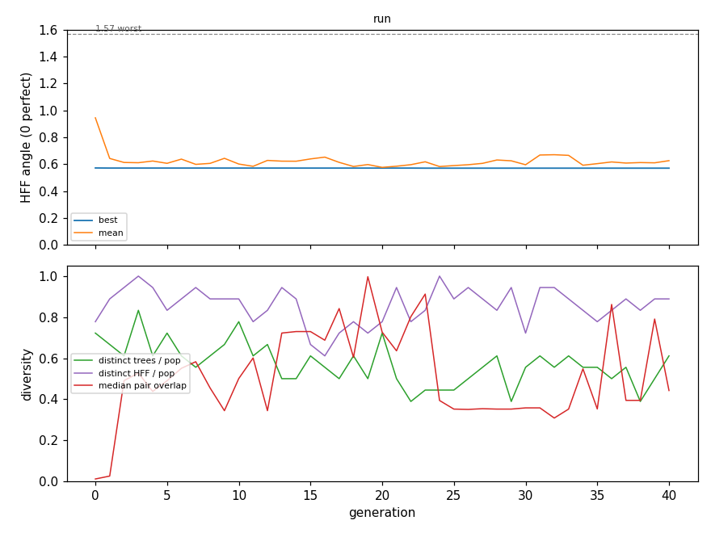

# UltraDim ingest evolution overnight (UI3, UI4), 2026-10-23

**Evolution did not beat today's index.** The best kernel ingests 250,000 records 59 to 107 times faster and searches 146 to 267 times faster than today's index, but finds 38 to 62 % of the true top ten where today's finds 97 to 98 %.

## What was built (00:40 to 02:16Z)

- **The scorer** (phylu `src/evolve/ingest_fitness.rs`). Per stage and query half (one half held out): miss rate, misses against today's index, broken entries. Per stage: ingest and search GPU time against today's. Each is its own input; two-level HFF.
- **The runner** (phylu `examples/wgsl_true_ingest_fit.rs`). The module is one gene of the true kingdom; every readable V24 kernel is a seed. Marriage 1.0, offspring mutation 0.2, SR's optimisers. Failures are saved under `bugs/` and counted. The hall of fame's best is re-measured on the whole 250k case every 10 generations. Each run has a 20 s wall budget (fuller `DeviceExecutor::with_wall_budget`).
- **The screens** (fuller `problems/v24_ingest_small5b`, `v24_ingest_small268`) and the planted control (`tests/corpus/v24/seed27_planted.wgsl`).

## The checks before the long run

- **Pre-flight** (3 generations): cleanse, the real e-graph, fewer trips, the fold and marriage all made children, with 0 defects. The exact e-graph, hoist and snap found nothing to rewrite in these seeds.
- **Planted control**: seed27 with its scoring loop run four times. Evolution cut the repeat to 2 at generation 14 and to 1 at generation 26, 31 minutes in.

## The commands

`/private/tmp/claude-501/ui4/run6.sh` (the last run; runs 1 to 5 are in `run.sh` to `run5.sh`), each under nohup, the GPU lock and a guard to 07:55Z. Logs are `/private/tmp/claude-501/ui4/long*.log`. Every launch, and the reason each run stopped, is in `docs/PLAN_true_gep_wgsl.md` under UI3 and UI4.

## Why six runs

| run | fitness case | stopped | why |
|---|---|---|---|
| 1 | small screen, best 2 also on 250k | 02:49Z, gen 4 | an exact rewrite of the leader was not re-run on 250k and lost its place |
| 2 | 2,500 records at 268 bytes a record | 03:21Z, gen 25 | its champion had recall 0.0005 at 250k: the small set never fills a fixed 32k-row table |
| 3 | 250k, first 2 stages, 250 queries | 04:30Z, gen 5 | generation 0 took 37 minutes |
| 4 | as 3, 20 s budget a run | 05:11Z, gen 27 | crash: a 5.09 GB readback buffer (fixed) |
| 5 | as 4, stronger mutation | 06:39Z, gen 60 | the fold froze whole entries; no progress after gen 10 |
| 6 | as 5, no fold, run-4/5 champions added | 07:55Z | the guard |

## New bests (run 6)

The fitness case is 250k cut to its first two stages (50,000 and 100,000 records) and its first 250 queries. Times are on that case, against today's index on the same records and queries. Memory a record is not measured: both arenas are fixed at 32 MiB a seed, 268 bytes a record at 250,000.

| gen | made by | HFF | θ_quality | θ_speed | recall, 50k / 100k records | ingest s (today) | search ms (today) |
|---|---|---|---|---|---|---|---|
| 0 | seed | 0.72654 | 1.09531 | 0.21549 | 0.4228 / 0.0016 | 0.06 (55) / 0.09 (175) | 422.9 (2406) / 1141.6 (3168) |
| 0 | seed | 0.69215 | 1.02096 | 0.30535 | 0.7880 / 0.0040 | 2.57 (55) / 5.12 (175) | 1181.7 (2406) / 1181.0 (3168) |
| 0 | seed | 0.57211 | 0.88634 | 0.01466 | 0.6372 / 0.5464 | 0.95 (55) / 1.89 (175) | 10.6 (2406) / 10.6 (3168) |
| 1 | subtree | 0.57179 | 0.88586 | 0.01474 | 0.6384 / 0.5472 | 0.95 (55) / 1.89 (175) | 10.7 (2406) / 10.8 (3168) |
| 1 | egraph_real | 0.57144 | 0.88534 | 0.01471 | 0.6400 / 0.5480 | 0.95 (55) / 1.89 (175) | 10.7 (2406) / 10.8 (3168) |
| 11 | subtree | 0.57139 | 0.88525 | 0.01471 | 0.6400 / 0.5484 | 0.95 (55) / 1.89 (175) | 10.7 (2406) / 10.8 (3168) |
| 14 | subtree | 0.57128 | 0.88509 | 0.01476 | 0.6412 / 0.5480 | 0.95 (55) / 1.89 (175) | 10.8 (2406) / 10.8 (3168) |
| 23 | one-point | 0.57125 | 0.88504 | 0.01475 | 0.6392 / 0.5504 | 0.95 (55) / 1.89 (175) | 10.8 (2406) / 10.8 (3168) |
| 23 | trips | 0.57071 | 0.88423 | 0.01471 | 0.6372 / 0.5556 | 0.95 (55) / 1.89 (175) | 10.7 (2406) / 10.8 (3168) |

## Chart

## The champion against its seed

Diff: `2026-10-23_UI_ingest_overnight/champion_vs_seed.diff` (generation-23 champion against generation-0 row 14). The change that matters: `col_axis(wid) < cfg.n_queries` became `col_axis(wid) < 1024u`. On 250 queries nothing changes; on 2,500, queries 1,024 and above get no candidates. A feature loop went from 64 to 63. The rest keep results the same: dead writes removed, multiply-adds rewritten as `fma`.

## On the whole 250k case, against today

The hall of fame's best, each measured once on all 2,500 queries and 5 stages. Today is today's index on the same data.

| stage (records) | today recall | gen-1 best recall | gen-23 champion recall | today ingest s | evolved ingest s | today search s | evolved search s |
|---|---|---|---|---|---|---|---|
| 1 (50k) | 0.9795 | 0.6236 | 0.2550 | 55.1 | 0.94 | 13.7 | 0.093 |
| 2 (100k) | 0.9812 | 0.5535 | 0.2258 | 175.0 | 1.88 | 15.2 | 0.094 |
| 3 (150k) | 0.9799 | 0.4791 | 0.1779 | 304.7 | 2.82 | 13.9 | 0.094 |
| 4 (200k) | 0.9745 | 0.4199 | 0.1258 | 437.1 | 3.75 | 25.1 | 0.094 |
| 5 (250k) | 0.9744 | 0.3809 | 0.0878 | 503.7 | 4.69 | 16.8 | 0.094 |

Evolved times are the generation-1 best's (the champion's ingest is within 1 %; its search 0.083 s). Ingest is cumulative, as today's settle is.

## Verdict

Not better than today. On the whole 250k case the best kernel (the generation-1 best) is 59 to 107 times faster at ingest and 146 to 267 times faster at search. Its recall is 36 to 59 points lower: 0.62 falling to 0.38, against today's 0.98 to 0.97. In 43 generations HFF on the fitness case went from 0.57211 to 0.57071. On the whole case that is a loss, recall 0.38 to 0.09 at stage 5, because the champion learned that only 250 queries are scored. No kernel reached today's recall at 250,000 records in 32 MiB a seed. The seeds were written for 25,000 records; at 250k each loses its recall after the first microbatch or cannot run (5 of 16). Next: score every query, or a fresh random query set each generation.

## Open problems

- **Kernels that cannot run in one workgroup.** 26 of 565 children in the planted control and 5 of 16 seeds at 250k have one workgroup over the per-submit work cap. The work is real (one edit raised a loop bound from 4 to 32). The kingdom needs the per-contract work budget of the design's section 9.
- **Trips makes kernels naga rejects.** 3 of 378 children in run 2 put a constant where only the thread's own element may go, and naga rejected the result. Sent to the kingdom owner.
- **The fold freezes a converged population**, so it is off. A definition should not swallow a whole entry.
- **Resume.** A checkpoint does not carry the fold's definitions, so a folded run cannot resume.
- **The reader does not read the kingdom's own rendered loops** ("a loop with no trip condition at its head"), so one run's hall of fame cannot seed the next.
- **Share lets** have no rows for the two-entry module.
- **Speed is measured against today's recorded times, not in interleaved pairs.**
