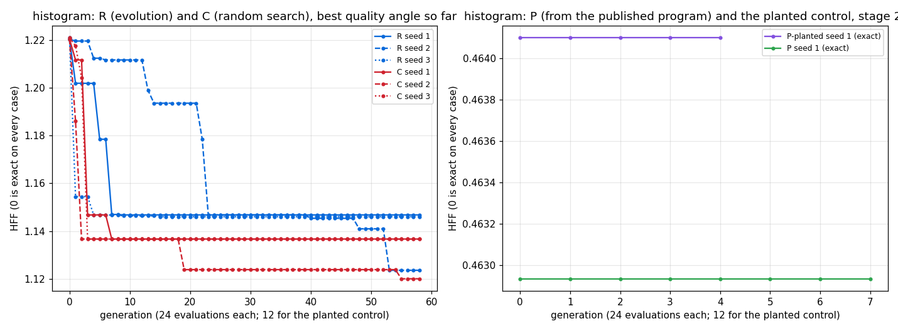

# STUDY: histogram (`k`, `is`, `vs` → `[k]i32`, `hist (+) 0 k (map (% k) is) vs`), evolving the benchmark

**Did we beat the benchmark? No.**
- Neither evolution nor random search found an exact program from examples, in 1,400 evaluations and 3 seeds each. Random search got closer than evolution: two C champions are exact on the k = 1 edge case, while every R champion is wrong in every cell.
- From the published program, an hour of evolution (P) found nothing faster: its champion is the published program itself, at 1.0046, which is matched.
- The planted-slowdown control could not be tested on histogram: the planted form is not slower. Futhark fuses the planted `map2.min vs vs` into the hist.

Study plan: `docs/STUDY_evolving_benchmarks.md`. Runs: `/private/tmp/claude-501/fbench/histogram_*`. Binaries:
- R seed 1 on fuller e64bd1f3 (per-candidate evaluation);
- R seeds 2 and 3 and C seeds 1 to 3 on 50339252 (batched evaluation). The two paths give the same series and the first 400 ledger rows on the same seed (R seed 2, measured).
- Gate, planted control, P and the champion rescores on 3b470301: timing input k = 100, n = 15 x 2^20; `--runs 60`; `--eval single`.

## Hypotheses against the expectations stated before the runs

| hypothesis | expected | measured | verdict |
|---|---|---|---|
| H1, discovery from random | likely | no exact program in 3 of 3 seeds at 1,400 evaluations. Best quality angle 1.1468, 1.1236, 1.1461 | **not supported** (expected likely) |
| H2, evolution sooner than random search | (expected wherever H1 holds) | neither regime reached an exact program. Random search's best-ever quality angle (1.120, 1.137, 1.137) is as low as or lower than evolution's (1.124, 1.146, 1.147). Two C champions, `(hist.add.n zeros vs)`, are exact on the k = 1 edge case; no R champion is exact on any case | **not supported**: random search did at least as well as evolution. The earlier text of this report said the opposite, from C's last-batch values (corrected 2026-10-28 16:50Z; see Failures 6) |
| H3, a faster exact variant | possible | P: 149 evaluations in 60 min. Champion = the published program, `(hist.add.n (tab (mod.k (get.n is j1))) vs)`: 11-pair re-time median 1.0046, 4 of 11 pairs faster, least A/A ratio 0.9880 | **not supported**: matched |

**The A/A gate (before P):** 22 of 22 pairs within 5 %. The published program takes about 3 ms per run.

**The planted control:**
- Start program: `(hist.add.n (tab (mod.k (get.n is j1))) (map2.min vs vs))`.
- Its one e-graph variant, at evaluation 2, is the published program. Its stage-2 HFF was 0.46463, against the planted program's 0.46410.
- The champion was the planted program itself: re-time median 1.0002 of the published program.
- So the planted form is not measurably slower, and there was nothing to remove. A histogram control needs a planted form that Futhark cannot fuse.

## Per-run results

The 1,400 evaluations took 58 to 154 min for R and 15 to 18 min for C. R's programs grew from 24 to 130 nodes against the published program's 7, and big programs compile slowly.

| regime | seed | start (UTC) | end (UTC) | evaluations | exact | first exact at evaluation | best HFF | stopped by | minutes | best nodes (published) | bugs (SetMem) |
|---|---|---|---|---|---|---|---|---|---|---|---|
| R | 1 | 10-27T23:02:52Z | 10-28T01:05:20Z | 1400 | no | - | 1.146802 | n_gen | 122.45 | 24 (7) | 2 (1) |
| R | 2 | 10-28T05:46:50Z | 10-28T06:45:00Z | 1400 | no | - | 1.123626 | n_gen | 58.17 | 79 (7) | 3 (3) |
| R | 3 | 10-28T06:45:00Z | 10-28T09:19:28Z | 1400 | no | - | 1.146064 | n_gen | 154.46 | 130 (7) | 0 (0) |
| C | 1 | 10-28T09:19:28Z | 10-28T09:34:45Z | 1400 | no | - | 1.136701 (best-ever) | n_gen | 15.27 | 5 (7) | 8 (7) |
| C | 2 | 10-28T09:34:45Z | 10-28T09:52:26Z | 1400 | no | - | 1.120076 (best-ever) | n_gen | 17.68 | 8 (7) | 8 (8) |
| C | 3 | 10-28T09:52:26Z | 10-28T10:08:08Z | 1400 | no | - | 1.136701 (best-ever) | n_gen | 15.68 | 7 (7) | 13 (9) |
| P-planted | 1 | 10-28T13:16:32Z | 10-28T13:33:18Z | 48 | yes | 1 | 0.464100 | n_gen | 16.11 | 9 (7) | 1 (1) |
| P | 1 | 10-28T13:33:18Z | 10-28T14:34:12Z | 149 | yes | 1 | 0.462934 | time | 60.22 | 7 (7) | 1 (1) |



Left panel: the best quality angle so far (0 is exact on every case), 24 evaluations per generation. All three R runs settle on a plateau near 1.146 (seed 2 near 1.124), where the median equals the best: 23 or 24 distinct programs with the same outputs. Right panel: P and the planted control, the stage-2 HFF.

## The relative score: each champion against the published program

How to read this table:
- **Correctness:** the seven quality inputs, as a mean over the 5 stored cases. The published program's are all 0.
- **Speed:** measured only for exact champions, in 11 interleaved pairs on k = 100, n = 15 x 2^20. "Faster" needs the median below the least A/A ratio AND at least 9 of 11 pairs below 1.
- Long champions are cut at 100 characters; the full text is in each run's `report.tsv` and `best.fut`.

| regime | seed | champion | exact | wrong_share | outside_1pct | outside_10pct | outside_50pct | mean_abs_over_scale | max_abs_over_scale | order_wrong | champion / published, median (11 pairs) | the 11 ratios | least A/A ratio | verdict |
|---|---|---|---|---|---|---|---|---|---|---|---|---|---|---|
| R | 1 | `(hist.max.n (map2.max (hist.min.k (hist.add.n (loop.k vs vs) (tab n)) zeros) (hist.min.k zeros (hist …` | no | 1.0000 | 0.7780 | 0.7646 | 0.6790 | 0.2833 | 0.4073 | 0.7722 | - | - (0 of 0 below 1) | 0.9833 | **not reached** |
| R | 2 | `(map2.min (hist.min.k (loop.n (tab (loop1.k (get.n vs (next (next (next (next (clamp n)))))) (sub (i …` | no | 1.0000 | 0.7780 | 0.7592 | 0.6536 | 0.2836 | 0.4073 | 0.7202 | - | - (0 of 0 below 1) | 0.9854 | **not reached** |
| R | 3 | `(hist.max.n (hist.min.k (loop.n (loop.k (loop.n (map2.min zeros zeros) (loop1.k (loop1.k (map2.add z …` | no | 1.0000 | 0.7780 | 0.7646 | 0.6790 | 0.2765 | 0.4073 | 0.7722 | - | - (0 of 0 below 1) | 0.9905 | **not reached** |
| C | 1 | `(hist.add.n zeros vs)` | no | 0.8000 | 0.8000 | 0.8000 | 0.8000 | 0.1760 | 0.2834 | 0.7556 | - | - (0 of 0 below 1) | 0.9830 | **not reached** |
| C | 2 | `(replicate (add (mul k (sum.n vs)) n))` | no | 1.0000 | 0.7926 | 0.7256 | 0.6339 | 0.1934 | 0.3369 | 0.8000 | - | - (0 of 0 below 1) | 0.8572 | **not reached** |
| C | 3 | `(hist.add.n zeros vs)` | no | 0.8000 | 0.8000 | 0.8000 | 0.8000 | 0.1760 | 0.2834 | 0.7556 | - | - (0 of 0 below 1) | 0.9871 | **not reached** |
| P-planted | 1 | `(hist.add.n (tab (mod.k (get.n is j1))) (map2.min vs vs))` | yes | 0.0000 | 0.0000 | 0.0000 | 0.0000 | 0.0000 | 0.0000 | 0.0000 | 1.0002 | 0.9425, 0.9968, 0.9969, 0.9955, 1.0020, 1.0001, 1.0002, 1.0012, 1.0152, 1.0048, 1.0077 (4 of 11 below 1) | 0.9829 | **matched** |
| P | 1 | `(hist.add.n (tab (mod.k (get.n is j1))) vs)` | yes | 0.0000 | 0.0000 | 0.0000 | 0.0000 | 0.0000 | 0.0000 | 0.0000 | 1.0046 | 1.0055, 1.0131, 1.0151, 1.0084, 1.0044, 1.0047, 1.0046, 0.9914, 0.9999, 0.9916, 1.0004 (3 of 11 below 1) | 0.9880 | **matched** |

How far the inexact champions are from the published program:
- **Cells right:** none for every R champion and for C seed 2 (`wrong_share` 1.0). C seeds 1 and 3, `(hist.add.n zeros vs)`, sum every value into bin 0, so they are exact on the k = 1 case and wrong elsewhere (`wrong_share` 0.8).
- **The errors are large:** 63–80 % of cells are off by more than half the output's range. The mean error over scale (`mean_abs_over_scale`, e/(1+e)) is 0.28 for R and 0.18–0.19 for C.
- **The order is not reproduced:** 72–80 % of neighbouring pairs are in the wrong order.
- **R against C:** C's best-ever champions are closer than R's on correctness (0.8 against 1.0 of cells wrong) and on the mean error (0.18 against 0.28). R's champions are 24–130 nodes; C's are 4–7.

A/A sets of the rescores and of the P runs:

| run | A/A set | pairs | median | least | greatest |
|---|---|---|---|---|---|
| R s1 | yardstick vs itself | 11 | 0.9913 | 0.9833 | 1.0102 |
| R s1 | the published program compiled as a candidate | 11 | 1.0034 | 0.9879 | 1.0186 |
| R s2 | yardstick vs itself | 11 | 1.0013 | 0.9911 | 1.0138 |
| R s2 | the published program compiled as a candidate | 11 | 0.9976 | 0.9854 | 1.0126 |
| R s3 | yardstick vs itself | 11 | 0.9991 | 0.9905 | 1.0176 |
| R s3 | the published program compiled as a candidate | 11 | 1.0067 | 0.9916 | 1.0689 |
| C s1 | yardstick vs itself | 11 | 1.0012 | 0.9885 | 1.0156 |
| C s1 | the published program compiled as a candidate | 11 | 0.9991 | 0.9830 | 1.0206 |
| C s2 | yardstick vs itself | 11 | 1.0000 | 0.8572 | 1.0112 |
| C s2 | the published program compiled as a candidate | 11 | 0.9991 | 0.9903 | 1.0259 |
| C s3 | yardstick vs itself | 11 | 1.0029 | 0.9896 | 1.0093 |
| C s3 | the published program compiled as a candidate | 11 | 1.0005 | 0.9871 | 1.0103 |
| P-planted s1 | yardstick vs itself | 11 | 1.0015 | 0.9926 | 1.0184 |
| P-planted s1 | the published program compiled as a candidate | 11 | 1.0027 | 0.9829 | 1.0099 |
| P s1 | yardstick vs itself | 11 | 1.0045 | 0.9928 | 1.1350 |
| P s1 | the published program compiled as a candidate | 11 | 1.0029 | 0.9880 | 1.0167 |

## Champions against the published program

The published program (futhark-benchmarks `micro/reduce_by_index.fut`), as `main` with the declared signature:

```futhark
def bins k is = map (% k) is |> map i64.i32

entry main [n] (k: i32) (is: [n]i32) (vs: [n]i32) : []i32 =
  hist (+) 0 (i64.i32 k) (bins k is) vs
```

- **P (and the planted control's e-graph variant):** the published program written as a gene, the bins as `tabulate n (\j1 -> is[j1] % k)` instead of `map (% k) is`. It is the same computation, and its re-time is 1.0046.
- **R seed 1:** `(hist.max.n (map2.max (hist.min.k …) …) is)`, a `max`-histogram over `n` bins indexed by `is`. It has the published program's ingredients (`hist`, `is`, `vs`) but never the `% k` index map in the right place, and never `+` as the operator. No diff to the published program is meaningful.
- **R seeds 2 and 3:** 79 and 130 nodes of nested `hist.min`/`hist.max`/`loop` with the same flaw.
- **C (best-ever, from the hall of fame):** `(hist.add.n zeros vs)` (seeds 1 and 3) and `(replicate (add (mul k (sum.n vs)) n))` (seed 2).

## Operator effectiveness

Each R child is compared with its best parent in the same stage.
- The variation operators improved on the best parent in 1 to 3 % of children; 46 to 70 % of children were equal to it. That is the plateau: many distinct programs with the same outputs.
- The e-graph pump and the saturated fold produced 314 children, all equal in fitness to their parents. Their job is equivalent forms, not new behaviour.

| regimes | operator | children | better than best parent | equal | worse | exact (stage 1, HFF 0) | made a run's first exact |
|---|---|---|---|---|---|---|---|
| R | mutation | 1309 | 36 (3 %) | 746 (57 %) | 527 (40 %) | 0 | 0 |
| R | crossover+mutation | 1211 | 25 (2 %) | 560 (46 %) | 626 (52 %) | 0 | 0 |
| R | marriage | 946 | 9 (1 %) | 663 (70 %) | 274 (29 %) | 0 | 0 |
| R | saturated_fold | 207 | 0 (0 %) | 207 (100 %) | 0 (0 %) | 0 | 0 |
| R | pump_egraph | 107 | 0 (0 %) | 107 (100 %) | 0 (0 %) | 0 | 0 |
| P+P-planted | mutation | 85 | 15 (18 %) | 0 (0 %) | 70 (82 %) | 0 | 0 |
| P+P-planted | crossover+mutation | 51 | 1 (2 %) | 0 (0 %) | 50 (98 %) | 0 | 0 |
| P+P-planted | marriage | 36 | 3 (8 %) | 1 (3 %) | 32 (89 %) | 0 | 0 |
| P+P-planted | egraph_exact | 1 | 0 (0 %) | 0 (0 %) | 1 (100 %) | 0 | 0 |
| P+P-planted | pump_egraph | 1 | 0 (0 %) | 0 (0 %) | 1 (100 %) | 0 | 0 |

1. **H1 fails on histogram.** The published form needs `tab (mod.k (get.n is j1))` as the bin index, a `tab` over `n` that holds a `mod` by `k` of an element of `is`. Neither the random draws nor the operators built it in 1,400 evaluations. The R populations collapsed onto a plateau of programs with equal outputs, where selection has no slope.
2. **The branch compiler failed on some legal programs.**
   - "Known compiler limitation: SetMem in a GPU kernel" (`docs/PROPOSAL_memory_views_setmem.md`): R 1 + 3 + 0, C 7 + 8 + 9, planted control 1, P 1. That is 30 of about 7,000 compiled programs.
   - "Internal compiler error": 4 in C seed 3.
   - Each such program is scored worst and logged; the batch path isolates it by halving the batch.
3. **One program ran past the 120 s quality timeout on the GPU, within the work guard:** R seed 1's first run, on the old binary, a nested `hist` program. The run went on normally.
4. **Histogram ran at 0.06–0.3 evaluations a second until the shim cached Metal pipelines** (the batching agent's fix in 50339252). Two R runs stopped on the guard short of 1,400 evaluations and were rerun; they are kept in `fbench/superseded_short_guard/`.
5. **The planted control is uninformative here**, as said above.
6. **A measurement fault, found and fixed after the first version of this report.**
   - For C, `report.tsv`'s `best_hff`/`best_program` was the last random batch's best, not the best of the run. C has no selection, so only the hall of fame keeps its best-ever.
   - The first version compared R's best (elitist, so correct) with C's last batch, and concluded that evolution got closer. The C champions were rescored from hall-of-fame rank 1 at 16:34–16:42Z, which reverses the conclusion.
   - The runner now reports `best_ever_*` for every regime (fuller f8409a2f).
