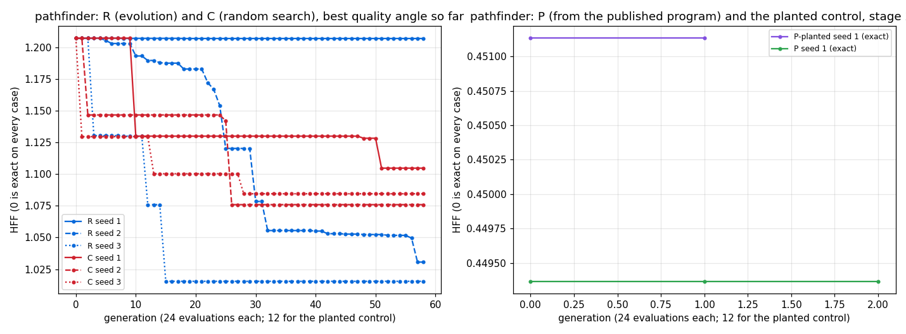

# STUDY: pathfinder (Rodinia, `[rows][cols]i32 -> [cols]i32`), evolving the benchmark

**Did we beat the benchmark?**
- **Against the published Futhark port: yes, by about 3 to 5 %. But the gain is in how the kingdom writes the published algorithm, not in what evolution found.**
  - The reference gene is the published algorithm as the kingdom expresses it, with clamped neighbour indices and no edge branches. It is 5.3 to 5.7 % faster than the published program in two independent 11-pair re-times, 11 of 11 pairs faster both times.
  - Starting from that gene, an hour of evolution (P) returned a champion 2.95 to 3.0 % faster than the published program. That is about 2.5 % *slower* than its own starting point.
- **From examples alone (R and C), no exact program** in 1,400 evaluations × 3 seeds each.

Study plan: `docs/STUDY_evolving_benchmarks.md`. Runs: `/private/tmp/claude-501/fbench/pathfinder_*`. Binaries:
- R seed 1 on fuller e64bd1f3 (per-candidate evaluation);
- R seeds 2 and 3 and C seeds 1 to 3 on 50339252 (batched; equivalent quality and selection);
- gate, planted control, P and rescores on 3b470301, timed on the 256 x 256 training case with `--eval single`.

## Hypotheses against the expectations stated before the runs

| hypothesis | expected | measured | verdict |
|---|---|---|---|
| H1, discovery from random | possible | no exact program in 3 of 3 seeds. Best quality angle 1.207, 1.031, 1.015 | **not supported** |
| H2, evolution sooner than random search | (expected wherever H1 holds) | no exact program either way. Evolution got closer in 2 of 3 seeds: quality angle 1.031 and 1.015 against C's best of 1.207. Cells off by more than half the range: 6 % and 13 % (R seeds 2 and 3) against 26–87 % (C) | **undecided** on exact programs; evolution made real progress on the error that random search did not |
| H3, a faster exact variant (expected: "possible: fusion of the row loop") | possible | P's champion: 0.9705 (11 of 11 pairs faster, least A/A ratio 0.9888) at the end of the run, and 0.9699 in an independent re-time (11 of 11 faster, least A/A ratio 0.9671). The unevolved reference gene: 0.9473 and 0.9434 | **supported against the published program, but not by evolution**: the starting point already beat it, and evolution did not improve on the starting point |

**The A/A gate (before P):** 22 of 22 pairs within 5 %. The published program runs in about 0.96 ms per run on 256 x 256.

**The planted control:**
- Start program: `(map2.min ref ref')`, the reference and its re-associated twin, doing the work twice. Its stage-2 HFF was 0.629.
- The e-graph's 24 variants removed the doubled work at evaluation 2; the variants scored 0.452 to 0.457.
- The champion, a single-loop variant, re-times at 0.9663 of the published program, 11 of 11 pairs faster, just above that run's floor of 0.9632, so matched.
- So the slowdown was recovered.

## Per-run results

| regime | seed | start (UTC) | end (UTC) | evaluations | exact | first exact at evaluation | best HFF | stopped by | minutes | best nodes (published) | bugs (SetMem) |
|---|---|---|---|---|---|---|---|---|---|---|---|
| R | 1 | 10-28T04:27:50Z | 10-28T05:11:00Z | 1400 | no | - | 1.207037 | n_gen | 43.16 | 14 (24) | 1 (0) |
| R | 2 | 10-28T05:11:08Z | 10-28T05:20:24Z | 1400 | no | - | 1.030623 | n_gen | 9.25 | 94 (24) | 0 (0) |
| R | 3 | 10-28T05:20:24Z | 10-28T05:28:33Z | 1400 | no | - | 1.015466 | n_gen | 8.14 | 46 (24) | 2 (2) |
| C | 1 | 10-28T05:28:33Z | 10-28T05:33:33Z | 1400 | no | - | 1.215311 | n_gen | 5.00 | 2 (24) | 2 (2) |
| C | 2 | 10-28T05:33:33Z | 10-28T05:39:59Z | 1400 | no | - | 1.207317 | n_gen | 6.44 | 4 (24) | 0 (0) |
| C | 3 | 10-28T05:39:59Z | 10-28T05:46:50Z | 1400 | no | - | 1.243769 | n_gen | 6.83 | 14 (24) | 1 (1) |
| P-planted | 1 | 10-28T14:36:21Z | 10-28T14:57:54Z | 20 | yes | 1 | 0.451133 | time | 20.56 | 24 (24) | 0 (0) |
| P | 1 | 10-28T14:57:54Z | 10-28T15:59:51Z | 62 | yes | 1 | 0.449366 | time | 60.96 | 24 (24) | 0 (0) |



Left panel: the best quality angle so far (0 is exact on every case), 24 evaluations per generation. R seeds 2 and 3 keep improving to the end of the budget; R seed 1 (the per-candidate path) and all C seeds stay near 1.21. Right panel: the stage-2 HFF of P and of the planted control.

## The relative score: each champion against the published program

How to read this table:
- **Correctness:** the seven quality inputs, as a mean over the 8 stored cases. The published program's are all 0.
- **Speed:** 11 interleaved pairs on 256 x 256. "Faster" needs the median below the least A/A ratio AND at least 9 of 11 pairs below 1.
- Long champions are cut at 100 characters; the full texts are in `report.tsv` and `best.fut`.

| regime | seed | champion | exact | wrong_share | outside_1pct | outside_10pct | outside_50pct | mean_abs_over_scale | max_abs_over_scale | order_wrong | champion / published, median (11 pairs) | the 11 ratios | least A/A ratio | verdict |
|---|---|---|---|---|---|---|---|---|---|---|---|---|---|---|
| R | 1 | `(row.rows.cols walls (next (prev (clamp (add (loop1.rows rows 10) (mul (ival.cols (clamp cols)) cols …` | no | 0.8750 | 0.8750 | 0.8750 | 0.8750 | 0.6329 | 0.6549 | 0.1198 | - | - (0 of 0 below 1) | 0.9790 | **not reached** |
| R | 2 | `(loop1.cols (map2.sub (loop.cols (replicate (add (add (max (min (loop1.cols rows s1) (sum.rows zeros …` | no | 0.9849 | 0.9829 | 0.7088 | 0.0630 | 0.3847 | 0.4801 | 0.5495 | - | - (0 of 0 below 1) | 0.9650 | **not reached** |
| R | 3 | `(map2.add (row.rows.cols walls last) (replicate (get.rows (loop.rows (loop1.rows (loop1.rows zeros ( …` | no | 0.8712 | 0.8712 | 0.8650 | 0.1275 | 0.4517 | 0.5191 | 0.1198 | - | - (0 of 0 below 1) | 0.9664 | **not reached** |
| C | 1 | `(tab rows)` | no | 0.9932 | 0.9932 | 0.9920 | 0.2572 | 0.5097 | 0.5965 | 0.8025 | - | - (0 of 0 below 1) | 0.97 …`(row.rows.cols walls (next last))` | no | 0.8750 | 0.8750 | 0.8750 | 0.8750 | 0.6338 | 0.6558 | 0.1198 | - | - (0 of 0 below 1) | 0.96 …`(row.rows.cols walls (clamp (min (loop.cols (add 0 cols) (loop1.rows cols (min s2 s1))) 10)))` | no | 0.8750 | 0.8750 | 0.8750 | 0.8738 | 0.6345 | 0.6588 | 0.4391 | - | - (0 of 0 below 1) | 0.97 …`(loop1.rows (row.rows.cols walls zero) (tab (add (get.cols (row.rows.cols walls i1) j2) (min (min (get.cols s1 (prev j2)) (get.cols s1 (next j2))) (get.cols s1 j2)))))` | yes | 0.0000 | 0.0000 | 0.0000 | 0.0000 | 0.0000 | 0.0000 | 0.0000 | 0.9663 | 0.9901, 0.9457, 0.9 …`(loop1.rows (row.rows.cols walls zero) (tab (add (min (min (get.cols s1 (prev j2)) (get.cols s1 (next j2))) (get.cols s1 j2)) (get.cols (row.rows.cols walls i1) j2))))` | yes | 0.0000 | 0.0000 | 0.0000 | 0.0000 | 0.0000 | 0.0000 | 0.0000 | 0.9705 | 0.9713, 0.9857, 0.9695, 0.9439, 0.9776, 0.9862, 0.9705, 0.9716, 0.9684, 0.9693, 0.9364 (11 of 11 below 1) | 0.9888 | **beat** |

The decomposition that decides what "beat" means here. Every row is exact; the re-times were made one after another, 16:21–16:30Z:

| program | what it is | re-time median against the published program | pairs faster | least A/A ratio | verdict |
|---|---|---|---|---|---|
| reference gene, first re-time | the published algorithm, as the kingdom writes it (no evolution) | 0.9473 | 11 of 11 | 0.9525 | beat |
| reference gene, second re-time | the same | 0.9434 | 11 of 11 | 0.9845 | beat |
| P champion, at the end of P | an e-graph variant of the reference gene (the `add` commuted, the `min`s re-associated) | 0.9705 | 11 of 11 | 0.9888 | beat |
| P champion, second re-time | the same | 0.9699 | 11 of 11 | 0.9671 | matched (the median is above that run's floor) |
| planted control's champion | another e-graph variant | 0.9663 | 11 of 11 | 0.9632 | matched |

So the kingdom's form of pathfinder is faster than the published port. The search's champion is faster than the published port too, but slower than the form the search started from. In P the start and the champion each had 11 timing slots. The champion's in-run median was 0.940, against the reference gene's 0.955: selection on those slots ranked the champion first by noise. The re-times do not support that ranking.

A/A sets:

| run | A/A set | pairs | median | least | greatest |
|---|---|---|---|---|---|
| R s1 | yardstick vs itself | 11 | 0.9980 | 0.9790 | 1.0207 |
| R s1 | the published program compiled as a candidate | 11 | 1.0063 | 0.9918 | 1.0278 |
| R s2 | yardstick vs itself | 11 | 0.9896 | 0.9650 | 1.0115 |
| R s2 | the published program compiled as a candidate | 11 | 0.9856 | 0.9661 | 1.0519 |
| R s3 | yardstick vs itself | 11 | 0.9931 | 0.9664 | 1.0375 |
| R s3 | the published program compiled as a candidate | 11 | 0.9923 | 0.9751 | 1.0176 |
| C s1 | yardstick vs itself | 11 | 0.9964 | 0.9830 | 1.0195 |
| C s1 | the published program compiled as a candidate | 11 | 0.9950 | 0.9716 | 1.0374 |
| C s2 | yardstick vs itself | 11 | 1.0014 | 0.9804 | 1.0196 |
| C s2 | the published program compiled as a candidate | 11 | 0.9994 | 0.9644 | 1.0391 |
| C s3 | yardstick vs itself | 11 | 1.0107 | 0.9848 | 1.0277 |
| C s3 | the published program compiled as a candidate | 11 | 0.9978 | 0.9795 | 1.0141 |
| P-planted s1 | yardstick vs itself | 11 | 1.0026 | 0.9632 | 1.0195 |
| P-planted s1 | the published program compiled as a candidate | 11 | 0.9922 | 0.9720 | 1.0365 |
| P s1 | yardstick vs itself | 11 | 1.0035 | 0.9888 | 1.0273 |
| P s1 | the published program compiled as a candidate | 11 | 1.0067 | 0.9892 | 1.0239 |

## Champions against the published program

The published program (Rodinia `pathfinder.fut`, `diku-dk/futhark-benchmarks`), its kernel as the yardstick:

```futhark
def min (a: i32, b: i32) : i32 = if (a <= b) then a else b

entry main [rows][cols] (wall: [rows][cols]i32) : [cols]i32 =
  let result = copy (wall[0])
  in loop (result) for t < (rows - 1) do
       map5 (\i prev res next wall' ->
               let res = if i > 0 then min (res, prev) else res
               let res = if i < cols - 1 then min (res, next) else res
               in wall' + res)
            (iota cols) (rotate (-1) result) result (rotate 1 result) wall[t + 1]
```

The reference gene (P's start), as the generator writes it:

```futhark
  in loop (s1: [cols]i32) = ((walls)[(0i64)]) for t1 < rows - 1 do let i1 = t1 + 1 in
     (tabulate cols (\j2 -> walls[i1][j2] + i32.min (i32.min s1[j2] s1[i64.max 0 (j2 - 1)]) s1[i64.min (cols - 1) (j2 + 1)]))
```

The P champion, as a diff against the reference gene:

```diff
-  (tabulate cols (\j2 -> walls[i1][j2] + i32.min (i32.min s1[j2] s1[i64.max 0 (j2 - 1)]) s1[i64.min (cols - 1) (j2 + 1)]))
+  (tabulate cols (\j2 -> i32.min (i32.min s1[i64.max 0 (j2 - 1)] s1[i64.min (cols - 1) (j2 + 1)]) s1[j2] + walls[i1][j2]))
```

The kingdom's form differs from the published program in three ways, and all three remove work per element:
- the edge neighbours are clamped indices instead of `if` branches;
- it uses `tabulate` with direct indexing instead of `map5` over `iota` and two `rotate`s;
- it uses `i32.min` instead of a user `min` on a tuple.

The R and C champions are not exact. The closest, R seed 3 (46 nodes), is wrong in 87 % of cells, but only 13 % are off by more than half the range.

## Operator effectiveness

Each R child is compared with its best parent in the same stage.
- In R, `mutation` was the most effective operator: 5 % of its children improved on their best parent, against 2 % for `crossover+mutation` and `marriage`. The pump and the saturated fold make equivalent forms, so they never change fitness in stage 1.
- In P and the planted control, the e-graph variants were the only children that scored better than their parent: 21 of 34 (23 in P, 11 in the planted control). In the planted control that is real, because the variants remove the doubled work. In P it came from noisy in-run slots, and the re-times do not show the champion variant faster than the reference. All 40 mutation, crossover and marriage children of P scored worse than their parents.

| regimes | operator | children | better than best parent | equal | worse | exact (stage 1, HFF 0) | made a run's first exact |
|---|---|---|---|---|---|---|---|
| R | mutation | 1268 | 58 (5 %) | 509 (40 %) | 701 (55 %) | 0 | 0 |
| R | crossover+mutation | 1245 | 24 (2 %) | 387 (31 %) | 834 (67 %) | 0 | 0 |
| R | marriage | 916 | 15 (2 %) | 504 (55 %) | 397 (43 %) | 0 | 0 |
| R | saturated_fold | 234 | 0 (0 %) | 234 (100 %) | 0 (0 %) | 0 | 0 |
| R | pump_egraph | 117 | 0 (0 %) | 117 (100 %) | 0 (0 %) | 0 | 0 |
| P+P-planted | egraph_exact | 34 | 21 (62 %) | 0 (0 %) | 13 (38 %) | 0 | 0 |
| P+P-planted | marriage | 14 | 0 (0 %) | 0 (0 %) | 14 (100 %) | 0 | 0 |
| P+P-planted | mutation | 13 | 0 (0 %) | 0 (0 %) | 13 (100 %) | 0 | 0 |
| P+P-planted | crossover+mutation | 13 | 0 (0 %) | 0 (0 %) | 13 (100 %) | 0 | 0 |
## Failures, honestly

1. **No exact program from examples** (H1, H2), although evolution clearly beat random search on how close it got.
2. **Selection in P chose on timing noise.**
   - Eleven slots per program, each its own HFF input, did not stop a champion that re-times about 2.5 % slower than its parent from winning the run.
   - The in-run medians were 0.940 for the champion and 0.955 for the reference, but the reference re-times at 0.943–0.947 and the champion at 0.970.
   - The final 11-pair re-time and the decomposition above are what catch it. The run's own ranking is not a speed claim.
3. **The speed win belongs to the kingdom's expression of the algorithm, not to the search.** It is a real, repeatable 5 % against the published port: 22 of 22 pairs faster over two re-times. It is not evidence that evolution improves GPU code.
4. **P is slow.** Timing a new program in 11 pairs costs about a minute, so P scored 62 programs in its hour.
5. **Bugs** (compile failures of legal programs, each scored worst and logged): in the counted runs, 5 SetMem compiler limitations (R seed 3: 2, C seed 1: 2, C seed 3: 1) and 1 other compile failure with no C (R seed 1). The superseded pilot also hit a Futhark internal compiler error ("Use of unknown variable" after the "reduce device synchronizations" pass).
