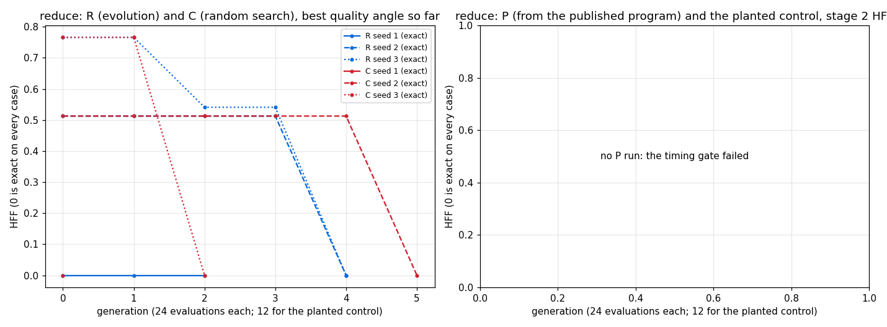

# STUDY: reduce (`[n]i32 -> i32`, `i32.sum`), evolving the benchmark

**Did we beat the benchmark? No.**
- Evolution and random search both rediscover the published program from examples alone, in 3 of 3 seeds each.
- Every exact champion is either the published program itself or a slower equivalent.
- No speed claim, either way, survives the timing protocol on reduce. Its A/A gate failed, so reduce had no P run and H3 is undecided.

Study plan: `docs/STUDY_evolving_benchmarks.md`. Runs: `/private/tmp/claude-501/fbench/reduce_*`. Binaries:
- reduce R seed 1 on fuller 79e81284;
- R seeds 2 and 3 on b1fe8606 (`--stop-at-exact`);
- C seeds 1 to 3 on f1c8bd17;
- the gate and the champion rescores on 3b470301, with timing input n = 15 x 2^20, `--runs 60`, `--eval single`.

The discovery search is the same on all these binaries: no change to quality, selection or the random draws.

## Hypotheses against the expectations stated before the runs

| hypothesis | expected | measured | verdict |
|---|---|---|---|
| H1, discovery from random (exact on held-out cases, ≥ 3 of 5 seeds) | yes, quickly | exact in 3 of 3 seeds, at evaluations 19, 118 and 119 | **supported**, as expected |
| H2, evolution finds exact programs sooner than random search at equal budget | (H2 is expected wherever H1 holds) | random search: exact in 3 of 3 seeds, at evaluations 19, 127 and 60 (median 60, against evolution's 118) | **not supported**: random search is as good as or better than evolution |
| H3, a faster exact variant of the published program | unlikely | no P run: the A/A timing gate failed (21 of 22 pairs within 5 % at `--runs 60`; the published program takes 1.47 ms on n = 15 x 2^20; the dispatch limit, 65,535 x 256, caps n) | **undecided** |

Why H2 fails here:
- The published program is 2 nodes, `(sum.n xs)`.
- A random gene of program size 8 expresses it often enough that random search finds it in 19 to 127 draws.
- Selection adds nothing on a target this small. Worse, evolution's two exact programs from operators, R seeds 2 and 3, are bloated equivalents (14 and 10 nodes) and 4.6 and 2.4 times slower.
- Random search's three champions are the published program itself.

## Per-run results

The R and C runs stop at the first program exact on every case: training and held-out (`--stop-at-exact`).

R seed 1 ran before that rule existed:
- It found the exact program `(sum.n xs)` in its random generation 0, at evaluation 19.
- It then ran 2 generations in stage 2, until it was stopped.
- Its 21 bugs are programs that dispatch no GPU work: their timing was logged as a bug until b1fe8606. This does not affect discovery.

| regime | seed | start (UTC) | end (UTC) | evaluations | exact | first exact at evaluation | best HFF | stopped by | minutes | best nodes (published) | bugs (SetMem) |
|---|---|---|---|---|---|---|---|---|---|---|---|
| R | 1 | 10-27T20:30:03Z | 10-27T20:38:51Z | 72 | yes | 19 | 0.588137 | killed | 8.59 | 2 (2) | 21 (not counted) |
| R | 2 | 10-27T20:39:40Z | 10-27T20:44:52Z | 118 | yes | 118 | 0.000000 | early_stop | 4.99 | 14 (2) | 0 (not counted) |
| R | 3 | 10-27T20:44:52Z | 10-27T20:48:26Z | 119 | yes | 119 | 0.000000 | early_stop | 3.40 | 10 (2) | 0 (not counted) |
| C | 1 | 10-27T20:48:26Z | 10-27T20:49:19Z | 19 | yes | 19 | 0.000000 | early_stop | 0.70 | 2 (2) | 0 (not counted) |
| C | 2 | 10-27T20:49:19Z | 10-27T20:52:51Z | 127 | yes | 127 | 0.000000 | early_stop | 3.37 | 2 (2) | 0 (not counted) |
| C | 3 | 10-27T20:52:51Z | 10-27T20:56:38Z | 60 | yes | 60 | 0.000000 | early_stop | 3.62 | 2 (2) | 0 (not counted) |



The chart shows the best quality angle so far for each run (the stage-1 HFF; 0 is exact on every case). Each generation is 24 evaluations. C has no selection, so its best is cumulated.

## The relative score: each champion against the published program

How to read this table:
- **Correctness:** the champion's seven quality inputs, as a mean over the 5 stored cases. The published program's are all 0.
- **Speed:** the champion's GPU time over the published program's, in 11 interleaved pairs, on the timing input n = 15 x 2^20.
- **Noise floor:** the least ratio of both A/A sets measured in the same process: the yardstick against itself, and the published program compiled as a candidate.
- **"Faster"** needs the median below that floor AND at least 9 of 11 pairs below 1 (study plan §3, 2026-10-28 13:10Z).

Reduce's timing gate failed, so every reduce speed result is marked undecided.

| regime | seed | champion | exact | wrong_share | outside_1pct | outside_10pct | outside_50pct | mean_abs_over_scale | max_abs_over_scale | order_wrong | champion / published, median (11 pairs) | the 11 ratios | least A/A ratio | verdict |
|---|---|---|---|---|---|---|---|---|---|---|---|---|---|---|
| R | 1 | `(sum.n xs)` | yes | 0.0000 | 0.0000 | 0.0000 | 0.0000 | 0.0000 | 0.0000 | 0.0000 | 0.9850 | 0.9714, 0.7043, 0.7096, 0.9850, 1.1947, 0.9813, 0.9987, 1.0243, 0.9978, 0.9736, 1.3775 (8 of 11 below 1) | 0.9936 | **matched (median below the floor but only 8 of 11 pairs faster); speed undecided: the timing gate failed** |
| R | 2 | `(loop1.n (maximum.n xs) (sum.n (loop.n (tab (neg (mul (neg n) (neg (neg 2))))) xs)))` | yes | 0.0000 | 0.0000 | 0.0000 | 0.0000 | 0.0000 | 0.0000 | 0.0000 | 4.5602 | 4.2971, 4.5602, 4.3975, 4.4420, 4.5453, 4.9555, 4.9928, 4.7042, 5.5662, 4.5212, 5.3598 (0 of 11 below 1) | 0.9951 | **exact but slower; speed undecided: the timing gate failed** |
| R | 3 | `(add (min (get.n (loop.n xs zeros) last) 10) (sum.n xs))` | yes | 0.0000 | 0.0000 | 0.0000 | 0.0000 | 0.0000 | 0.0000 | 0.0000 | 2.3915 | 2.4027, 2.3210, 2.3915, 3.1407, 2.5063, 2.3694, 2.5070, 2.4866, 1.7840, 1.9651, 1.7729 (0 of 11 below 1) | 0.9951 | **exact but slower; speed undecided: the timing gate failed** |
| C | 1 | `(sum.n xs)` | yes | 0.0000 | 0.0000 | 0.0000 | 0.0000 | 0.0000 | 0.0000 | 0.0000 | 1.0005 | 0.9983, 1.0002, 0.9955, 0.9979, 0.9991, 1.0038, 1.0041, 1.0010, 1.0015, 1.0005, 1.0016 (4 of 11 below 1) | 0.9960 | **matched; speed undecided: the timing gate failed** |
| C | 2 | `(sum.n xs)` | yes | 0.0000 | 0.0000 | 0.0000 | 0.0000 | 0.0000 | 0.0000 | 0.0000 | 1.0051 | 1.4195, 1.0052, 1.4020, 0.9994, 0.9827, 1.0051, 1.1060, 0.9866, 1.0317, 0.9218, 0.8289 (5 of 11 below 1) | 0.9973 | **matched; speed undecided: the timing gate failed** |
| C | 3 | `(sum.n xs)` | yes | 0.0000 | 0.0000 | 0.0000 | 0.0000 | 0.0000 | 0.0000 | 0.0000 | 1.0006 | 0.9974, 0.9995, 1.0007, 1.0019, 0.9985, 1.0001, 1.0006, 0.9982, 1.0018, 1.0010, 1.0023 (4 of 11 below 1) | 0.9932 | **matched; speed undecided: the timing gate failed** |

**The false "beat", kept as evidence for the sign test.**
- Under the first rule (median below the least A/A ratio alone), R seed 1's champion scored "beat". That champion is `(sum.n xs)`, the published program itself.
- Its pairs were 0.97, 0.70, 0.71, 0.99, 1.19, 0.98, 1.00, 1.02, 1.00, 0.97, 1.38, with median 0.985.
- The A/A floor, 0.9936, came from a quiet set. Only 8 of the 11 pairs were below 1.
- The rule now also needs 9 of 11 pairs faster, and the change is recorded in the study plan.

The A/A sets of the rescores (each the yardstick against itself, and the published program compiled as a candidate):

| run | A/A set | pairs | median | least | greatest |
|---|---|---|---|---|---|
| R s1 | yardstick vs itself | 11 | 0.9993 | 0.9945 | 1.0040 |
| R s1 | the published program compiled as a candidate | 11 | 0.9991 | 0.9936 | 1.3112 |
| R s2 | yardstick vs itself | 11 | 0.9996 | 0.9951 | 1.0072 |
| R s2 | the published program compiled as a candidate | 11 | 1.0007 | 0.9953 | 1.0076 |
| R s3 | yardstick vs itself | 11 | 0.9994 | 0.9951 | 1.0079 |
| R s3 | the published program compiled as a candidate | 11 | 1.0006 | 0.9978 | 1.0052 |
| C s1 | yardstick vs itself | 11 | 1.0001 | 0.9960 | 1.0042 |
| C s1 | the published program compiled as a candidate | 11 | 1.0005 | 0.9973 | 1.0032 |
| C s2 | yardstick vs itself | 11 | 1.0006 | 0.9973 | 1.0024 |
| C s2 | the published program compiled as a candidate | 11 | 1.0013 | 0.9975 | 1.0217 |
| C s3 | yardstick vs itself | 11 | 1.0005 | 0.9932 | 1.0019 |
| C s3 | the published program compiled as a candidate | 11 | 1.0007 | 0.9982 | 1.0039 |

## Champions against the published program

The published program (futhark-benchmarks `micro/reduce.fut`, `entry sum_i32 = i32.sum`):

```futhark
entry main [n] (xs: [n]i32) : i32 = i32.sum xs
```

**R seed 1 and C seeds 1, 2 and 3.** The same program. The only difference is the generator's parentheses and an unused `replicate`:

```diff
-entry main [n] (xs: [n]i32) : i32 = i32.sum xs
+entry main [n] (xs: [n]i32) : i32 =
+  let zeros_n = replicate n 0i32
+  in i32.sum (xs)
```

**R seed 2.** Exact and 4.56 times slower. An outer loop runs `n - 1` times and recomputes a sum of `xs` that does not depend on the loop:

```futhark
in loop (s1: i32) = (i32.maximum (xs)) for t1 < n - 1 do let i1 = t1 + 1 in
     (i32.sum (loop (s2: [n]i32) = (tabulate n (\j2 -> (-((-(i32.i64 n)) * (-(-(2i32))))))) for i2 < n do (xs)))
```

**R seed 3.** Exact and 2.39 times slower. It adds a term that is always 0:

```futhark
in (i32.min ((loop (s1: [n]i32) = (xs) for i1 < n do (zeros_n))[(n - 1)]) (10i32)) + (i32.sum (xs))
```

The term is `min(0, 10)`. The loop writes `zeros_n` on every iteration, so its last element is 0.

## Operator effectiveness

Each R child is compared with its best parent in the same stage. The exact programs of R seeds 2 and 3 were made by `crossover+mutation` (seed 2, generation 4) and `mutation` (seed 3, generation 4). R seed 1's exact program was a random gene of generation 0.

| regimes | operator | children | better than best parent | equal | worse | exact (stage 1, HFF 0) | made a run's first exact |
|---|---|---|---|---|---|---|---|
| R | mutation | 87 | 20 (23 %) | 17 (20 %) | 50 (57 %) | 1 | 1 |
| R | crossover+mutation | 76 | 13 (17 %) | 9 (12 %) | 54 (71 %) | 1 | 1 |
| R | marriage | 54 | 3 (6 %) | 16 (30 %) | 35 (65 %) | 0 | 0 |
## Failures, honestly

1. **Reduce cannot be timed reliably, so H3 is undecided.**
   - The published program runs 1.47 ms on n = 15 x 2^20.
   - n cannot grow: a map over more than 65,535 x 256 elements exceeds wgpu's workgroups per dispatch.
   - One or two timing processes in 22 run 1.3 times slow or 0.8 times fast. Gate at `--runs 60`: 21 of 22 pairs within 5 %. A probe at `--runs 200`: 20 of 22.
   - Multi-dispatch timing in the rust-wgpu runtime is the planned fix; reduce P reruns then.
2. **Three timing faults were found on reduce and fixed.**
   - Timed on the 1,000-element training case, the A/A ratios fell in three clusters: 0.30, 1.00 and 3.3, the GPU's clock states on a 10–30 µs kernel. Stage-2 selection then chose on that noise. The planted control's champion had an in-run median of 0.428 and an 11-pair re-time of 1.348.
   - The first process of a freshly compiled executable runs about 3.2 times slow.
   - n = 2^24 exceeded the dispatch limit for any map over n.
   - Every P result on reduce before these fixes is void. Those runs are kept in `fbench/superseded_P_old_timing/`.
3. **Reduce's planted-slowdown control did not run under the final protocol.** It is gated with P. Its earlier run, on the void timing, recovered an exact program at evaluation 1 but could not show the slowdown removed.
4. **The batched evaluation's timing failed the gate:** 13 of 22 pairs on reduce, with the published program at 2.0–2.2 ms in the batch process against 1.47 ms on its own. Timing therefore uses `--eval single`. Quality inputs are bit-identical on both paths.
