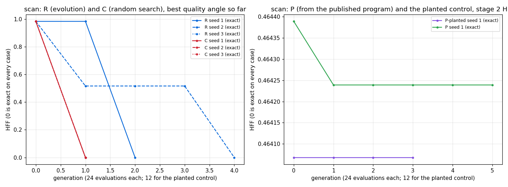

# STUDY: scan (`[n]i32 -> [n]i32`, inclusive `scan (+) 0`), evolving the benchmark

**Did we beat the benchmark? No: matched.**
- Evolution and random search both rediscover the published program from examples alone, in 3 of 3 seeds each.
- From the published program, an hour of evolution (regime P) found nothing faster. Its champion is an equivalent form that times at 1.0000 of the published program, inside the noise.
- The planted-slowdown control passed:
  - the planted form is 5.5 % slower, measured;
  - the search removed it at once, through the e-graph.
  The machinery can see and remove a slowdown of that size. On scan there is none to find.

Study plan: `docs/STUDY_evolving_benchmarks.md`. Runs: `/private/tmp/claude-501/fbench/scan_*`. Binaries:
- R and C on fuller f1c8bd17, with `--stop-at-exact`;
- gate, planted control, P and champion rescores on 3b470301: timing input n = 15 x 2^20, `--runs 60`, `--eval single`, 11 timing slots per program.

## Hypotheses against the expectations stated before the runs

| hypothesis | expected | measured | verdict |
|---|---|---|---|
| H1, discovery from random | yes | exact in 3 of 3 seeds at evaluations 57, 108 and 41 | **supported**, as expected |
| H2, evolution sooner than random search | (expected wherever H1 holds) | random search: exact in 3 of 3 seeds at 42, 46 and 28 (median 42, against evolution's 57) | **not supported**: random search is as good or better |
| H3, a faster exact variant | unlikely | P: 119 evaluations in 61 min. Champion `(scan.add (loop1.n xs xs))`: 11-pair re-time median 1.0000, 6 of 11 pairs below 1, least A/A ratio 0.9990 | **not supported**: matched, as expected |

**The A/A gate (before P):** 22 of 22 pairs within 5 %. The published program takes 12.7 ms per run on n = 15 x 2^20.

**The planted control:**
- Start program: `(scan.add (map2.max xs xs))`.
- Its first e-graph variant, at evaluation 1, is the published `(scan.add xs)`. The run's champion is that program: re-time median 1.0002, matched.
- The planted form is slower, measured: C seed 3's champion happened to be the planted form `(scan.add (map2.min xs xs))`. It re-times at 1.0554, with all 11 pairs between 1.054 and 1.058, far above the A/A noise.
- So the timing sees a 5.5 % slowdown, and the search removes it.

## Per-run results

| regime | seed | start (UTC) | end (UTC) | evaluations | exact | first exact at evaluation | best HFF | stopped by | minutes | best nodes (published) | bugs (SetMem) |
|---|---|---|---|---|---|---|---|---|---|---|---|
| R | 1 | 10-27T21:11:04Z | 10-27T21:13:04Z | 57 | yes | 57 | 0.000000 | early_stop | 1.80 | 4 (2) | 0 (not counted) |
| R | 2 | 10-27T21:13:04Z | 10-27T21:18:16Z | 108 | yes | 108 | 0.000000 | early_stop | 5.03 | 2 (2) | 0 (not counted) |
| R | 3 | 10-27T21:18:16Z | 10-27T21:20:10Z | 41 | yes | 41 | 0.000000 | early_stop | 1.73 | 2 (2) | 0 (not counted) |
| C | 1 | 10-27T21:20:10Z | 10-27T21:21:56Z | 42 | yes | 42 | 0.000000 | early_stop | 1.60 | 4 (2) | 0 (not counted) |
| C | 2 | 10-27T21:21:56Z | 10-27T21:23:44Z | 46 | yes | 46 | 0.000000 | early_stop | 1.62 | 2 (2) | 0 (not counted) |
| C | 3 | 10-27T21:23:44Z | 10-27T21:25:06Z | 28 | yes | 28 | 0.000000 | early_stop | 1.19 | 4 (2) | 0 (not counted) |
| P-planted | 1 | 10-28T11:01:07Z | 10-28T11:23:12Z | 37 | yes | 1 | 0.464068 | time | 21.44 | 2 (2) | 0 (0) |
| P | 1 | 10-28T11:36:14Z | 10-28T12:37:58Z | 119 | yes | 1 | 0.464239 | time | 61.07 | 4 (2) | 0 (0) |



Left panel: the best quality angle so far (0 is exact on every case), 24 evaluations per generation. Right panel: the stage-2 HFF of P and of the planted control; it moves only in the fourth decimal.

## The relative score: each champion against the published program

How to read this table:
- **Correctness:** the seven quality inputs, as a mean over the 5 stored cases. The published program's are all 0.
- **Speed:** champion GPU time over published GPU time, in 11 interleaved pairs on n = 15 x 2^20.
- **"Faster"** needs the median below the least A/A ratio AND at least 9 of 11 pairs below 1 (study plan §3).

| regime | seed | champion | exact | wrong_share | outside_1pct | outside_10pct | outside_50pct | mean_abs_over_scale | max_abs_over_scale | order_wrong | champion / published, median (11 pairs) | the 11 ratios | least A/A ratio | verdict |
|---|---|---|---|---|---|---|---|---|---|---|---|---|---|---|
| R | 1 | `(scan.add (loop1.n xs s1))` | yes | 0.0000 | 0.0000 | 0.0000 | 0.0000 | 0.0000 | 0.0000 | 0.0000 | 1.0006 | 1.0009, 1.0011, 1.0035, 1.0002, 1.0003, 0.9997, 1.0000, 1.0006, 1.0008, 1.0007, 0.9998 (2 of 11 below 1) | 0.9993 | **matched** |
| R | 2 | `(scan.add xs)` | yes | 0.0000 | 0.0000 | 0.0000 | 0.0000 | 0.0000 | 0.0000 | 0.0000 | 1.0000 | 1.0000, 0.9998, 1.0001, 1.0000, 0.9997, 0.9998, 1.0019, 1.0000, 1.0019, 1.0004, 1.0034 (3 of 11 below 1) | 0.9980 | **matched** |
| R | 3 | `(scan.add xs)` | yes | 0.0000 | 0.0000 | 0.0000 | 0.0000 | 0.0000 | 0.0000 | 0.0000 | 1.0002 | 1.0009, 0.9999, 0.9970, 1.0002, 1.0008, 0.9992, 0.9989, 0.9967, 1.0004, 1.0006, 1.0003 (5 of 11 below 1) | 0.9977 | **matched** |
| C | 1 | `(scan.add (loop.n xs xs))` | yes | 0.0000 | 0.0000 | 0.0000 | 0.0000 | 0.0000 | 0.0000 | 0.0000 | 0.9998 | 0.9995, 0.9997, 1.0000, 0.9998, 1.0001, 0.9993, 1.0001, 1.0013, 1.0001, 0.9996, 0.9997 (6 of 11 below 1) | 0.9984 | **matched** |
| C | 2 | `(scan.add xs)` | yes | 0.0000 | 0.0000 | 0.0000 | 0.0000 | 0.0000 | 0.0000 | 0.0000 | 0.9998 | 1.0002, 0.9998, 0.9993, 1.0004, 0.9994, 0.9989, 0.9999, 1.0003, 1.0005, 0.9996, 0.9997 (7 of 11 below 1) | 0.9978 | **matched** |
| C | 3 | `(scan.add (map2.min xs xs))` | yes | 0.0000 | 0.0000 | 0.0000 | 0.0000 | 0.0000 | 0.0000 | 0.0000 | 1.0554 | 1.0554, 1.0557, 1.0556, 1.0550, 1.0569, 1.0544, 1.0542, 1.0552, 1.0555, 1.0552, 1.0581 (0 of 11 below 1) | 0.9980 | **exact but slower** |
| P-planted | 1 | `(scan.add xs)` | yes | 0.0000 | 0.0000 | 0.0000 | 0.0000 | 0.0000 | 0.0000 | 0.0000 | 1.0002 | 1.0003, 1.0002, 1.0032, 0.9984, 1.0008, 1.0004, 0.9990, 0.9973, 0.9994, 0.9979, 1.0025 (5 of 11 below 1) | 0.9988 | **matched** |
| P | 1 | `(scan.add (loop1.n xs xs))` | yes | 0.0000 | 0.0000 | 0.0000 | 0.0000 | 0.0000 | 0.0000 | 0.0000 | 1.0000 | 1.0009, 0.9994, 0.9993, 1.0001, 1.0000, 0.9991, 0.9999, 1.0003, 1.0000, 1.0000, 0.9999 (5 of 11 below 1) | 0.9990 | **matched** |


A/A sets, each the yardstick against itself and the published program compiled as a candidate:

| run | A/A set | pairs | median | least | greatest |
|---|---|---|---|---|---|
| R s1 | yardstick vs itself | 11 | 1.0003 | 0.9995 | 1.0015 |
| R s1 | the published program compiled as a candidate | 11 | 1.0001 | 0.9993 | 1.0026 |
| R s2 | yardstick vs itself | 11 | 1.0001 | 0.9980 | 1.0013 |
| R s2 | the published program compiled as a candidate | 11 | 1.0004 | 0.9993 | 1.0009 |
| R s3 | yardstick vs itself | 11 | 0.9997 | 0.9977 | 1.0010 |
| R s3 | the published program compiled as a candidate | 11 | 1.0002 | 0.9979 | 1.0029 |
| C s1 | yardstick vs itself | 11 | 0.9996 | 0.9984 | 1.0008 |
| C s1 | the published program compiled as a candidate | 11 | 0.9999 | 0.9988 | 1.0033 |
| C s2 | yardstick vs itself | 11 | 1.0000 | 0.9987 | 1.0007 |
| C s2 | the published program compiled as a candidate | 11 | 1.0000 | 0.9978 | 1.0009 |
| C s3 | yardstick vs itself | 11 | 1.0003 | 0.9994 | 1.0006 |
| C s3 | the published program compiled as a candidate | 11 | 0.9999 | 0.9980 | 1.0007 |
| P-planted s1 | yardstick vs itself | 11 | 0.9999 | 0.9990 | 1.0007 |
| P-planted s1 | the published program compiled as a candidate | 11 | 1.0000 | 0.9988 | 1.0014 |
| P s1 | yardstick vs itself | 11 | 1.0004 | 0.9995 | 1.0022 |
| P s1 | the published program compiled as a candidate | 11 | 1.0002 | 0.9990 | 1.0013 |

## Champions against the published program

The published program (futhark-benchmarks `micro/scan.fut`), as `main`:

```futhark
entry main [n] (xs: [n]i32) : [n]i32 = scan (+) 0 xs
```

| run | champion | how it differs | measured |
|---|---|---|---|
| R s2, R s3, C s2, the planted control | `(scan.add xs)` | none: the published program | matched |
| R s1 | `(scan.add (loop1.n xs s1))` | a loop of `n - 1` iterations whose body returns its own state, so it returns `xs` | matched: Futhark removes the loop |
| C s1 | `(scan.add (loop.n xs xs))` | a loop that returns `xs` | matched |
| P s1 | `(scan.add (loop1.n xs xs))` | as R s1 | matched: 1.0000 |
| C s3 | `(scan.add (map2.min xs xs))` | an elementwise `min` of `xs` with itself, which Futhark keeps | exact but slower: 1.0554 |

The generator's text for P's champion:

```diff
-entry main [n] (xs: [n]i32) : [n]i32 = scan (+) 0 xs
+entry main [n] (xs: [n]i32) : [n]i32 =
+  let zeros_n = replicate n 0i32
+  in scan (+) 0i32 (loop (s1: [n]i32) = (xs) for t1 < n - 1 do let i1 = t1 + 1 in (xs))
```

## Operator effectiveness

Each child is compared with its best parent in the same stage.
- R: of the three exact programs, `mutation` made two (seeds 2 and 3) and `crossover+mutation` one (seed 1).
- P and the planted control: no operator made a faster exact program; there was none to make. The one `egraph_exact` child, the planted control's variant, is the published program and improved on its parent.

| regimes | operator | children | better than best parent | equal | worse | exact (stage 1, HFF 0) | made a run's first exact |
|---|---|---|---|---|---|---|---|
| R | marriage | 40 | 6 (15 %) | 8 (20 %) | 26 (65 %) | 0 | 0 |
| R | crossover+mutation | 40 | 3 (8 %) | 3 (8 %) | 34 (85 %) | 1 | 1 |
| R | mutation | 40 | 9 (22 %) | 8 (20 %) | 23 (58 %) | 2 | 2 |
| P+P-planted | mutation | 65 | 8 (12 %) | 1 (2 %) | 56 (86 %) | 0 | 0 |
| P+P-planted | crossover+mutation | 43 | 2 (5 %) | 0 (0 %) | 41 (95 %) | 0 | 0 |
| P+P-planted | marriage | 30 | 1 (3 %) | 1 (3 %) | 28 (93 %) | 0 | 0 |
| P+P-planted | egraph_exact | 1 | 1 (100 %) | 0 (0 %) | 0 (0 %) | 0 | 0 |
## Failures, honestly

1. **H2 fails.** On a 2-node target, a random gene of program size 8 is exact often enough: in 28 to 46 draws for random search. Selection did not help.
2. **P had little to work with.**
   - The e-graph has no rewrite of `scan (+) 0 xs` itself (0 variants), so P's population came from mutation of one program.
   - Timing every new program in 11 pairs of 60 runs of a 12.7 ms program costs about 50 s, so P scored 119 programs in its hour.
   - 21 candidates were over the work cap at the timing size; they were never dispatched and got no speed credit.
3. **Earlier P runs used void timing.** Before the timing fixes (study plan §3), scan's planted control ran on the void timing. It is kept in `fbench/superseded_P_old_timing/` and does not count.
